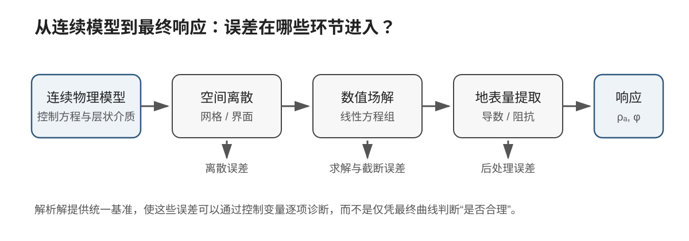
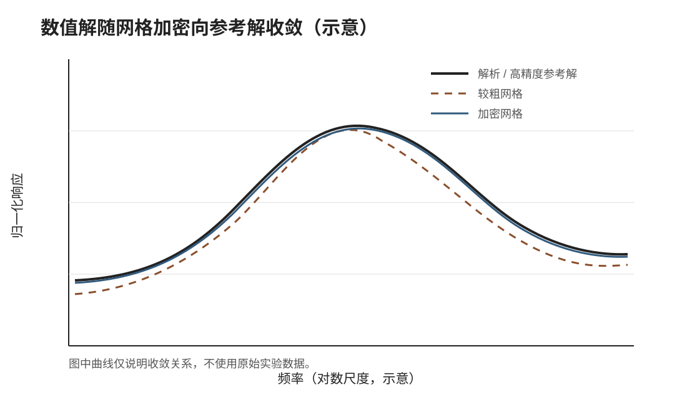
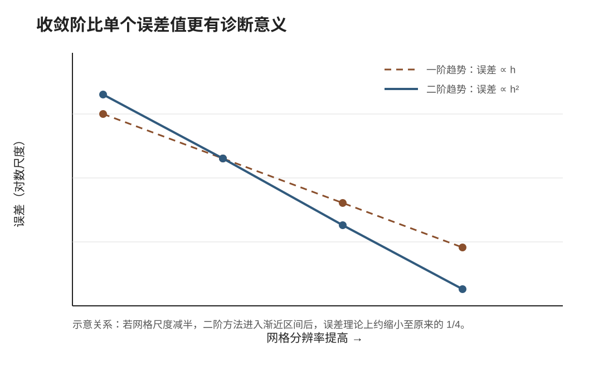



编写数值模拟程序时，有一个非常容易让人掉以轻心的特点：**只要线性方程组没有奇异崩溃，程序几乎总会吐出一组漂亮的结果。** 视电阻率曲线光滑流畅，随频率的变化趋势也符合直觉——可这些表面上的“合理”，并不足以证明数值解真的算准了。

原因很简单：数值方法从连续的物理微分方程走到最终响应曲线，中间经历了**空间网格离散、深部边界截断、地表数值求导以及线性方程组求解**等多个环节。每一步都会悄悄引入近似误差，最后全混在同一条曲线里。单凭肉眼看曲线“顺不顺眼”，根本没法判断里面是不是藏着系统偏差。

幸运的是，如果一个物理问题恰好**同时拥有解析解和数值解**，排查难度就会直线下降。解析解就像一把精准的游标卡尺，能帮我们把“结果好像有点偏”拆解成“误差究竟是哪一步闯的祸”。一维水平层状介质的大地电磁（MT）正演正是这样一个绝佳标本（关于其完整数学推导，可对照阅读系列讲义 [03｜阻抗、45° 相位、趋肤深度与层状地球正演](/posts/2026/10/mt-course-02b-layered-earth/) 与 [05｜数值正演进阶：边界条件、二维三维与薄层敏感性](/posts/2026/10/mt-course-03b-numerical-forward/)）。

下面我们以一维 MT 正演为具体舞台，梳理一套通用的数值验证思路：**当数值解与解析解出现偏差时，如何通过控制变量把主要误差源逐一揪出来，并在精度与计算成本之间找到最佳平衡。**

## 1. 为什么解析解是数值程序最好的“校准标尺”？

考虑一维水平层状地球：地下由若干水平岩层组成，每层具有恒定电阻率 $\rho_j$ 和厚度 $h_j$，最底层为向下无限延伸的均匀半空间。在忽略位移电流的低频近似下，对于角频率 $\omega=2\pi f$，第 $j$ 层的复传播常数 $k_j$ 和本征阻抗 $Z_{0j}$ 分别为：

$$
k_j=\sqrt{\frac{i\omega\mu_0}{\rho_j}},\qquad Z_{0j}=\sqrt{i\omega\mu_0\rho_j}.
$$

从最底层半空间（$Z_N=Z_{0N}$）出发，利用相邻层界面的切向场连续条件，自下而上逐层递推即可得到地表波阻抗：

$$
Z_j=Z_{0j}\frac{Z_{j+1}+Z_{0j}\tanh(k_jh_j)}{Z_{0j}+Z_{j+1}\tanh(k_jh_j)}.
$$

拿到地表阻抗 $Z_1$ 后，立刻就能算出视电阻率和阻抗相位：

$$
\rho_a=\frac{|Z_1|^2}{\omega\mu_0},\qquad \phi=\arg(Z_1).
$$

这套解析递推公式完全不需要把地下切成网格，也不存在人工底边界截断，算出来的结果在双精度浮点数下几乎就是“绝对真值”。在结构复杂的二维或三维模型里，因为没有解析解，一旦结果怪异，你很难分清是地质模型本身复杂还是程序写出了 Bug；**先在有解析解的一维模型上把数值求解器校验到严丝合缝，相当于在进入复杂战场前先校准好瞄准镜。**

## 2. 从微分方程到地表阻抗：误差是在哪几个关口混进来的？

用有限差分法求解一维电场方程 $\dfrac{d^2E}{dz^2}-i\omega\mu_0\sigma E=0$ 时，我们先把连续深度函数 $E(z)$ 离散成网格节点上的有限个数值 $E_0,E_1,E_2,\dots,E_n$，再用相邻节点的差商替代微积分导数。整个计算链条环环相扣：

$$
\text{连续模型}\longrightarrow\text{空间网格离散}\longrightarrow E(z)\text{ 的数值解}\longrightarrow E'(0)\text{ 的地表求导}\longrightarrow Z\longrightarrow \rho_a,\phi.
$$

至少有四个常见关口会引入误差：

| 计算环节 | 误差产生原因 | 常用诊断手段 |
|---|---|---|
| **空间网格离散** | 用有限步长 $h$ 替代无限小微元，产生截断误差 | 系统按比例加密网格，检查收敛阶数 |
| **地层界面处理** | 岩层分界面没有落在网格节点上，或跨界面电导率平均不当 | 将网格节点严格对齐地层界面，对比不同界面平均格式 |
| **深部计算边界** | 用有限深度的底边界 $z=L$ 替代无穷深半空间 | 逐步下延底边界深度，观察地表响应何时不再变化 |
| **地表场量提取** | 算出节点电场后，仍需用离散节点近似地表导数 $E'(0)$ | 保持内部电场解不变，对比一阶与二阶单侧差分公式 |

*图 1　从连续模型到最终响应的计算链。解析解的核心价值之一，就是让空间离散、边界截断与地表后处理误差能够被分开诊断。*

对于大地电磁而言，表格里的最后一项尤其容易成为隐蔽短板：即使你的线性求解器已经把地下几百个节点的电场 $E_j$ 算得极准，只要最后在地表 $z=0$ 处用粗糙公式估算磁场 $H_y(0)=-\dfrac{1}{i\omega\mu_0}E'(0)$，整条阻抗曲线的精度照样会被拉低。

## 3. 网格加密很有用，但不该成为唯一的“大力出奇迹”手段

遇到数值误差偏大时，最本能的反应就是把网格切得更密。设特征网格间距为 $h$，理论上一阶差分格式进入渐近收敛区后的误差按 $O(h)$ 下降，而二阶中心差分格式的误差按 $O(h^2)$ 下降（步长减半，误差缩小为四分之一）。

*图 2　数值解随网格加密向参考解收敛的示意。曲线仅用于展示收敛趋势，不对应特定野外实测数据集。*

然而，“加密网格后误差确实变小了”只说明空间离散分辨率在起作用，并没有告诉你**原本的误差瓶颈究竟卡在哪里**。如果整个计算链条里某一个局部环节（比如地表求导）只用了低阶一阶近似，那么靠全局把网格加密十倍去硬抗这个局部误差，不仅计算耗时暴增，而且往往事倍功半。

## 4. 一个常被忽视的瓶颈：地表导数阶数限制整体精度

地表 $z_0=0$ 处上方没有地下网格节点，无法直接套用对称中心差分。如果图省事，只用地表和第一个地下节点构造一阶前向差分：

$$
E'(0)\approx\frac{E_1-E_0}{h},
$$

它的截断误差是 $O(h)$（一阶精度）。即便地下所有内部节点都用了二阶精度的三点中心差分，最终算出来的地表阻抗整体精度也会被这个 $O(h)$ 的地表求导拖累成一阶收敛！

改用地表以下前三个节点构造二阶单侧差分（设前两个网格宽度分别为 $a$ 和 $b$；等间距 $a=b=h$ 时系数简化为 $\frac{-3E_0+4E_1-E_2}{2h}$）：

$$
E'(0)\approx -\frac{2a+b}{a(a+b)}E_0+\frac{a+b}{ab}E_1-\frac{a}{b(a+b)}E_2.
$$

这个改动**完全不需要修改地下有限差分矩阵，也不增加任何网格节点数量**，仅仅改进了最后一步的地表后处理提取公式。在典型一维分层测试中，单单把地表求导从一阶升级为二阶，就能让视电阻率误差下降接近两个数量级，相位误差改善约一个数量级。这给我们一个重要启发：**数值模拟的最终精度往往取决于整条链条中最薄弱的那个低阶环节（木桶短板效应）。**

## 5. 如何用“控制变量法”把混合误差逐项拆开？

在概念上，可以把总误差看作各个环节误差的叠加：

$$
\varepsilon_{\mathrm{total}}\sim \varepsilon_{\mathrm{grid}}+\varepsilon_{\mathrm{surface}}+\varepsilon_{\mathrm{boundary}}+\varepsilon_{\mathrm{interface}}+\cdots
$$

（实际计算中不同误差项可能相互耦合甚至正负抵消，因此这里作为定性诊断框架使用。）要排查谁是罪魁祸首，只需严格执行**控制变量实验**：
- **锁定地表求导误差**：保持地下节点电场解完全不变，仅切换一阶和二阶地表求导公式，观察误差变化；
- **锁定底边界截断误差**：保持网格间距和求导公式不变，只把计算区域底边界深度 $L$ 逐步往下加深，直到误差曲线不再变化为止；
- **分频段分别检视**：不要只看所有频率平均下来的单个总误差，而应分别画出逐频率的视电阻率相对误差 $e_\rho(f)$ 和相位绝对误差 $e_\phi(f)$：
  $$
  e_\rho(f)=100\left(\frac{\rho_a^{\mathrm{num}}(f)}{\rho_a^{\mathrm{ref}}(f)}-1\right)\%,\qquad e_\phi(f)=\phi^{\mathrm{num}}(f)-\phi^{\mathrm{ref}}(f).
  $$
  高频误差大通常指向浅部网格过粗或地表求导不够准；低频误差大则往往暴露底边界截断太浅。

## 6. 为什么局部加密网格时，总误差偶尔反而会略微变大？

做数值实验时有时会碰到一个反直觉的现象：把某一层网格加密后，总误差不但没降，反而比加密前略微大了一点点。

这并不是因为加密网格写错了，而是**误差正负抵消被打破**的结果。假设原本网格离散误差 $\varepsilon_1=+0.05$，而底边界截断误差 $\varepsilon_2=-0.04$，两者一正一负偶然抵消，总误差看起来只有 $+0.01$；当你加密网格把 $\varepsilon_1$ 减小到 $+0.01$ 后，总误差反而变成了 $0.01-0.04=-0.03$！因此，只看单次修改前后的误差数字容易被假象迷惑，必须看一连串系统加密后的收敛规律。

## 7. 收敛阶（Convergence Order）比单一的“小误差”更有说服力

哪怕某一组参数算出来的误差只有 $10^{-4}$，也不能排除“正负误差刚好凑巧抵消”的可能。真正能证明数值格式健康工作的铁证，是沿着成倍加密的网格序列 $h,\,h/2,\,h/4,\,h/8$ 观察误差衰减率：

$$
\varepsilon(h)\longrightarrow \frac{\varepsilon(h)}{4}\longrightarrow \frac{\varepsilon(h)}{16}.
$$

在双对数坐标下画出“误差随网格间距 $h$ 的变化直线”，如果直线斜率稳定接近 $2$，就说明整个求解器（包括内部离散、界面处理和地表求导）已经真正进入了稳健的**二阶渐近收敛区间**。

*图 3　一阶与二阶方法的典型收敛趋势。相比单独报告某一组误差数值，收敛阶能够更直接地证明离散算法是否按理论预期工作。*

## 8. 趋肤深度为自适应网格设计提供了天然物理标尺

在电磁场问题中，**趋肤深度** $\delta$ 刻画了场振幅随深度衰减的特征长度：

$$
\delta=\sqrt{\frac{2\rho}{\omega\mu_0}}\approx 503\sqrt{\frac{\rho}{f}}\ \mathrm{m}.
$$

频率越高、岩石越导电，电磁波衰减得越快，浅部所需网格就越细；频率越低，穿透越深，网格尺度可以随之按比例放宽。让网格步长与当前频率和地层电阻率对应的趋肤深度挂钩：

$$
\Delta z \sim \frac{\delta}{P}
$$

（其中 $P$ 表示每个趋肤深度内至少布置的网格单元数，例如取 $P=10\sim 20$），再配合底边界深度取为最低频趋肤深度的数倍，就能在保证全频带精度的同时避免无谓的节点浪费。此外，利用一维三对角矩阵的稀疏带状结构，将存储和求解复杂度从稠密矩阵的 $O(N^2)$ 降至 $O(N)$，也能大幅提升计算效率。

## 9. 一套可复用的数值验证标准流程

把上述经验沉淀下来，任何偏微分方程数值求解器在上线前都可以遵循这条五步验证流水线：

$$
\text{解析参考解}\longrightarrow\text{分频误差度量}\longrightarrow\text{控制变量定位瓶颈}\longrightarrow\text{网格收敛阶检验}\longrightarrow\text{精度—成本权衡}.
$$

1. **选定解析基准**：构造包含核心物理特征（如高低阻夹层）的简化模型，计算解析参考解；
2. **定义多维误差指标**：分别统计幅值相对误差与相位误差随频率的分布；
3. **控制变量逐项排雷**：固定其余设置，依次测试地表求导阶数、界面对齐方式和底边界深度，优先修复低成本高回报的短板环节；
4. **验证理论收敛阶**：通过 $h \to h/2 \to h/4$ 系统加密，确认收敛斜率达到设计阶数；
5. **确定经济网格规模**：在满足工程允许误差的前提下，选定计算量最小的网格与边界配置。

数值程序永远会给出一个输出。真正区分“跑通了代码”和“做好了科学计算”的，正是这一整套能够说清楚**“为什么我们可以相信这个结果”**的验证逻辑。

---

*延伸阅读：如果想从零推导本文用到的层状解析递推公式与有限差分矩阵，欢迎回到系列主线 [从零理解大地电磁测深｜自学教程总目录](/posts/2026/10/mt-course/)。*
