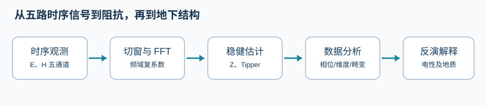



## 为什么要写这一套教程？

大地电磁测深（MT）通过地表观测到的天然电磁场变化，反过来推断地下岩石的导电结构，把电磁学、微积分、信号处理、数值计算和地质学串在了一起。它最容易让人望而却步的地方，在于前后知识咬得很紧：如果还没弄明白“偏导数在算什么”，就要直接看“对电场取旋度”，后面的公式很快就会变成一串陌生的符号。

这套教程的目标是：**哪怕数学基础暂时薄弱，也能顺着一条不跳步的台阶，从最朴素的物理直觉一直走到完整的理论、反演和地质解释。**

全书 17 篇讲义基本都遵循同一个节奏：先抛出一个具体的物理问题，把每个新出现的符号认清楚；接着用几组最简单的数字手算一遍，建立手感；然后再引入一般符号写出严格公式，并说清楚它成立的前提与失效的边界。每节末尾都附有自检题，用来帮你确认自己是否真的顺通了逻辑，而不是考你背公式的速度。

## 第一阶段：把抽象物理量变成看得见的语言

1. **[01｜场、三角函数与复数：零基础的电磁学语言](/posts/2026/10/mt-course-01-foundations/)**：分清标量与矢量、场与波的区别，从余弦波的振幅、频率、相位出发，自然引入复平面与复指数求导。
2. **[02｜导数、旋度与麦克斯韦方程：一维控制方程推导](/posts/2026/10/mt-course-02a-maxwell-math/)**：从山坡坡度与小正方形回路起步，把三维麦克斯韦方程简化为一维控制方程，并求得指数解。
3. **[03｜阻抗、45° 相位、趋肤深度与层状地球正演](/posts/2026/10/mt-course-02b-layered-earth/)**：理解为什么要用电场除以磁场，推导出均匀半空间的 45° 相位与趋肤深度，再学会自下而上递推多层地球响应。

## 第二阶段：数值正演、野外观测与信号处理

4. **[04｜有限差分基础：从网格、三点差分到稀疏矩阵](/posts/2026/10/mt-course-03a-numerical-grid/)**：把连续的地下切成均匀或非均匀网格，用泰勒展开解释三点差分精度，并把节点方程排成稀疏三对角矩阵。
5. **[05｜数值正演进阶：边界条件、二维三维与薄层敏感性](/posts/2026/10/mt-course-03b-numerical-forward/)**：处理地表求导与深部截断边界，区分二维 TE/TM 模式与三维交错网格，理解薄层纵向电导等效性。
6. **[06｜野外观测、仪器原理与测站设计](/posts/2026/10/mt-course-04-field-observation/)**：从两根电极间的电位差出发，认识 MT 五通道测量、GPS 授时同步、选址避噪、数据质控与野外安全。
7. **[07｜从时间序列到频谱：傅里叶变换、采样与切窗](/posts/2026/10/mt-course-05a-fourier-sampling/)**：用频率投影理解傅里叶分解，认识采样混叠、奈奎斯特频率、FFT、去趋势加窗与频谱泄漏。
8. **[08｜从频谱到阻抗：最小二乘、远参考与稳健估计](/posts/2026/10/mt-course-05b-impedance-estimation/)**：从过原点直线回归推广到复数最小二乘，看清磁场噪声如何压低阻抗，再用远参考与稳健回归对抗干扰。

## 第三阶段：从阻抗张量读出地下构造线索

9. **[09｜阻抗张量、地质维度与坐标旋转](/posts/2026/10/mt-course-06a-tensor-dimensions/)**：理解阻抗张量为什么是四个复数，区分 1D/2D/3D 结构与 TE/TM 极化，推导 $\mathbf Z'=\mathbf R\mathbf Z\mathbf R^T$。
10. **[10｜旋转不变量、Groom–Bailey 畸变与相位张量](/posts/2026/10/mt-course-06b-tensor-interpretation/)**：构造不随坐标旋转改变的 WAL 不变量，拆解近地表电流性畸变，推导相位张量如何抵消实数畸变并画出椭圆。
11. **[11｜地质走向估计、极坐标图与静态位移](/posts/2026/10/mt-course-06c-strike-static/)**：使用 Swift、Bahr、WAL 与相位张量寻找地质走向，理解角度歧义，识别对数视电阻率曲线的静态位移。

## 第四阶段：从地表数据反推地下并写出可靠地质解释

12. **[12｜反演基础：反问题、零空间、误差与 RMS](/posts/2026/10/mt-course-07a-inverse-theory/)**：认识反问题的存在性、唯一性与稳定性，用具体方程看清零空间，理解加权残差与归一化 RMS。
13. **[13｜反演优化：雅可比矩阵、Newton 与 Gauss–Newton 推导](/posts/2026/10/mt-course-07b-optimization/)**：从偏导数到灵敏度矩阵，手算抛物线 Newton 迭代，完整推导带权重与正则化的 Gauss–Newton 更新方程。
14. **[14｜Occam 正则化与反演结果可靠性验证](/posts/2026/10/mt-course-07c-occam-resolution/)**：量化模型粗糙度与 L 曲线权衡，学会用棋盘测试和异常恢复试验检验反演彩图的可信边界。
15. **[15｜岩石导电机制、Archie 定律与全球深部电性](/posts/2026/10/mt-course-08a-rock-physics/)**：区分电子传导与离子传导，手算 Archie 定律体会流体连通性的威力，认识大陆阵列与全球地幔电导率模型。
16. **[16｜大陆构造案例：Cascadia、北美裂谷、华北与青藏高原](/posts/2026/10/mt-course-08b-continental-cases/)**：在俯冲带、古裂谷、克拉通和碰撞造山带等真实构造环境中，结合多学科证据解释深部导电异常。
17. **[17｜区域与海洋案例：西准噶尔、海洋 MT 与地质解释证据链](/posts/2026/10/mt-course-08c-field-cases/)**：对比长周期 MT 与高密度 AMT，认识海水层与海底地形对海洋 MT 的影响，用完整案例演练证据链写作。

> **阅读提示**：全系列共 17 篇完整讲义，每篇开头均附有本篇路线图与文内锚点，按顺序阅读即可；如果从站内旧链接跳转过来，页面会自动定位到合并后的对应小节。

## 统一的坐标与时间约定

为了避免不同章节中出现“同一个符号代表不同方向”的混乱，全系列统一采用如下**基准约定**：

- $x$ 轴正向指**北**，$y$ 轴正向指**东**，$z$ 轴正向指**下**（深度增大方向）；这三个轴组成右手坐标系（NED）。
- $E_x$ 是电场的北向分量，$E_y$ 是东向分量。野外电极实际铺设方向如果有所偏离，只需记录方位角并按旋转公式换算即可。
- 一维正演里的深度 $z\ge 0$ 向地下增加；向下传播并衰减的平面波写为 $e^{-kz}$，选择 $\operatorname{Re}k>0$。
- 单频相量使用 $e^{+i\omega t}$ 时间因子，因此时间求导对应 $\partial/\partial t\mapsto +i\omega$；法拉第定律写作 $\nabla\times\mathbf E=-i\omega\mu_0\mathbf H$。
- 讨论二维构造时，为了方便常把局部的 $x'$ 轴旋转到地质走向，此时带撇号的方向不必仍指地理正北；张量旋转采用本系列约定的 $\mathbf Z'=\mathbf R\mathbf Z\mathbf R^T$。

以上是我们为保持全书一致而选定的计算约定，并非全世界的文献都采用同一套符号。部分处理软件使用东—北—上（ENU）坐标或 $e^{-i\omega t}$ 时间因子，引用外部数据或公式前务必先核对坐标、单位与傅里叶约定。

## 统一的数学记号

- $E,H$ 为电场和磁场强度，$E_x,H_y$ 表示在相应坐标方向的分量。
- $t$ 为时间，$f$ 为频率，$T$ 为周期，$\omega=2\pi f$ 为角频率。
- $i^2=-1$，$\widetilde E$ 表示复振幅，$\operatorname{Re}$ 表示取实部。
- $\rho$ 为电阻率，$\sigma=1/\rho$ 为电导率；$\mu_0$ 为真空磁导率。
- 研究单个频率的场时，默认使用 $e^{+i\omega t}$ 时间约定；如有变化会明确标注。

不同章节出现的新符号，在首次登场时仍会重新解释，你不需要把这里当成一张必须死背的符号表。

## 全系列校订与延伸阅读

- **跨章节技术核对**：全系列已完成公式符号、坐标约定与配图的统一校订，核对记录见 [2026-10-22 全系列校订记录](https://github.com/GuaYsu/guaysu.github.io/blob/master/docs/mt-course-audit-2026-10-22.md)。
- **数值误差专题**：[从解析解到数值解：为什么“算出来了”还不够](/posts/2026/09/analytical-vs-numerical-solution/) 专门讨论一维有限差分中的网格加密、边界截断、地表求导与收敛阶检验，非常适合在学完第 04、05 篇之后对照阅读。
