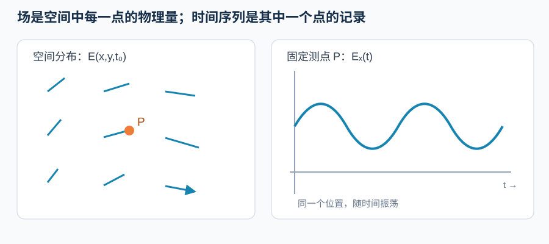
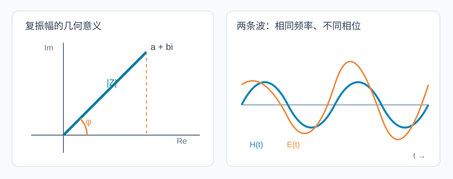



在真正写出麦克斯韦方程之前，我们需要先把描述电磁场的“基本词汇”备齐。本篇分三步走：先看清空间里的“场”和固定测点记录到的“波”有什么区别；再用高中学过的余弦函数拆解振幅、频率和相位；最后请出复数和欧拉公式，把烦琐的三角函数求导变成简单的代数乘法。

## 本篇路线图
- [1.1 场究竟是什么：从风场到地表电磁观测](#sec-01-field-wave)
- [1.2 三角函数里的振幅、频率与相位](#sec-01b-trigonometry)
- [1.3 复数从哪里来：把振幅和相位装在一起](#sec-01c-complex)

---

## 1.1 场究竟是什么：从风场到地表电磁观测

### 开始之前

想理解大地电磁测深，我们后面确实会用到麦克斯韦方程、复数、偏导数和矩阵。不过现在完全可以先不管它们，最开始只盯住一个最朴素的问题：

**仪器在地面上实际观测到的，究竟是什么？**

如果没有先把“场”的概念踩实，直接让电场 $E$ 带着两个下标钻进微分方程，很快就会失去方向感。我们先把物理直觉搭起来，再一点一点往里加数学。

### 一、从校园气温理解“场”

先想象一个晴朗的中午，你拿着温度计在校园里四处测量气温。

操场上是 $30\,^\circ\mathrm C$，大树底下是 $28\,^\circ\mathrm C$，教学楼背阴的一侧可能只有 $27\,^\circ\mathrm C$。每一个位置都对应一个温度值。只要你沿着校园走一圈，就能画出一张完整的校园温度分布图。

这张分布图，在物理上就叫作一个**温度场**。

注意，它并没有要求温度按正弦规律起伏。温度场只表达一个非常朴素的事实：

> 在空间的每一个位置，都可以讨论一个对应的物理量。

为了和后面的地下电磁计算保持一致，我们统一约定：$x$ 轴正向指**北**，$y$ 轴正向指**东**，而后面出现的 $z$ 轴正向表示**向下的深度**。这套北—东—下（NED）三轴满足右手定则。先只看地面上的两个水平坐标，温度场就可以写作

$$
T=T(x,y).
$$

这行公式读作：“温度 $T$ 是位置 $(x,y)$ 的函数。”这里的 $T$ 不是某一个写死的数字，而是一个**随着位置改变而改变的量**。

再想一步：如果你站在原地不动，从早上一直测到晚上，温度还会变吗？当然会。这时我们就把时间 $t$ 也写进括号里：

$$
T=T(x,y,t).
$$

现在公式的意思变成：**不同位置、不同时刻，温度都可能不同。** 这就是“场”的第一个核心特点。

### 二、温度只有大小，风和电场却还有方向

温度用一个带单位的数字就能说清，但描述风速就得再多给一项信息。

同样是 $5\,\mathrm{m/s}$ 的风，向东吹和向北吹完全是两回事。要完整描述风的状态，必须同时说明**大小**和**方向**。既有大小又有方向的量，叫作**矢量**。

在地图上，我们习惯把风画成一支支小箭头：箭头指向代表风向，箭头长短代表风速大小。把每个位置都画上这样一支箭头，就得到了一幅风的矢量场。

电场也是一种矢量场。空间某处的电场强度用粗体 $\mathbf E$ 表示，它的物理意义很直观：假如把一个足够小的正试探电荷放在那里，它会受到什么方向、多大的电场力。

定义写为

$$
\mathbf E=\frac{\mathbf F}{q}.
$$

逐个认一下式子里的符号：

- $\mathbf E$：电场强度，字母加粗表示它是矢量；
- $\mathbf F$：试探电荷受到的电场力，同样是矢量；
- $q$：试探电荷所带的正电荷量，是一个普通数字。

举个例子：如果 $1\,\mathrm C$ 的正电荷在某处受到 $2\,\mathrm N$ 向东的电场力，当地电场强度就是 $2\,\mathrm{N/C}$（等价于 $2\,\mathrm{V/m}$），方向向东。真实实验里试探电荷必须足够小，免得它自己把原本的电场搅乱。

**箭头只是我们为了看清矢量场而发明的画法。** 每支箭头对应某个位置的大小和方向，就像天气预报图上的风向标；真实空气和地下岩石里当然没有密密麻麻插着小箭头。

### 三、一支斜向的箭头，怎么拆成三个数字？

为了方便计算，我们选定三个互相垂直的坐标轴：

- $x$ 轴（指北）；
- $y$ 轴（指东）；
- $z$ 轴（向下）。

空间里任何一支斜向的箭头，都可以分解到这三个坐标轴上，就像把斜着走的一步拆成“向北走了多少”“向东走了多少”和“向下走了多少”。

因此电场矢量可以写成三个分量的组合：

$$
\mathbf E=(E_x,E_y,E_z).
$$

这里的下标 $x,y,z$ 只表示**方向分量**。比如

$$
\mathbf E=(3,4,0)\,\mathrm{V/m}
$$

意思是：沿 $x$ 方向（北向）的分量为 $3\,\mathrm{V/m}$，沿 $y$ 方向（东向）为 $4\,\mathrm{V/m}$，沿 $z$ 方向（垂向）为 $0$。整支箭头的总长度（大小）直接用三维勾股定理就能算出来：

$$
\lvert\mathbf E\rvert=\sqrt{3^2+4^2+0^2}=5\,\mathrm{V/m}.
$$

先把它当成熟悉的勾股定理即可，不需要任何额外的高等数学。

**这里务必停一秒分清：** $E_x$ 的意思是“$x$ 方向上的电场分量”，绝不是“位于 $x$ 这个地点的电场”。这个区分会贯穿后面所有的偏导数和张量公式。

### 四、固定在一个测点不动，场会怎样随时间变化？

现在我们带着仪器来到某个固定的观测点 $P$。虽然站的位置没变，但当地的电场却可能随时间不停起伏。

假设沿 $x$ 方向的电场分量在 1 秒内先向北增强，再减弱到零，接着反向朝南增强，最后又回到初始状态。约定“向北为正、向南为负”，每隔 $0.25$ 秒记下一个读数，得到这样一张记录表：

| 时刻 $t$（秒） | $E_x$（V/m） |
|---|---:|
| 0 | 2 |
| 0.25 | 0 |
| 0.50 | -2 |
| 0.75 | 0 |
| 1.00 | 2 |

观察这串数字，会发现两个特征：第一，测点位置自始至终没动，变化的是时间；第二，经过 $1$ 秒后，数值精确回到了起点。如果这种起伏一直重复下去，它就是周期性振荡。

高中学过的余弦函数恰好能描述这串数据：

$$
E_x(t)=2\cos(2\pi t).
$$

你看，电场虽然整体上是分布在整个三维空间的矢量场，但当我们盯住**某一个固定测点的某一个方向分量**时，它就变成了一条随时间起伏的普通曲线。

这也顺便解开了一个常见疑惑：**为什么“场”经常用三角函数来写？** 因为当所研究的场分量恰好做单频简谐振荡时，余弦或正弦函数刚好能刻画它随时间的变化；并不是所有的场天生都长成正弦形状。比如一块静止不动的带电体周围存在静电场，它随空间位置改变，却根本不随时间振荡，也就用不着余弦函数来描述。

### 五、波和场到底是什么关系？

一句话概括两者的分工：**场**回答的是“空间中各处分布着什么物理量”，**波**描述的是“某种变化怎样在空间和时间中传播”。

对比下面两个式子就能看清差异。先看只含时间变量的表达式：

$$
E_x(t)=2\cos(2\pi t).
$$

它只记录了当前这一个测点如何随时间振荡，并没有告诉我们十米之外的电场在什么时候达到峰值。

一旦扰动确实沿着深度 $z$ 方向传播，表达式就必须同时包含空间坐标 $z$ 和时间 $t$。例如一种理想简谐波写作

$$
E_x(z,t)=2\cos(\omega t-kz).
$$

式子里新出现了两个符号：

- $\omega$（读作“欧米伽”）：**角频率**，衡量场随时间振荡得有多快；
- $k$：**波数**，衡量相位随空间位置变化得有多快。

我们来做两次“切片观察”：

- 先固定位置 $z=0$，式子变成 $E_x(0,t)=2\cos(\omega t)$，这就是地表测点记录到的时间波形；
- 再固定时刻 $t=0$，式子变成 $E_x(z,0)=2\cos(-kz)=2\cos(kz)$，这就是某一瞬间沿深度拍下的空间快照。

**同一个函数，沿时间轴看是时间波形，沿空间轴看是空间分布。** 两张图画出来都像波浪，但横轴代表的物理量完全不同。

真实的地下岩石能够导电，电磁场往深处传播时会不断消耗能量、振幅越来越小。后面我们还会遇到带有 $e^{-\alpha z}$ 因子的表达式，它专门刻画“越往深处振幅越弱”的衰减规律，现在先留个印象即可。

### 六、磁场同样需要三个分量来描述

磁场强度记作 $\mathbf H$，和电场一样也是三维矢量：

$$
\mathbf H=(H_x,H_y,H_z).
$$

在最理想的一维水平层状地球模型中，如果天然电场沿 $x$ 方向（北向）振荡，对应的磁场就会沿 $y$ 方向（东向）振荡。这时我们重点考察 $(E_x,H_y)$ 这一对互相垂直的分量。

不过，这只是理想一维模型的对称结果。一旦地下岩层的导电性沿水平方向发生变化，电场和磁场就不再严格保持简单的单向垂直关系，所以后面的章节才需要引入完整的 $2\times 2$ 阻抗张量。现阶段只需记住：**下标 $x,y,z$ 代表坐标轴方向，先选 $(E_x,H_y)$ 是为了从最简单的极化情形入手。**

### 七、回到大地电磁测深（MT）

大地电磁测深（magnetotellurics，简称 MT）利用的是地球周围天然存在的、随时间变化的电磁场。野外观测仪器通常在同一测点同步记录两个水平电场分量和三个磁场分量：

$$
E_x(t),\quad E_y(t),\quad H_x(t),\quad H_y(t),\quad H_z(t).
$$

请注意，仪器直接记下来的是五条随时间跳动的电磁场曲线，而不是五张现成的“地下电阻率表格”。我们后面要做的事情，就是把这些时间信号按不同频率拆开，分析每个频率下电场与磁场的比例和相位关系，再一步步反推出地下深处的电性结构。

### 自我小测

**1.** 某地从早晨到晚上气温不断变化，描述校园温度分布时写 $T(x,y)$ 还是 $T(x,y,t)$ 更合适？  
**答：** 写 $T(x,y,t)$，因为温度同时随空间位置 $(x,y)$ 和时间 $t$ 变化。

**2.** $E_x=-3\,\mathrm{V/m}$ 是否说明电场的“大小是负数”？  
**答：** 不是。矢量本身的大小永远是非负的；这里的负号表示电场在 $x$ 轴上的**分量**指向 $x$ 轴负方向（即向南）。

**3.** $E_x(t)=3\cos(\omega t)$ 描述的是“整个空间里电场都长成余弦波”，还是“某一个固定测点的电场分量随时间振荡”？  
**答：** 表达式里没有空间坐标变量，因此它描述的是某一个固定位置上的电场分量随时间振荡。要刻画空间变化，必须把空间坐标写进自变量中。

---

理清了“空间里的矢量场”和“单点记录的时间曲线”之后，下一节我们就把放大镜对准单点时间曲线，把余弦函数里的振幅、频率和相位彻底拆明白。

[继续阅读：1.2 三角函数里的振幅、频率与相位](#sec-01b-trigonometry)

---

## 1.2 三角函数里的振幅、频率与相位

上一节我们看到，固定测点上单频振荡的电场分量可以写成

$$
E_x(t)=A\cos(\omega t+\varphi).
$$

先别急着背这个总公式。我们把它拆成四个零件，逐个看清每个字母在起什么作用，最后再亲手拼回原样。

### 一、从最朴素的余弦函数出发

先看高中最熟悉的余弦函数：

$$
y=\cos x.
$$

挑几个特殊角度代进去：

| $x$ | $0^\circ$ | $90^\circ$ | $180^\circ$ | $270^\circ$ | $360^\circ$ |
|---|---:|---:|---:|---:|---:|
| $\cos x$ | 1 | 0 | −1 | 0 | 1 |

从 $0^\circ$ 转到 $360^\circ$，函数值刚好走完一轮“最大值 $1 \to 0 \to$ 最小值 $-1 \to 0 \to$ 最大值 $1$”的完整循环，之后不断重复。

不过，微积分和物理公式里几乎一律使用**弧度**而非度数。把圆周转满一圈规定为 $2\pi$ 弧度，对应 $360^\circ$，于是有

$$
360^\circ=2\pi,\qquad 180^\circ=\pi,\qquad 90^\circ=\frac{\pi}{2}.
$$

其中圆周率 $\pi\approx 3.14159$。弧度只是角度的另一套单位，就像同一根绳子既可以量成“$100$ 厘米”也可以记作“$1$ 米”。改用弧度后，上面的对照表变成：

| $x$ | $0$ | $\pi/2$ | $\pi$ | $3\pi/2$ | $2\pi$ |
|---|---:|---:|---:|---:|---:|
| $\cos x$ | 1 | 0 | −1 | 0 | 1 |

### 二、如果峰值不是 1 怎么办？——引入振幅 $A$

$\cos t$ 的取值始终被夹在 $-1$ 和 $+1$ 之间。如果某测点的电场峰值能达到 $3\,\mathrm{V/m}$，只需在余弦前面乘上 $3$：

$$
E_x(t)=3\cos t.
$$

这样曲线就在 $-3$ 和 $+3\,\mathrm{V/m}$ 之间上下摆动。一般地，把正数 $A$ 写在前面：

$$
E_x(t)=A\cos t.
$$

$A$ 叫作**振幅**，决定振荡能达到的最大幅度。例如 $A=5\,\mathrm{V/m}$ 时，电场分量 $E_x$ 就在 $+5$ 和 $-5\,\mathrm{V/m}$ 之间往复变化（注意 $E_x$ 作为方向分量可以取负值，而电场矢量的总大小 $\lvert\mathbf E\rvert$ 始终非负）。

### 三、为什么把 $t$ 换成 $\omega t$？——周期、频率与角频率

$E_x(t)=A\cos t$ 还有个局限：它的自变量每增加 $2\pi$ 才重复一圈，相当于把振荡周期死锁在了 $2\pi$ 秒。而天然电磁场既有几百赫兹的快速抖动，也有几千秒才慢悠悠摆动一次的超长周期变化。

我们从**周期** $T$ 开始调整节奏：

- 如果一个信号每 $2$ 秒完成一次完整振荡，周期就是 $T=2\,\mathrm s$；
- 如果每秒完成 $1$ 次振荡，周期就是 $T=1\,\mathrm s$；
- 如果每秒完成 $4$ 次振荡，周期就是 $T=0.25\,\mathrm s$。

把“每秒完成多少次完整振荡”定义为**频率** $f$，单位是赫兹（$\mathrm{Hz}$，即 $\mathrm s^{-1}$）：

$$
f=\frac{1}{T}.
$$

例如 $f=2\,\mathrm{Hz}$ 就代表每秒振荡 $2$ 圈。由于每转 $1$ 圈对应 $2\pi$ 弧度，每秒振荡 $f$ 圈时，每秒转过的角度就是 $2\pi f$。这个“每秒转过多少弧度”的物理量叫作**角频率**，用希腊字母 $\omega$ 表示：

$$
\boxed{\omega=2\pi f=\frac{2\pi}{T}}.
$$

把 $\omega$ 放进余弦括号里，表达式就有了清晰的物理意义：

$$
E_x(t)=A\cos(\omega t).
$$

因为 $\omega$ 是“每秒积累的弧度数”，$t$ 是“经过的秒数”，两者相乘得到的 $\omega t$ 正好就是从 $t=0$ 开始累计转过的总角度。

#### 动手算一遍

假设某电场每秒振荡 $2$ 次，则频率 $f=2\,\mathrm{Hz}$，周期 $T=1/2=0.5\,\mathrm s$，角频率

$$
\omega=2\pi\times 2=4\pi\ \mathrm{rad/s}.
$$

若振幅 $A=3\,\mathrm{V/m}$，函数写作

$$
E_x(t)=3\cos(4\pi t).
$$

代入几个时刻验证一下：
- $t=0$ 时，角度为 $0$，$\cos 0=1$，电场为 $+3\,\mathrm{V/m}$；
- $t=0.25\,\mathrm s$ 时，角度为 $4\pi\times 0.25=\pi$，$\cos\pi=-1$，电场变成 $-3\,\mathrm{V/m}$；
- $t=0.50\,\mathrm s$ 时，角度达到 $2\pi$，$\cos 2\pi=1$，电场重新回到 $+3\,\mathrm{V/m}$，刚好走完一个完整周期。

### 四、相位：为什么频率相同的两列波步调可能不一致？

同时观察同一测点的磁场和电场记录：

$$
H_y(t)=2\cos(\omega t),\qquad E_x(t)=3\cos(\omega t+\varphi).
$$

两者的角频率 $\omega$ 完全相同，但电场括号里多了一个角度 $\varphi$。取 $\varphi=\pi/2$ 看看会发生什么：

$$
E_x(t)=3\cos\left(\omega t+\frac{\pi}{2}\right).
$$

在起始时刻 $t=0$，磁场已经处在正峰值 $H_y(0)=2$，而电场却刚好处在零点 $E_x(0)=0$。虽然它们每秒振荡的圈数一模一样，但起跑线错开了四分之一圈。

括号里额外加上的常数角度 $\varphi$ 叫作**初相位**，两条同频信号之间初相位的差称为**相位差**。

你可以想象两位跑者在圆形跑道上匀速跑步，速度完全相同，但其中一人起跑时就站在前方四分之一圈的位置。跑得再久，两人之间始终保持着这四分之一圈的距离。在正的角频率 $\omega>0$ 与当前余弦写法下：
- 当 $\varphi>0$ 时，$\cos(\omega t+\varphi)$ 比 $\cos(\omega t)$ 更早到达峰值，称为**相位超前**；
- 当 $\varphi<0$ 时，到达峰值的时间更晚，称为**相位滞后**。

需要留意的是，真实 MT 观测中电场和磁场究竟谁超前、超前多少度，不能靠“直觉猜想”，必须根据地下介质导电性和电磁方程严格推算（第 03 篇就会算出均匀半空间里那著名的 $45^\circ$ 相位差）。

### 五、两个最容易混淆的概念

**第一，频率和相位不是一回事。**  
频率管的是“摆动得有多快”（每秒几圈），相位管的是“步调有没有对齐”（起跑差了几分之几圈）。即使两个人跑步速度（频率）完全一致，只要起跑点相差半圈，他们的相位差就始终是 $\pi$（$180^\circ$）。

**第二，时间上的周期 $T$ 和空间上的波长 $\lambda$ 不是一回事。**  
对于同时依赖空间和时间的简谐行波 $E_x(z,t)=A\cos(\omega t-kz)$，角频率 $\omega=2\pi/T$ 控制时间上的快慢，波数 $k=2\pi/\lambda$ 控制空间上的疏密。当你盯着固定测点的时间曲线 $E_x(t)$ 看时，横轴是时间（秒），千万不要把横轴上的一个周期直接读成“深度”或“波长”。

### 六、把所有零件拼回总公式

现在回头看最初的公式：

$$
\boxed{E_x(t)=A\cos(\omega t+\varphi)}.
$$

每个字母都已经有了明确身份：
- $A$：振幅，决定摆幅大小；
- $f$：频率，$T=1/f$ 为周期，$\omega=2\pi f$ 为角频率，决定振荡快慢；
- $t$：时间；
- $\varphi$：初相位，决定 $t=0$ 时的起始状态。

#### 动手练习（建议先自己算再核对）

**1.** 已知 $f=0.5\,\mathrm{Hz}$，求周期 $T$ 和角频率 $\omega$。  
**解：** 由 $T=1/f$ 得 $T=2\,\mathrm s$；代入 $\omega=2\pi f$ 得 $\omega=\pi\,\mathrm{rad/s}$。

**2.** 比较 $\cos(\omega t+\pi)$ 与 $\cos(\omega t)$，谁的振幅更大？  
**解：** 两者振幅完全相同，都是 $1$。它们相差半个周期（$\pi$ 弧度），且 $\cos(\omega t+\pi)=-\cos(\omega t)$。

**3.** 某电场分量为 $E_x(t)=4\cos(6\pi t+\pi/3)$，读出振幅、频率和初相位。  
**解：** 振幅为 $4$；角频率 $\omega=6\pi$，故频率 $f=\omega/(2\pi)=3\,\mathrm{Hz}$；初相位为 $\pi/3$ 弧度（即 $60^\circ$）。

---

用余弦函数表达单频信号已经很清楚了，但一遇到微分方程，余弦求导变正弦、正弦求导又冒出负号，算起来非常繁琐。下一节我们引入复数，把“振幅”和“相位”打包进同一个数学对象，让求导变成简单的乘法。

[继续阅读：1.3 复数从哪里来：把振幅和相位装在一起](#sec-01c-complex)

---

## 1.3 复数从哪里来：把振幅和相位装在一起

上一节我们学会用 $E_x(t)=A\cos(\omega t+\varphi)$ 描述正弦振荡的电场。既然实数余弦已经够用了，为什么几乎所有电磁学教材都要改写成

$$
E_x(t)=\operatorname{Re}\left[\widetilde E\,e^{i\omega t}\right]？
$$

这并不是为了故意把公式写得高深，恰恰相反，是为了把后面的微分方程算得更省力。我们从最基础的代数规则一步步看起。

### 一、认识虚数单位 $i$

在普通实数世界里，任何数的平方都大于或等于零（例如 $2^2=4$，$(-2)^2=4$），方程 $x^2=-1$ 没有实数解。为了打破这个限制，数学上引入一个新符号 $i$，规定它满足

$$
\boxed{i^2=-1}.
$$

$i$ 称为**虚数单位**。在计算时，你只需要把 $i$ 当作一个遵守普通加法、乘法分配律的字母，唯一的新规则就是：**每当出现 $i^2$，立刻替换成 $-1$**。

试算一题加法（合并同类项）：

$$
(2+3i)+(4-i)=(2+4)+(3-1)i=6+2i.
$$

再试算一题乘法（按多项式展开）：

$$
(1+i)(2+3i)=2+3i+2i+3i^2.
$$

把末尾的 $i^2$ 换成 $-1$：

$$
=2+5i+3(-1)=-1+5i.
$$

整个过程没有任何神秘假设，完全是按规则做代数化简。

### 二、复数在平面上对应“长度”和“角度”

形如

$$
z=a+bi
$$

的数叫作**复数**，其中实数 $a$ 叫**实部**，实数 $b$ 叫**虚部**（注意虚部是实数 $b$，不带 $i$）。

如果我们把实部当横坐标、虚部当纵坐标，复数 $z=3+4i$ 就对应平面上的一个点 $(3,4)$，这个平面叫作**复平面**。

从原点 $(0,0)$ 到点 $(3,4)$ 连一条线段，这条线段有两个几何特征：

1. **模长 $\lvert z\rvert$**（线段的长度）：直接用勾股定理计算，

   $$
   \lvert z\rvert=\sqrt{a^2+b^2}.
   $$

   对 $z=3+4i$，模长为 $\lvert 3+4i\rvert=\sqrt{3^2+4^2}=5$。

2. **辐角 $\varphi=\arg z$**（线段与正横轴的逆时针夹角）：在第一象限的直角三角形中，对边比邻边等于正切值，因此

   $$
   \tan\varphi=\frac{4}{3},\qquad \varphi\approx 53.13^\circ.
   $$

   （若点落在其他象限，则需结合 $a,b$ 的正负号来确定所在象限的正确角度。）

到这里你会发现一个巧合：**复平面上的一个点天然拥有“一个长度（模长）”和“一个角度（辐角）”，而简谐波也正好需要“一个振幅”和“一个相位”。** 连接这两者的桥梁，就是欧拉公式。

### 三、欧拉公式：连接复指数与三角函数

数学上有一个极为优美的恒等式——**欧拉公式**：

$$
\boxed{e^{i\theta}=\cos\theta+i\sin\theta}.
$$

式子里的 $e\approx 2.71828$ 是自然常数，$\theta$ 是以弧度为单位的角度。我们不必把它想成“某种奇怪的指数电场”，它反映的是复指数运算与圆周三角函数之间严丝合缝的数学等价关系。

代几个特殊角度感受一下：
- 当 $\theta=0$：$e^{i0}=\cos 0+i\sin 0=1$；
- 当 $\theta=\pi/2$：$e^{i\pi/2}=\cos\frac{\pi}{2}+i\sin\frac{\pi}{2}=i$；
- 当 $\theta=\pi$：$e^{i\pi}=\cos\pi+i\sin\pi=-1$。

当 $\theta$ 从 $0$ 连续增大时，$e^{i\theta}$ 始终保持模长 $\sqrt{\cos^2\theta+\sin^2\theta}=1$，在复平面上沿着单位圆逆时针旋转。如果在前面再乘上正实数 $A$，就得到

$$
Ae^{i\varphi},
$$

它表示一个模长为 $A$、辐角为 $\varphi$ 的复数——“振幅”和“初相位”就这样被装进了同一个复数里。

### 四、复数乘法为什么等价于相位相加？

回顾中学学过的同底数幂相乘规则 $e^u e^v=e^{u+v}$。令 $u=i\alpha$、$v=i\beta$，立刻得到

$$
e^{i\alpha}e^{i\beta}=e^{i(\alpha+\beta)}.
$$

这说明：**两个复数相乘，模长相乘，辐角相加。** 举个例子，把一个复数乘以 $i=e^{i90^\circ}$，相当于保持它的长度不变，在复平面上逆时针旋转 $90^\circ$；而对 $i$ 开平方取主值时，角度减半：

$$
\sqrt{i}=e^{i45^\circ}=\frac{1+i}{\sqrt{2}}.
$$

这里的 $45^\circ$ 来自纯数学运算中 $\sqrt{i}$ 的主值辐角。具体到地下电磁场时，相位究竟是多少度，还得由麦克斯韦方程和地下电性结构来决定（第 03 篇会详细推导均匀半空间里的 $45^\circ$ 相位）。

### 五、把真实电场和复数计算工具区分开

现在来看具体操作。假设地表真实振荡的电场为

$$
E_x(t)=3\cos(\omega t+60^\circ).
$$

我们把它的振幅 $3$ 和初相位 $60^\circ$ 打包成一个不随时间变化的复数，称为**复振幅**（或相量），记作 $\widetilde E$（波浪线只是用来提醒它是复数）：

$$
\widetilde E=3e^{i60^\circ}.
$$

接着乘上随时间旋转的因子 $e^{i\omega t}$，构造一个复数函数 $\mathcal E(t)$（花体字母 $\mathcal E$ 用来和真实电场 $E_x$ 区分）：

$$
\mathcal E(t)=\widetilde E\,e^{i\omega t}=3e^{i60^\circ}e^{i\omega t}=3e^{i(\omega t+60^\circ)}.
$$

用欧拉公式把它展开成“实部 + 虚部”：

$$
\mathcal E(t)=3\cos(\omega t+60^\circ)+3i\sin(\omega t+60^\circ).
$$

只要取它的**实部**（记作 $\operatorname{Re}$），就精准还原出了真实的物理电场：

$$
\boxed{E_x(t)=\operatorname{Re}[\mathcal E(t)]}.
$$

**一句话总结：物理仪器测到的是实数，复数是让我们中途推导更轻松的计算桥梁；算完所有加减乘除和微积分之后，最后取实部就能回到真实世界。**（为了书写简洁，后面进入频域推导时，通常不再特意写花体 $\mathcal E$，直接用 $E_x$ 代表复振幅，只在时间域与频域同时出现时才加记号区分。）

### 六、复数带来的最大红利：时间求导变成乘法

为什么要费劲绕一圈用复数？答案就在求导运算里。

如果直接用余弦函数对时间 $t$ 求导：

$$
\frac{d}{dt}\left[A\cos(\omega t)\right]=-A\omega\sin(\omega t).
$$

余弦变成了正弦，前面还多出负号；一旦式子里再带初相位或二阶导数，三角函数变换会越来越繁琐。

改用复指数形式 $\mathcal E(t)=\widetilde E e^{i\omega t}$ 后，由于 $\widetilde E$ 是常数，而指数函数求导满足 $\frac{d}{dt}e^{ct}=ce^{ct}$，令 $c=i\omega$ 便有

$$
\frac{d}{dt}e^{i\omega t}=i\omega e^{i\omega t},
$$

于是

$$
\boxed{\frac{d\mathcal E}{dt}=i\omega\,\mathcal E}.
$$

**对简谐场求一次时间导数，等价于直接乘以 $i\omega$！** 因此在后面所有单频麦克斯韦方程里，时间偏导算子可以直接替换：

$$
\frac{\partial}{\partial t}\longrightarrow i\omega.
$$

这个替换之所以成立，正是因为我们约定研究的是带有 $e^{+i\omega t}$ 时间因子的单频相量。

### 七、亲手走一遍完整转换

把实数电场 $E_x(t)=2\cos(4\pi t+\pi/3)$ 转成复数形式，再还原回来：

1. **读出参数**：振幅 $A=2$，角频率 $\omega=4\pi\,\mathrm{rad/s}$（即频率 $f=2\,\mathrm{Hz}$），初相位 $\varphi=\pi/3$。
2. **写出复振幅**：$\widetilde E=2e^{i\pi/3}$。
3. **乘上时间因子并合并指数**：
   $$
   \mathcal E(t)=2e^{i\pi/3}e^{i4\pi t}=2e^{i(4\pi t+\pi/3)}.
   $$
4. **取实部还原**：
   $$
   \operatorname{Re}[\mathcal E(t)]=2\cos(4\pi t+\pi/3).
   $$

### 自我小测

**1.** 复数 $z=3+4i$ 的模长 $\lvert z\rvert$ 是多少？  
**答：** $\lvert z\rvert=\sqrt{3^2+4^2}=5$。

**2.** 复振幅 $\widetilde E=5e^{i\pi/6}$ 对应的振幅和初相位分别是多少？  
**答：** 振幅为 $5$，初相位为 $\pi/6$ 弧度（即 $30^\circ$）。

**3.** 在采用 $e^{+i\omega t}$ 时间约定时，对单频简谐场求一次时间偏导数，等价于乘以什么？  
**答：** 等价于乘以 $i\omega$。

---

至此，描述电磁场所需的“基础语言”已经全部备齐。下一篇我们正式走进电磁场方程，看看导数和旋度是如何把电场与磁场联系起来的。

[继续阅读：02｜导数、旋度与麦克斯韦方程：一维控制方程推导](/posts/2026/10/mt-course-02a-maxwell-math/) · [返回总目录](/posts/2026/10/mt-course/)
