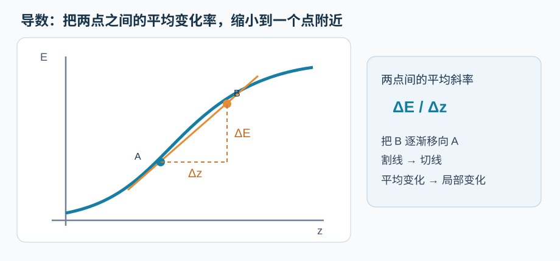
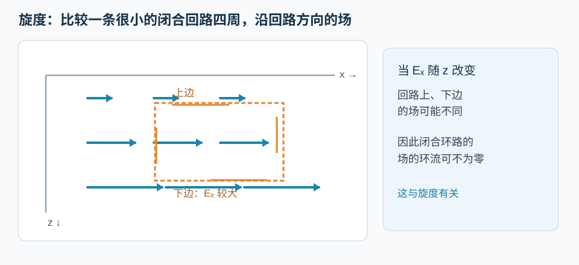



学会了用复数描述随时间振荡的电场，接下来我们要解决一维正演的核心问题：**已知地下岩石的电导率，怎样建立控制方程来计算地下和地表的电磁场？** 本篇采用“用多少学多少”的顺序：先从坡度理解导数与偏导数，再沿着一个小方框算出旋度，最后把两条麦克斯韦方程合并成一维控制方程，并亲手求出它的指数解。

## 本篇路线图
- [2.1 导数究竟在求什么：从坡度走到偏导数](#sec-02a-derivatives)
- [2.2 旋度并不可怕：从一个小回路走到麦克斯韦方程](#sec-02b-curl)
- [2.3 一维控制方程是怎样一步一步得到的](#sec-02c-1d-ode)

---

## 2.1 导数究竟在求什么：从坡度走到偏导数

先暂时把电磁学放一旁，解决一个纯粹的数学小问题：**当一个物理量随着位置或时间改变时，我们怎样定量描述它“改变得有多快”？**

这就是导数的工作。后面要遇到的旋度、麦克斯韦方程和有限差分，全都建立在这个概念之上。我们从两组最简单的数字算起。

### 一、从山坡的坡度想起

假设你沿着一条笔直的山路上坡，每隔 $10$ 米记一次水平距离和海拔高度：

| 水平距离 $x$（米） | 0 | 10 | 20 | 30 |
|---|---:|---:|---:|---:|
| 高度 $h$（米） | 100 | 102 | 104 | 106 |

每往前走 $10$ 米，海拔稳定升高 $2$ 米。平均坡度就是“高度的增量”除以“水平距离的增量”：

$$
\frac{\Delta h}{\Delta x}=\frac{102-100}{10-0}=0.2.
$$

希腊字母 $\Delta$（读作“delta”）表示**增量**（终点值减起点值）。这里 $\Delta h=2$ 米，$\Delta x=10$ 米，坡度 $0.2$ 表示每向前走 $1$ 米海拔升高 $0.2$ 米。对于直线山坡 $h(x)=100+0.2x$，任意两点的平均坡度都等于 $0.2$。

但如果山路是一条越走越陡的曲线，不同位置的陡峭程度就各不相同了，我们需要一种方法来刻画**某一个具体点附近**的局部坡度。

### 二、把两个点放得越来越近

假设某条弯曲山坡的高度函数为

$$
h(x)=x^2.
$$

我们想知道在 $x=2$ 处（此时高度 $h(2)=2^2=4$）坡度究竟有多陡。做法很简单：把另一个观测点不断往 $x=2$ 身边靠拢，观察平均坡度的变化趋势：

- 从 $x=2$ 到 $x=3$（间距 $1$）：
  $$
  \frac{h(3)-h(2)}{3-2}=\frac{9-4}{1}=5.
  $$
- 从 $x=2$ 到 $x=2.1$（间距 $0.1$）：
  $$
  \frac{h(2.1)-h(2)}{2.1-2}=\frac{4.41-4}{0.1}=4.1.
  $$
- 从 $x=2$ 到 $x=2.01$（间距 $0.01$）：
  $$
  \frac{h(2.01)-h(2)}{2.01-2}=\frac{4.0401-4}{0.01}=4.01.
  $$

一串结果 $5,\,4.1,\,4.01\dots$ 稳稳地趋向于 $4$。数学上把另一点无限逼近目标点时平均变化率趋向的极限值，定义为该点的**导数**：

$$
\boxed{\frac{dh}{dx}=\lim_{\Delta x\to 0}\frac{h(x+\Delta x)-h(x)}{\Delta x}}.
$$

符号 $\lim_{\Delta x\to 0}$ 读作“当 $\Delta x$ 趋近于 $0$ 时的极限”。我们是在 $\Delta x$ 无限接近 $0$ 的过程中观察比值的趋向，并不需要真的拿 $0$ 当分母。

### 三、亲手推导一次 $x^2$ 的导数

把 $h(x)=x^2$ 代入导数定义：

$$
\frac{dh}{dx}=\lim_{\Delta x\to 0}\frac{(x+\Delta x)^2-x^2}{\Delta x}.
$$

先把分子里的完全平方展开：$(x+\Delta x)^2=x^2+2x\Delta x+(\Delta x)^2$，减去后面的 $x^2$ 后，分子只剩下

$$
2x\Delta x+(\Delta x)^2=\Delta x(2x+\Delta x).
$$

在 $\Delta x\ne 0$ 时约去分子分母公有的 $\Delta x$：

$$
\frac{\Delta x(2x+\Delta x)}{\Delta x}=2x+\Delta x.
$$

最后让 $\Delta x$ 趋近于 $0$，就得到

$$
\boxed{\frac{d(x^2)}{dx}=2x}.
$$

代入 $x=2$，结果正是 $4$，和刚才三次数值逼近完全吻合。熟悉了这种推导思路，就能理解微积分里最常用的幂函数求导法则：$x^n$ 的导数是 $nx^{n-1}$——它不是凭空背出来的口诀，而是把刚才展开约分的过程推广到了任意次方。

### 四、在电磁学里，导数描述什么？

假设地下某段深度内，电场的 $x$ 分量随深度 $z$ 线性减弱：

$$
E_x(z)=10-2z,
$$

其中深度 $z$ 的单位是 $\mathrm m$，$E_x$ 的单位是 $\mathrm{V/m}$。深度每增加 $1\,\mathrm m$，$E_x$ 就减小 $2\,\mathrm{V/m}$，因此导数为

$$
\frac{dE_x}{dz}=-2\ \mathrm{V/m^2}.
$$

负号说明电场随着深度增加而衰减。

但真实电磁场往往同时随深度 $z$ 和时间 $t$ 变化，例如

$$
E_x(z,t)=(10-2z)\cos(\omega t).
$$

现在函数括号里有两个自变量，要算变化率，就必须先指明是沿着哪一个变量在变。

### 五、偏导数：求谁的导数，就把其他变量当常数

- **只看随深度 $z$ 的变化**：把时间 $t$ 暂时定格不动。此时 $\cos(\omega t)$ 只是一个固定常数，直接提出导数外面：
  $$
  \boxed{\frac{\partial E_x}{\partial z}=-2\cos(\omega t)}.
  $$
- **只看随时间 $t$ 的变化**：把深度 $z$ 暂时固定不动。此时 $(10-2z)$ 是固定常数，利用 $\frac{d}{dt}\cos(\omega t)=-\omega\sin(\omega t)$ 得到
  $$
  \boxed{\frac{\partial E_x}{\partial t}=-(10-2z)\omega\sin(\omega t)}.
  $$

这个弯弯的符号 $\partial$ 读作“偏”（partial），提醒我们：**函数依赖多个变量，这里只挑分母上的那一个变量求导，其余变量一律按常数对待。** 以后看到分式模样的偏导数，第一反应先盯分母——分母是 $z$还是 $t$，直接决定了物理问题在考察空间分布还是时间演化。

### 六、一个最容易看岔的下标细节

看清这个记号：

$$
\frac{\partial E_x}{\partial z}.
$$

分子里的下标 $x$ 和分母里的 $z$ 各管各的：
- $E_x$ 的下标 $x$，指明这是**电场矢量的北向（$x$ 方向）分量**；
- 分母的 $z$，指明我们要考察这个分量**沿垂向深度 $z$ 改变得有多快**。

因此 $\partial E_x/\partial z$ 读作“电场的 $x$ 分量随深度 $z$ 的变化率”，在 MT 里通常不为零。它既不是“$x$ 方向除以 $z$ 方向”，也不是“位于 $x$ 处的电场”。

### 七、二阶导数：变化率本身变化得有多快？

对函数 $h(x)=x^2$ 求一次导数，得到斜率函数 $h'(x)=2x$；如果对斜率函数 $2x$ 再求一次导数，就得到**二阶导数**：

$$
h''(x)=\frac{d^2h}{dx^2}=2.
$$

“二阶”就是连续求两次导数的意思（分母上的 $dx^2$ 是微积分的固定简写，并非普通代数里的 $(dx)^2$）。直线 $h=2x+1$ 的斜率处处等于 $2$，斜率本身不变化，所以二阶导数为 $0$；抛物线 $h=x^2$ 的斜率越往右越大，所以二阶导数等于 $2$。后面一维电磁控制方程里出现的 $\partial^2 E_x/\partial z^2$，描述的就是“电场随深度的变化率，本身又随深度如何弯曲”。

### 自我小测

**1.** 若 $h(x)=3x+5$，求 $dh/dx$。  
**答：** $x$ 每增加 $1$ 个单位，$h$ 恒定增加 $3$，故 $dh/dx=3$。

**2.** 若 $h(x)=x^2+2x$，求 $x=3$ 处的导数。  
**答：** 逐项求导得 $h'(x)=2x+2$，代入 $x=3$ 得 $2\times 3+2=8$。

**3.** 若 $E_x(z,t)=z^2+3t$，分别求 $\partial E_x/\partial z$ 和 $\partial E_x/\partial t$。  
**答：** 固定 $t$ 对 $z$ 求导得 $\partial E_x/\partial z=2z$；固定 $z$ 对 $t$ 求导得 $\partial E_x/\partial t=3$。

---

学会了沿一条直线算变化率，接下来把视角从“一条线”放大到“一个小方框”：如果电场在空间各个方向都有分量，而且不同位置的大小还不一样，怎么衡量它在一个小闭合回路周围“打转”的趋势？这就是下一节要讲的旋度。

[继续阅读：2.2 旋度并不可怕：从一个小回路走到麦克斯韦方程](#sec-02b-curl)

---

## 2.2 旋度并不可怕：从一个小回路走到麦克斯韦方程

描述矢量场在局部小回路周围环绕趋势的数学工具叫**旋度**。我们先从一个具体的小正方形回路算起，把它的物理画面和正负号规则彻底摸透。

### 一、沿着一个小方框走一圈：什么是环流？

想象空气中吹着一阵风，你拿着风速计沿着地面画的一个小正方形走一圈。

走每一条边时，我们只关心**沿着前进方向的风速分量**：如果边长 $1$ 米，风正好顺着你走的方向以 $3\,\mathrm{m/s}$ 吹过，这条边就贡献 $+3$；如果逆风而行，贡献就是负数；如果风完全垂直于你的脚步方向，贡献就是 $0$。

把闭合路径每一小段的这种投影贡献全部加起来，得到的总和叫作**环流**。对于连续的电场 $\mathbf E$，环流写作闭合路径积分：

$$
\oint_C \mathbf E\cdot d\boldsymbol\ell.
$$

逐个拆解符号：
- $\oint_C$：沿着闭合回路 $C$ 绕一圈累加；
- $\mathbf E$：路径上某点的电场矢量；
- $d\boldsymbol\ell$：沿着绕行方向的微小位移矢量；
- $\cdot$：矢量点积，提取电场在前进方向上的分量。

整圈的环流和回路面积大小有关。如果我们把这个小方框不断缩小，用**环流除以回路面积**，得到的“单位面积有向环流密度”，就是**旋度**在回路法线方向上的分量。

### 二、试试看：电场全朝 $x$ 方向吹，为什么依然有旋度？

设想地下某处电场只有 $x$ 方向（北向）分量，但它的强度随深度 $z$ 增大，例如深度 $1$ 米处 $E_x=1$，深度 $2$ 米处 $E_x=2$：

$$
\mathbf E=(E_x(z),0,0).
$$

我们在 $x$–$z$ 竖直平面内画一个宽 $\Delta x$、高 $\Delta z$ 的小方框，按“上边向 $+x \to$ 右边向 $+z \to$ 下边向 $-x \to$ 左边向 $-z$”的顺序走一圈：

1. **上边（深度 $z_{\rm top}$）**：顺着 $+x$ 走，贡献为 $+E_x(z_{\rm top})\Delta x$；
2. **左右两条竖边**：路径沿 $z$ 方向，而电场只有 $x$ 分量，两者垂直，贡献均为 $0$；
3. **下边（深度 $z_{\rm bottom}$）**：逆着 $+x$ 方向走，贡献为 $-E_x(z_{\rm bottom})\Delta x$。

四条边相加，总环流为

$$
\big[E_x(z_{\rm top})-E_x(z_{\rm bottom})\big]\Delta x.
$$

由于下边比上边深 $\Delta z$（即 $z_{\rm bottom}=z_{\rm top}+\Delta z$），把总环流除以方框面积 $\Delta x\,\Delta z$：

$$
\frac{E_x(z_{\rm top})-E_x(z_{\rm bottom})}{\Delta z}
=-\frac{E_x(z_{\rm top}+\Delta z)-E_x(z_{\rm top})}{\Delta z}.
$$

当方框缩得无限小时，右端就趋近于

$$
-\frac{\partial E_x}{\partial z}.
$$

这里的负号来自**绕行方向与右手定则**：在北—东—下（NED）右手坐标系中，先向 $+x$、再向 $+z$ 绕行，右手四指顺着绕行方向弯曲时，大拇指指向**$-y$**（正西）；因此刚才算出的是沿 $-y$ 法向的环流密度。如果要算旋度的 **$+y$ 分量**，只需把绕行方向反过来，符号随之翻正，得到 $+\partial E_x/\partial z$。

这个例子揭示了一个核心直觉：**电场箭头本身不必真的画成漩涡状，只要相邻深度的场强不一样，小回路上下两边就无法抵消，旋度就不为零。**

### 三、三维旋度的完整公式

对一般三维矢量场 $\mathbf E=(E_x,E_y,E_z)$，旋度记作 $\nabla\times\mathbf E$（$\nabla$ 读作 nabla，是空间微分算子）。在直角坐标系中展开为三个分量：

$$
\nabla\times\mathbf E=
\begin{pmatrix}
\dfrac{\partial E_z}{\partial y}-\dfrac{\partial E_y}{\partial z}\\[6pt]
\dfrac{\partial E_x}{\partial z}-\dfrac{\partial E_z}{\partial x}\\[6pt]
\dfrac{\partial E_y}{\partial x}-\dfrac{\partial E_x}{\partial y}
\end{pmatrix}.
$$

把刚才的特例 $\mathbf E=(E_x(z),0,0)$ 代进去：因为 $E_y=E_z=0$，且 $E_x$ 只随 $z$ 变化，第一、三行全为零，第二行正好留下

$$
\nabla\times\mathbf E=
\begin{pmatrix}
0\\
\dfrac{\partial E_x}{\partial z}\\
0
\end{pmatrix},
$$

与前面用小方框推出来的 $+y$ 分量完全一致。

顺便认识另外两个常见的矢量微积分记号，避免后续混淆：
- **梯度 $\nabla f$**：作用在标量场 $f$ 上，指向 $f$ 增长最快的方向；
- **散度 $\nabla\cdot\mathbf E=\frac{\partial E_x}{\partial x}+\frac{\partial E_y}{\partial y}+\frac{\partial E_z}{\partial z}$**：把各分量沿**自身方向**的变化率相加，结果是一个标量，衡量局部有没有源或汇；而旋度组合的是**交叉方向**的空间变化率，结果仍是矢量。

### 四、读懂两条核心麦克斯韦方程

有了旋度，电磁学最核心的两条微分方程就能直接读懂了。

**第一条：法拉第电磁感应定律**

$$
\boxed{\nabla\times\mathbf E=-\frac{\partial\mathbf B}{\partial t}}.
$$

左边是电场的空间旋度，右边是磁感应强度 $\mathbf B$ 随时间变化率的负值。用一句话翻译：**磁场只要随时间变化，就会在周围激发起有旋度的电场。**

在通常近似为非磁性的地下岩石中，磁感应强度 $\mathbf B$ 与磁场强度 $\mathbf H$ 满足简单的线性比例关系

$$
\mathbf B=\mu_0\mathbf H,
$$

其中 $\mu_0=4\pi\times 10^{-7}\,\mathrm{H/m}$ 是真空磁导率（两人物理含义相关但单位不同，计算时不可混用）。

**第二条：安培–麦克斯韦定律**

$$
\boxed{\nabla\times\mathbf H=\mathbf J+\frac{\partial\mathbf D}{\partial t}}.
$$

右边第一项 $\mathbf J=\sigma\mathbf E$ 是自由电荷移动形成的**传导电流密度**（$\sigma$ 是电导率，电阻率 $\rho=1/\sigma$）；第二项 $\partial\mathbf D/\partial t$ 是麦克斯韦补充的**位移电流项**。

在天然大地电磁测深所用的低频段（通常低于 $10^4\,\mathrm{Hz}$），地下岩石的传导电流远大于位移电流，我们可以做准静态近似，略去 $\partial\mathbf D/\partial t$，把方程简化为

$$
\nabla\times\mathbf H\approx\mathbf J=\sigma\mathbf E.
$$

（注意：这是低频导电介质中的近似，高频探地雷达等场景则不能忽略位移电流。）

### 五、把三维旋度方程简化成一维方程

现在考虑最简单的一维水平层状模型：地下电导率只随深度 $z$ 变化，沿水平 $x,y$ 方向处处均匀。选取电场沿 $x$ 方向、磁场沿 $y$ 方向的极化方式：

$$
\mathbf E=(E_x(z),0,0),\qquad \mathbf H=(0,H_y(z),0).
$$

把它们分别代入三维旋度展开式：
- $\nabla\times\mathbf E$ 只剩下 $y$ 分量 $\dfrac{dE_x}{dz}$；
- $\nabla\times\mathbf H$ 展开第一行 $(\nabla\times\mathbf H)_x=\dfrac{\partial H_z}{\partial y}-\dfrac{\partial H_y}{\partial z}$，由于 $H_z=0$，只剩下 $-\dfrac{dH_y}{dz}$。

再结合上一篇学过的复相量规则（时间因子 $e^{+i\omega t}$ 下，$\partial/\partial t \to i\omega$）以及 $\mathbf B=\mu_0\mathbf H$，两条麦克斯韦方程立刻化简为：

$$
\boxed{\frac{dE_x}{dz}=-i\omega\mu_0 H_y},
$$

$$
\boxed{-\frac{dH_y}{dz}=\sigma E_x}.
$$

这两条式子不再是天书：第一条是法拉第定律的 $y$ 分量，第二条是忽略位移电流后的安培定律 $x$ 分量。

### 自我小测

**1.** 已知 $\mathbf E=(3z,0,0)$，求旋度 $\nabla\times\mathbf E$ 在 $y$ 方向的分量。  
**答：** $(\nabla\times\mathbf E)_y=\partial E_x/\partial z-\partial E_z/\partial x=3-0=3$。

**2.** 为什么从 $\nabla\times\mathbf H=\sigma\mathbf E$ 的 $x$ 分量里会冒出一个负号？  
**答：** 根据右手坐标系下的旋度公式，$(\nabla\times\mathbf H)_x=\partial H_z/\partial y-\partial H_y/\partial z$。在一维模型中 $H_z=0$，于是第一项为零，只留下带负号的 $-dH_y/dz=\sigma E_x$。

---

现在我们手里握着两条耦合在一起的一阶微分方程：一条说 $E_x$ 的深度导数取决于 $H_y$，另一条说 $H_y$ 的深度导数取决于 $E_x$。下一节我们就用最朴素的“代入消元法”把 $H_y$ 消掉，得到只含 $E_x$ 的一维控制方程。

[继续阅读：2.3 一维控制方程是怎样一步一步得到的](#sec-02c-1d-ode)

---

## 2.3 一维控制方程是怎样一步一步得到的

上一节我们从三维麦克斯韦方程里抽出了两条一维关系：

$$
\frac{dE_x}{dz}=-i\omega\mu_0 H_y \qquad\text{（式 1）}
$$

$$
-\frac{dH_y}{dz}=\sigma E_x \qquad\text{（式 2）}
$$

看着这两条式子，初学者最常卡住的地方是：“每个字母我都认识，可接下来为什么要偏偏对第一式再求一次导？”这一节我们把每一步代数变形拆开，把两个耦合方程合并成一个只含电场的控制方程，并求出它的指数解。

### 一、先把舞台上的符号清点一遍

| 符号 | 物理含义 |
|---|---|
| $z$ | 深度，从地表向下为正（$\mathrm m$） |
| $E_x(z)$ | 固定频率下电场的北向复振幅（$\mathrm{V/m}$） |
| $H_y(z)$ | 固定频率下磁场强度的东向复振幅（$\mathrm{A/m}$） |
| $i$ | 虚数单位，$i^2=-1$ |
| $\omega=2\pi f$ | 角频率（$\mathrm{rad/s}$） |
| $\mu_0$ | 真空磁导率（$\mathrm{H/m}$） |
| $\sigma$ | 岩石电导率，$\sigma=1/\rho$（$\mathrm{S/m}$） |
| $d/dz$ | 对深度 $z$ 求导 |

这里公共的时间因子 $e^{+i\omega t}$ 已经约去。我们先把单一均匀介质内的 $\sigma$ 当作常数（遇到多层地层时，只需在每一层内部各自套用下面的推导即可）。

### 二、为什么要把两条方程合并？

先看一个初中二元一次方程组：

$$
a=2b,\qquad b=3.
$$

想单独求出 $a$，只要把第二式里的 $b=3$ 代进第一式，消去未知数 $b$，就得到 $a=6$。

眼前电磁学遇到的困难完全一样，只不过未知量从两个数字变成了两个随深度变化的函数 $E_x(z)$ 和 $H_y(z)$。如果我们能先消去 $H_y(z)$，得到一个**只含 $E_x(z)$ 的独立方程**，就能先把电场算出来，再回头代进式 1 轻松算出磁场。

### 三、第一步：对式 1 两边再求一次深度导数

观察式 1 的右边是 $-i\omega\mu_0 H_y$，而式 2 里出现的是 $\frac{dH_y}{dz}$。为了让式 1 右边也变出 $\frac{dH_y}{dz}$ 以便替换，我们对式 1 等号两边**同时再求一次关于 $z$ 的导数**：

$$
\frac{d}{dz}\left(\frac{dE_x}{dz}\right)=\frac{d}{dz}\left(-i\omega\mu_0 H_y\right).
$$

左边连续求两次导数，简记为二阶导数 $\dfrac{d^2E_x}{dz^2}$；右边括号里的 $i$、$\omega$（固定频率）和 $\mu_0$ 都不随深度 $z$ 改变，作为常数直接提到导数外面：

$$
\boxed{\frac{d^2E_x}{dz^2}=-i\omega\mu_0\frac{dH_y}{dz}} \qquad\text{（式 3）}
$$

这一步纯粹是“等式两边同时求导”和“常数提出导数外”的微积分规则。

### 四、第二步：把式 2 代入式 3，消去 $H_y$

将式 2 两边同乘 $-1$，整理成

$$
\frac{dH_y}{dz}=-\sigma E_x.
$$

把它整块塞进刚刚得到的式 3 右边：

$$
\frac{d^2E_x}{dz^2}=-i\omega\mu_0\left(-\sigma E_x\right).
$$

右边两个负号相乘得正：

$$
\frac{d^2E_x}{dz^2}=i\omega\mu_0\sigma E_x.
$$

把右边的整项移到等号左边，大功告成：

$$
\boxed{\frac{d^2E_x}{dz^2}-i\omega\mu_0\sigma E_x=0}.
$$

这就是一维导电介质中电场的**二阶控制方程**。所谓“控制方程”，意思是地下任何满足前述假设的电场分布，都必须服从这条规律的约束。现在 $H_y$ 已经成功消去，方程里只剩下 $E_x$ 一个未知函数。

### 五、打包常数：引入复传播常数 $k$

为了不每次都抄写 $i\omega\mu_0\sigma$ 这一长串字母，我们定义一个简写记号 $k$，规定

$$
\boxed{k^2=i\omega\mu_0\sigma}.
$$

$k$ 叫作**复传播常数**（它是一个复数，实部控制衰减、虚部控制相位变化，下一篇会具体算出来）。引入 $k$ 之后，控制方程清爽了许多：

$$
\boxed{\frac{d^2E_x}{dz^2}-k^2E_x=0}.
$$

在数学上，这叫作**二阶常微分方程**：“微分方程”表示含有未知函数的导数，“常微分”表示只对单个自变量 $z$ 求导，“二阶”表示最高出现了二阶导数。

### 六、为什么偏偏用指数函数去试解？

面对未知函数 $E_x(z)$，怎么猜出它长什么样？我们先看一个更简单的方程：

$$
\frac{du}{dz}=2u.
$$

它的意思是：**函数 $u(z)$ 的变化率，处处等于它自身的 $2$ 倍。** 哪种函数求导以后还能保持原样、只多出一个常数系数？正是指数函数：

$$
\frac{d}{dz}e^{az}=ae^{az}.
$$

例如 $u=e^{2z}$ 求导后得到 $2e^{2z}$，恰好满足方程。推而广之，对指数函数连续求导两次也依然保留原形：

$$
\frac{d^2}{dz^2}e^{rz}=r^2e^{rz}.
$$

因此，我们尝试把试探解写成指数形式：

$$
E_x(z)=e^{rz},
$$

其中 $r$ 是待定的常数系数（注意区分 $r$ 与电阻率 $\rho$）。

### 七、把试探解代回方程，解出通解

把 $E_x(z)=e^{rz}$ 和它的二阶导数 $r^2e^{rz}$ 代入控制方程 $\dfrac{d^2E_x}{dz^2}-k^2E_x=0$：

$$
r^2e^{rz}-k^2e^{rz}=0.
$$

提取公因式 $e^{rz}$：

$$
(r^2-k^2)e^{rz}=0.
$$

由于指数函数 $e^{rz}$ 对任何有限深度 $z$ 都不可能等于零，只能让前面的括号为零：

$$
r^2-k^2=0 \implies (r-k)(r+k)=0,
$$

解得两个根：

$$
r=k \qquad\text{或}\qquad r=-k.
$$

这说明 $e^{kz}$ 和 $e^{-kz}$ 都是控制方程的解。因为方程是线性的，把这两个解各自乘上任意常数再相加，依然满足原方程。于是我们得到了一般通解：

$$
\boxed{E_x(z)=Ae^{-kz}+Be^{kz}}.
$$

这里的 $A$ 和 $B$ 是由上下边界条件决定的待定复常数（注意这里的系数 $B$ 只是字母符号，**不是磁感应强度 $\mathbf B$**）。两个指数解的来历非常扎实：我们试探了“求两次导数仍与自身成比例”的指数函数，然后通过代数因式分解解出了允许的系数。

### 八、均匀无限深半空间里，为什么能舍去 $Be^{kz}$？

假设整个地下是一块电导率均匀、向下无限延伸的岩石（称为**均匀半空间**），深度 $z\ge 0$ 向下递增。

当我们选取满足 $\operatorname{Re}k>0$ 的物理根分支时：
- $e^{-kz}$ 的模长随深度 $z$ 增大而指数衰减，越往深处越趋近于零；
- $e^{+kz}$ 的模长则随深度 $z$ 增大而指数爆炸，趋向无穷大。

在天然场源从地表向下传播、且地下无限深处没有额外能源的被动半空间中，电场不可能在深部无限增强，因此物理上必须令 $B=0$，舍去发散项，只保留衰减解：

$$
\boxed{E_x(z)=Ae^{-kz}}.
$$

（补充一句：只有向下无限延伸的最底层半空间才能直接令 $B=0$；如果地层是有限厚度的夹层，上下两个界面都会产生反射叠加，届时必须同时保留 $A$ 和 $B$ 两项，这正是下一篇层状正演要处理的情形。）

### 九、复数 $k$ 是怎样同时掌管“衰减”和“相位”的？

把复数 $k$ 写成实部与虚部之和：$k=\alpha+i\beta$（其中 $\alpha>0$）。代进衰减解：

$$
e^{-kz}=e^{-(\alpha+i\beta)z}=e^{-\alpha z}e^{-i\beta z}.
$$

两个因子分工明确：
- 实指数 $e^{-\alpha z}$：控制振幅随深度呈指数衰减；
- 虚指数 $e^{-i\beta z}$：控制波形相位随深度不断滞后平移。

把时间因子 $e^{+i\omega t}$ 乘回来，再令复常数 $A=\lvert A\rvert e^{i\phi_A}$ 并取实部，就还原出了地下任意深度 $z$、任意时刻 $t$ 的真实电场波形：

$$
E_x(z,t)=\operatorname{Re}\left[\lvert A\rvert e^{i\phi_A}e^{-\alpha z}e^{-i\beta z}e^{i\omega t}\right]
=\boxed{\lvert A\rvert e^{-\alpha z}\cos(\omega t-\beta z+\phi_A)}.
$$

这条式子把第 01 篇学过的“时间振荡”和“空间传播衰减”完美地统一到了同一个表达式里。

### 自我小测

**1.** 推导一维控制方程时，为什么要对式 1 $\frac{dE_x}{dz}=-i\omega\mu_0 H_y$ 再求一次深度导数？  
**答：** 为了在右边构造出 $\frac{dH_y}{dz}$，从而可以用式 2 $-\frac{dH_y}{dz}=\sigma E_x$ 进行替换，把未知函数 $H_y$ 消去。

**2.** 若函数 $u(z)=e^{-3z}$，求它的二阶导数 $u''(z)$。  
**答：** 一阶导数 $u'=-3e^{-3z}$，二阶导数 $u''=(-3)(-3)e^{-3z}=9e^{-3z}$，满足 $u''-9u=0$。

**3.** 已知半空间电场为 $E_x(z)=Ae^{-kz}$，求 $\frac{dE_x}{dz}$。  
**答：** 把 $A$ 和 $k$ 当作与 $z$ 无关的常数，得 $\frac{dE_x}{dz}=-kAe^{-kz}=-kE_x$。

---

我们已经求出了均匀半空间里的电场表达式 $E_x(z)=Ae^{-kz}$。下一篇我们就利用它算出磁场 $H_y(z)$，揭示“为什么用 $E_x$ 除以 $H_y$ 就能消除场源强弱的影响”，并把这套方法推广到任意多层的水平层状地球。

[继续阅读：03｜阻抗、45° 相位、趋肤深度与层状地球正演](/posts/2026/10/mt-course-02b-layered-earth/) · [返回总目录](/posts/2026/10/mt-course/)
