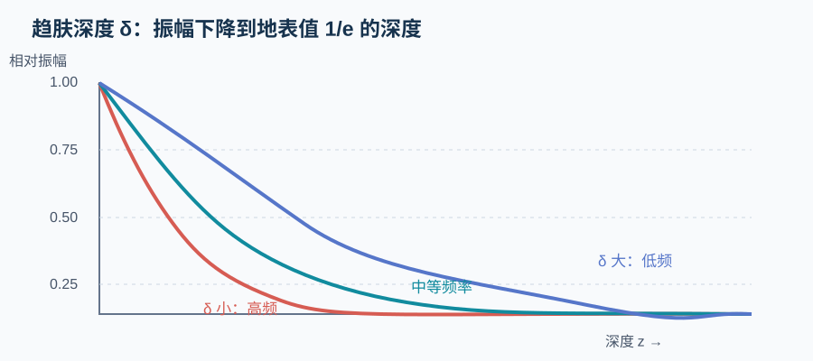
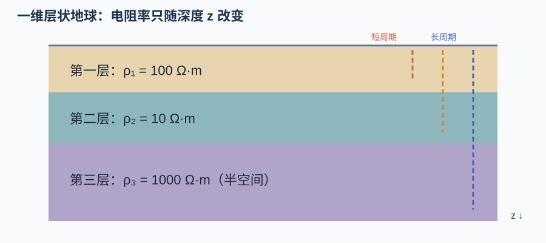



上一篇我们从麦克斯韦方程出发，求出了均匀半空间里的电场解 $E_x(z)=Ae^{-kz}$。本篇我们要做两件直接面向实际勘探的事：第一，由电场算出磁场，看看为什么两者之比（阻抗）能消除天然场源强弱起伏的干扰，并顺理成章推导出 $45^\circ$ 相位、视电阻率和趋肤深度；第二，走出理想均匀半空间，推导多层水平地层的阻抗递推公式，弄明白为什么要从地下最深处一步步往地表算。

## 本篇路线图
- [3.1 阻抗、45° 相位和趋肤深度，终于有了来历](#sec-02d-impedance)
- [3.2 地下有好几层，为什么要从下往上计算阻抗？](#sec-02e-layers)

---

## 3.1 阻抗、45° 相位和趋肤深度，终于有了来历

回顾上一篇得到的均匀半空间物理解：

$$
E_x(z)=Ae^{-kz},
$$

其中 $E_x(z)$ 是固定角频率 $\omega$ 下的电场复振幅，$k=\sqrt{i\omega\mu_0\sigma}$ 是复传播常数。现在我们把磁场 $H_y(z)$ 也算出来，看看电场与磁场之比如何把地下岩石的电阻率信息分离出来。

### 一、为什么测了电场还要同步测磁场？

天然电磁场源（如雷电活动与磁层电流体系）时刻都在剧烈起伏。今天太阳风强一点，地表测到的电场和磁场可能同时放大十倍；明天平静一些，两者又同时缩小。如果只盯着电场幅值有多大，你根本分不清“信号变强是因为天上的场源变强了”，还是“脚下的岩石电阻率变了”。

在理想平面波入射下，同一频率的电场和磁场会按相同比例随场源强弱缩放。因此，只要把**电场复振幅除以磁场复振幅**，场源强弱的公共系数就会在分子分母中约掉，留下来的纯粹是地下介质对电磁场的响应特性。

我们把这个复数比值定义为波阻抗（一维情形下的 $xy$ 分量）：

$$
\boxed{Z_{xy}=\frac{E_x}{H_y}}.
$$

因为分子和分母都是复数，阻抗 $Z_{xy}$ 也是一个复数，既有模长 $|Z_{xy}|$，也有相位 $\phi=\arg Z_{xy}$。

### 二、由电场反算磁场

回到一维法拉第电磁感应方程：

$$
\frac{dE_x}{dz}=-i\omega\mu_0 H_y.
$$

两边同时除以 $-i\omega\mu_0$，把 $H_y$ 单独解出来：

$$
H_y=-\frac{1}{i\omega\mu_0}\frac{dE_x}{dz}.
$$

代入半空间指数解 $E_x(z)=Ae^{-kz}$（上一篇自检题已算过 $\frac{dE_x}{dz}=-kE_x$）：

$$
H_y=-\frac{1}{i\omega\mu_0}(-kE_x)=\frac{k}{i\omega\mu_0}E_x.
$$

两个负号抵消了。这个式子表明，在均匀半空间内部任意深度，磁场和电场之间都保持着固定的复数比例关系。

### 三、把电场除以磁场，推导出阻抗公式

将刚刚算出的 $H_y$ 代入阻抗定义 $Z_{xy}=E_x/H_y$：

$$
Z_{xy}=\frac{E_x}{\dfrac{k}{i\omega\mu_0}E_x}.
$$

分子分母约去公共的 $E_x$，再记住“除以一个分数等于乘以它的倒数”，得到

$$
Z_{xy}=\frac{i\omega\mu_0}{k}.
$$

把传播常数 $k=\sqrt{i\omega\mu_0\sigma}$ 代入分母：

$$
Z_{xy}=\frac{i\omega\mu_0}{\sqrt{i\omega\mu_0\sigma}}.
$$

利用代数恒等式 $\frac{a}{\sqrt{a\sigma}}=\sqrt{\frac{a}{\sigma}}$（取与物理衰减分支一致的平方根），化简为

$$
Z_{xy}=\sqrt{\frac{i\omega\mu_0}{\sigma}}.
$$

最后利用电阻率与电导率互为倒数的关系 $\rho=1/\sigma$，就得到了大地电磁学中最核心的公式之一：

$$
\boxed{Z_{xy}=\sqrt{i\omega\mu_0\rho}}.
$$

这个公式不是硬背出来的教条，而是从麦克斯韦方程、半空间衰减解和 $E_x/H_y$ 定义一步步推出来的必然结果。

### 四、为什么均匀半空间的阻抗相位恰好是 $45^\circ$？

第 01 篇我们算过虚数单位的平方根：

$$
i=e^{i\pi/2} \implies \sqrt{i}=e^{i\pi/4}=e^{i45^\circ}.
$$

由于公式里的角频率 $\omega$、真空磁导率 $\mu_0$ 和电阻率 $\rho$ 全都是正实数，它们开平方只会决定复数的**模长**，不会带来任何额外的相位旋转。把根号拆开写成复数的极坐标形式：

$$
Z_{xy}=\sqrt{\omega\mu_0\rho}\cdot\sqrt{i}=\sqrt{\omega\mu_0\rho}\,e^{i\pi/4}.
$$

对照复数标准写法 $Z_{xy}=|Z_{xy}|e^{i\phi}$，模长和相位一目了然：

$$
\boxed{|Z_{xy}|=\sqrt{\omega\mu_0\rho}},\qquad \boxed{\phi=\frac{\pi}{4}=45^\circ}.
$$

**适用条件提醒：** $45^\circ$ 相位成立的前提是**均匀、各向同性、低频导电半空间、$e^{+i\omega t}$ 时间约定以及 $(E_x,H_y)$ 极化**。一旦地下出现多层高低阻变化或二维、三维构造，相位就会随频率偏离 $45^\circ$——恰恰是这些偏离，携带了地下结构随深度变化的信息。

### 五、从阻抗反算视电阻率（附量纲检查）

把模长公式 $|Z_{xy}|=\sqrt{\omega\mu_0\rho}$ 两边同时平方，解出电阻率 $\rho$：

$$
\rho=\frac{|Z_{xy}|^2}{\omega\mu_0}.
$$

如果地下确实是均匀半空间，右边算出来的就是地下岩石的真实电阻率。但真实地球往往由多层不同岩性的地层叠合而成，某一频率测到的阻抗混合了多个深度范围的综合影响；此时我们依然按同一个公式换算，但把结果命名为**视电阻率** $\rho_a$（下标 $a$ 取自 apparent，意为“表观的”）：

$$
\boxed{\rho_a=\frac{|Z|^2}{\omega\mu_0}}.
$$

**务必区分视电阻率 $\rho_a$ 与真实电阻率 $\rho$：** 视电阻率只是把观测阻抗换算成电阻率量纲后的一条响应曲线，并不是一张已经解好的地下分层报告。

#### 顺手做一次量纲（单位）检查

推导了一整页公式，怎么快速检查有没有漏乘或除反参数？算一遍单位往往比重新推导还快：
- 阻抗 $Z=E/H$ 的单位是 $\dfrac{\mathrm{V/m}}{\mathrm{A/m}}=\dfrac{\mathrm V}{\mathrm A}=\Omega$（欧姆）；
- 角频率 $\omega$ 的单位是 $\mathrm{s^{-1}}$，真空磁导率 $\mu_0$ 的单位可写作 $\Omega\cdot\mathrm{s/m}$，两者相乘的单位为 $[\omega\mu_0]=\Omega/\mathrm m$；
- 代入视电阻率公式：
  $$
  \left[\frac{|Z|^2}{\omega\mu_0}\right]=\frac{\Omega^2}{\Omega/\mathrm m}=\Omega\cdot\mathrm m,
  $$
  恰好就是电阻率的标准单位。

### 六、从复传播常数得到趋肤深度

回头再看复传播常数 $k=\sqrt{i\omega\mu_0\sigma}$。利用 $\sqrt{i}=\frac{1+i}{\sqrt{2}}$，把它拆成实部和虚部：

$$
k=\frac{1+i}{\sqrt{2}}\sqrt{\omega\mu_0\sigma}=(1+i)\sqrt{\frac{\omega\mu_0\sigma}{2}}.
$$

令正实数 $\alpha=\sqrt{\dfrac{\omega\mu_0\sigma}{2}}$，则 $k=\alpha+i\alpha$，半空间电场写成

$$
E_x(z)=Ae^{-kz}=Ae^{-\alpha z}e^{-i\alpha z}.
$$

其中实指数 $e^{-\alpha z}$ 控制振幅随深度的衰减。当深度 $z$ 增大到使 $\alpha z=1$ 时，电场振幅衰减为地表振幅的 $1/e\approx 36.8\%$。我们把这个特征衰减深度定义为**趋肤深度** $\delta$：

$$
\delta=\frac{1}{\alpha}=\sqrt{\frac{2}{\omega\mu_0\sigma}}=\sqrt{\frac{2\rho}{\omega\mu_0}}.
$$

代入 $\omega=2\pi f$ 和真空磁导率数值 $\mu_0=4\pi\times 10^{-7}\,\mathrm{H/m}$，就得到野外最常用的速算公式：

$$
\boxed{\delta\approx 503\sqrt{\frac{\rho}{f}}\ \mathrm m}.
$$

公式中电阻率 $\rho$ 单位为 $\Omega\cdot\mathrm m$，频率 $f$ 单位为 $\mathrm{Hz}$。例如在 $\rho=100\,\Omega\cdot\mathrm m$ 的岩石中：
- 当频率 $f=1\,\mathrm{Hz}$ 时，趋肤深度 $\delta\approx 503\times\sqrt{100/1}=5030\,\mathrm m\approx 5.03\,\mathrm{km}$；
- 当频率降到 $f=0.01\,\mathrm{Hz}$（即周期 $100\,\mathrm s$）时，趋肤深度增大到约 $50.3\,\mathrm{km}$。

注意，趋肤深度只是均匀半空间场振幅衰减的特征尺度，不是仪器探测能力的“一刀切截止线”；深部结构最终能否被分辨，还取决于观测频带宽度、噪声水平和地层电性对比。

### 七、为什么野外必须测量一系列不同频率？

由 $\delta\propto 1/\sqrt{f}$ 可以看出：频率越高（周期越短），电磁波衰减越快，主要反映浅部地层信息；频率越低（周期越长），电磁波穿透越深，能够携带更深部岩石的电性信息。因此，大地电磁测深必须跨多个数量级测量一系列频率，画出 $\rho_a(f)$ 和 $\phi(f)$ 随周期变化的曲线（称为测深曲线），才能实现从浅到深的“测深”。

### 自我小测

**1.** 若某频率的阻抗模长 $|Z|$ 增大为原来的 $2$ 倍，其他条件不变，视电阻率 $\rho_a$ 会变成原来的多少倍？  
**答：** $4$ 倍，因为 $\rho_a=|Z|^2/(\omega\mu_0)$ 与 $|Z|^2$ 成正比。

**2.** 在均匀半空间中，若观测频率降为原来的四分之一，趋肤深度 $\delta$ 变为原来的多少倍？  
**答：** $2$ 倍，因为 $\delta\propto 1/\sqrt{f}$。

**3.** 为什么不能把均匀半空间的 $45^\circ$ 相位当成“所有 MT 数据的标准答案”？  
**答：** $45^\circ$ 相位只在均匀各向同性半空间等理想假设下成立；地下一旦存在分层或横向构造变化，相位就会随频率偏离 $45^\circ$。

---

均匀半空间的公式虽然干净漂亮，但真实地球更像一块层层叠叠的千层糕。下一节我们把单一半空间推广到多层水平地层，推导层状地球的阻抗递推公式。

[继续阅读：3.2 地下有好几层，为什么要从下往上计算阻抗？](#sec-02e-layers)

---

## 3.2 地下有好几层，为什么要从下往上计算阻抗？

现实中的地下很少是上下均一的整块岩石：地表可能是松散低阻的沉积层，中间是致密高阻的结晶基底，更深处又可能出现含流体或部分熔融的低阻层。当电阻率随深度呈阶梯状分层变化时，地表的阻抗该如何计算？

这一节的最终递推公式看起来略长，但只要顺着“每层通解 $\to$ 界面连续 $\to$ 消去待定系数”三步走，每一步都是初中到高中的代数变形。

### 一、先弄清“一维分层”的几何模型

把地下想象成一块水平铺展的千层蛋糕：在同一个深度上，水平向北、向东电性完全一致；但随着深度 $z$ 往下走，岩石分成若干水平层。以三层模型为例：
- 第 1 层（表层）：厚度 $h_1$，电阻率 $\rho_1$；
- 第 2 层（中间层）：厚度 $h_2$，电阻率 $\rho_2$；
- 第 3 层（基底）：向下无限延伸，电阻率 $\rho_3$。

这里的“一维”指地下电阻率只随深度 $z$ 一个坐标变化（$\rho=\rho(z)$），并不代表电磁场只有一个分量。我们先固定一个角频率 $\omega$，在每一层内部各自求解方程。

### 二、有限厚度的地层里，为什么不能只留一个指数项？

在向下无限延伸的均匀半空间中，因为深部没有反射界面，我们舍去了随深度增大的 $e^{+kz}$ 项。但对于中间厚度有限的第 $j$ 层，它既有顶界面 $z=z_j$，又有底界面 $z=z_{j+1}=z_j+h_j$，电磁场在上下界面之间来回反射叠加，因此**两个指数项都必须保留**。

为了书写方便，我们用 $z-z_j$ 表示从第 $j$ 层顶面往下算起的局部深度，第 $j$ 层内的电场通解写作

$$
E_j(z)=A_j e^{-k_j(z-z_j)}+B_j e^{k_j(z-z_j)},
$$

其中 $k_j=\sqrt{i\omega\mu_0\sigma_j}$ 是第 $j$ 层的复传播常数（$\sigma_j=1/\rho_j$），$A_j,B_j$ 是该层内待定的两个复数系数。

### 三、层与层交界处，哪些物理量必须连续？

在没有外加面电流的水平岩层分界面 $z=z_{j+1}$ 上，电磁学边界条件要求**切向电场**与**切向磁场强度**必须连续，不能发生突变跳跃：

$$
E_j(z_{j+1})=E_{j+1}(z_{j+1}),\qquad H_j(z_{j+1})=H_{j+1}(z_{j+1}).
$$

两式相除，立刻得到一个极其关键的推论——**波阻抗 $Z=E/H$ 跨过水平地层界面时也是连续的**：

$$
Z_j(z_{j+1})=Z_{j+1}(z_{j+1}).
$$

也就是说，第 $j$ 层底部的阻抗，严格等于第 $j+1$ 层顶部的输入阻抗。正是这条连续性，把所有地层首尾相接串成了一条递推链。

### 四、求出第 $j$ 层的磁场与阻抗表达式

利用一维麦克斯韦关系 $H_j=-\dfrac{1}{i\omega\mu_0}\dfrac{dE_j}{dz}$，对第 $j$ 层的电场通解求导（注意 $e^{-k_j(z-z_j)}$ 求导带出 $-k_j$，而 $e^{+k_j(z-z_j)}$ 求导带出 $+k_j$）：

$$
H_j(z)=\frac{k_j}{i\omega\mu_0}\left[A_j e^{-k_j(z-z_j)}-B_j e^{k_j(z-z_j)}\right].
$$

引入第 $j$ 层材料自身的**本征阻抗** $\eta_j$（即假设整块地球都是第 $j$ 层材料时的半空间阻抗）：

$$
\eta_j=\frac{i\omega\mu_0}{k_j}=\sqrt{i\omega\mu_0\rho_j}.
$$

于是第 $j$ 层的磁场和任意深度处的波阻抗 $Z_j(z)=E_j(z)/H_j(z)$ 分别为

$$
H_j(z)=\frac{1}{\eta_j}\left[A_j e^{-k_j(z-z_j)}-B_j e^{k_j(z-z_j)}\right],
$$

$$
Z_j(z)=\eta_j\frac{A_j e^{-k_j(z-z_j)}+B_j e^{k_j(z-z_j)}}{A_j e^{-k_j(z-z_j)}-B_j e^{k_j(z-z_j)}}.
$$

### 五、换用局部坐标，把底界面阻抗 $Z_b$ 与顶界面阻抗 $Z_t$ 联系起来

为了看清单个岩层内部“顶”和“底”的关系，暂时省去层号下标 $j$，令局部深度 $s=z-z_j$（顶面 $s=0$，底面 $s=h$）：

$$
Z(s)=\eta\frac{Ae^{-ks}+Be^{ks}}{Ae^{-ks}-Be^{ks}}.
$$

1. **先看底面 $s=h$**：记底面处的输入阻抗为 $Z_b=Z(h)$，代入 $s=h$ 并令系数比值 $r=B/A$（分子分母同除 $Ae^{-kh}$）：
   $$
   \frac{Z_b}{\eta}=\frac{1+re^{2kh}}{1-re^{2kh}}.
   $$
   记 $q=re^{2kh}$，交叉相乘解出 $q$：
   $$
   Z_b(1-q)=\eta(1+q) \implies Z_b-\eta=(Z_b+\eta)q \implies q=\frac{Z_b-\eta}{Z_b+\eta}.
   $$
   代回 $q=re^{2kh}$，就用底面阻抗 $Z_b$ 表出了待定系数比值 $r$：
   $$
   r=\frac{B}{A}=\frac{Z_b-\eta}{Z_b+\eta}e^{-2kh}.
   $$

2. **再看顶面 $s=0$**：记顶面处的输入阻抗为 $Z_t=Z(0)$，代入 $s=0$（此时 $e^0=1$）：
   $$
   Z_t=\eta\frac{A+B}{A-B}=\eta\frac{1+r}{1-r}.
   $$
   把刚才解出的 $r$ 代进去：
   $$
   \boxed{Z_t=\eta\frac{1+\dfrac{Z_b-\eta}{Z_b+\eta}e^{-2kh}}{1-\dfrac{Z_b-\eta}{Z_b+\eta}e^{-2kh}}}.
   $$

### 六、整理成双曲正切形式的递推公式

利用双曲正切函数的定义 $\tanh x=\dfrac{e^x-e^{-x}}{e^x+e^{-x}}$，把上面分式的分子分母同乘 $(Z_b+\eta)e^{kh}$ 并合并同类项，就能化简为地球物理文献中最常见的紧凑形式（恢复层号下标 $j$，$Z_t \to Z_j$，$Z_b \to Z_{j+1}$）：

$$
\boxed{Z_j=\eta_j\frac{Z_{j+1}+\eta_j\tanh(k_jh_j)}{\eta_j+Z_{j+1}\tanh(k_jh_j)}}.
$$

式子里的每一个符号都很清楚：
- $\eta_j=\sqrt{i\omega\mu_0\rho_j}$：第 $j$ 层自身的本征阻抗；
- $k_j=\sqrt{i\omega\mu_0/\rho_j}$：第 $j$ 层的复传播常数，$h_j$ 为第 $j$ 层厚度；
- $Z_{j+1}$：第 $j$ 层底面（即第 $j+1$ 层顶面）的输入阻抗；
- $Z_j$：算出来的第 $j$ 层顶面的输入阻抗。

### 七、为什么偏偏要从地下最深处一步步往上算？

假设地下共有 $N$ 层，最底下的第 $N$ 层是向下无限延伸的均匀半空间。因为无限深处再也没有反射界面，第 $N$ 层内部只有向下衰减波，所以它顶面的输入阻抗直接等于自身的本征阻抗：

$$
Z_N=\eta_N=\sqrt{i\omega\mu_0\rho_N}.
$$

这就是整条递推链的**唯一起点**！拿到 $Z_N$ 后，代入第 $N-1$ 层的厚度 $h_{N-1}$ 和电阻率 $\rho_{N-1}$，就能算出 $Z_{N-1}$；接着一层层往上递推，直到算出地表 $z=0$ 处的阻抗 $Z_1$：

$$
Z_N \longrightarrow Z_{N-1} \longrightarrow \cdots \longrightarrow Z_2 \longrightarrow Z_1.
$$

在**正演计算**中，我们是预先给定地下每一层的厚度和电阻率，从最底层半空间出发自下而上递推，最终算出一系列频率下的地表视电阻率 $\rho_a(f)=|Z_1|^2/(\omega\mu_0)$ 和相位 $\phi(f)=\arg Z_1$，再拿去和野外实测曲线对比。

### 八、用两个极端情况检验公式是否靠谱

任何复杂的物理公式，都可以用两个极端情况快速检验它有没有写错：

1. **当本层厚度趋近于零（$h_j\to 0$）**：  
   此时 $\tanh(k_jh_j)\to 0$，递推公式退化为
   $$
   Z_j \to \eta_j\frac{Z_{j+1}+0}{\eta_j+0}=Z_{j+1}.
   $$
   物理上非常合理：一层厚度为零的“空气薄片”不会改变下方传上来的阻抗。

2. **当本层非常厚（$\operatorname{Re}(k_jh_j)\gg 1$，即远大于趋肤深度）**：  
   此时 $\tanh(k_jh_j)\to 1$，递推公式退化为
   $$
   Z_j \to \eta_j\frac{Z_{j+1}+\eta_j}{\eta_j+Z_{j+1}}=\eta_j.
   $$
   物理上同样合理：当这一层厚到电磁波根本穿透不过去时，下面的地层再怎么变化也影响不到顶面，地表测到的就是这一层自己的本征阻抗。

### 自我小测

**1.** 为什么在厚度有限的中间地层里，不能像均匀半空间那样直接把 $B_j$ 设为零？  
**答：** 中间地层同时存在顶、底两个界面，电磁场在界面处发生反射叠加，必须同时保留 $e^{-k_j(z-z_j)}$ 和 $e^{+k_j(z-z_j)}$ 两项，才能同时满足上下界面的切向场连续条件。

**2.** 递推公式里的 $Z_{j+1}$ 是第 $j+1$ 层的“本征阻抗”吗？  
**答：** 不是。$Z_{j+1}$ 是第 $j+1$ 层及其以下所有地层共同作用在第 $j+1$ 层顶面产生的**等效输入阻抗**；只有最底层的无限半空间才满足 $Z_N=\eta_N$。

**3.** 为什么 $h_j\to 0$ 时 $Z_j\to Z_{j+1}$ 是一个重要的自检？  
**答：** 它验证了当某一层厚度趋近于零时，递推公式不会凭空制造出虚假的物理响应，保证了层界面连续性。

---

到这里，一维水平层状地球的解析正演已经全部打通。可一旦地下出现倾斜断层、起伏盆地或局部三维矿体，解析公式就无能为力了。下一篇我们开启第二阶段，学习如何用有限差分法把连续的地下切成网格，让计算机替我们求解复杂介质中的电磁场。

[继续阅读：04｜有限差分基础：从网格、三点差分到稀疏矩阵](/posts/2026/10/mt-course-03a-numerical-grid/) · [返回总目录](/posts/2026/10/mt-course/)
