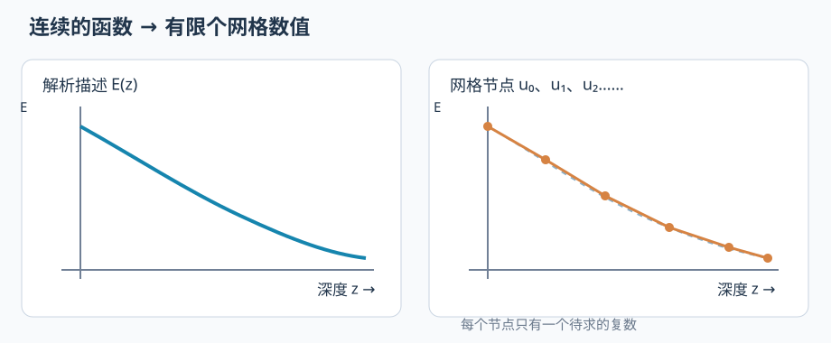
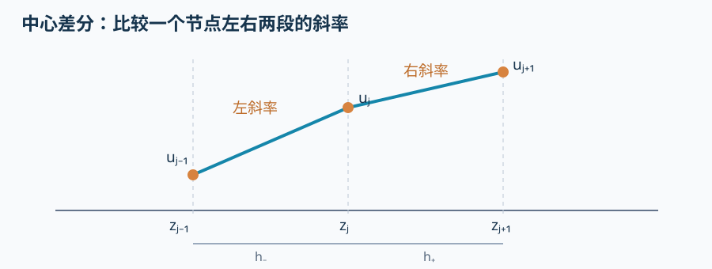
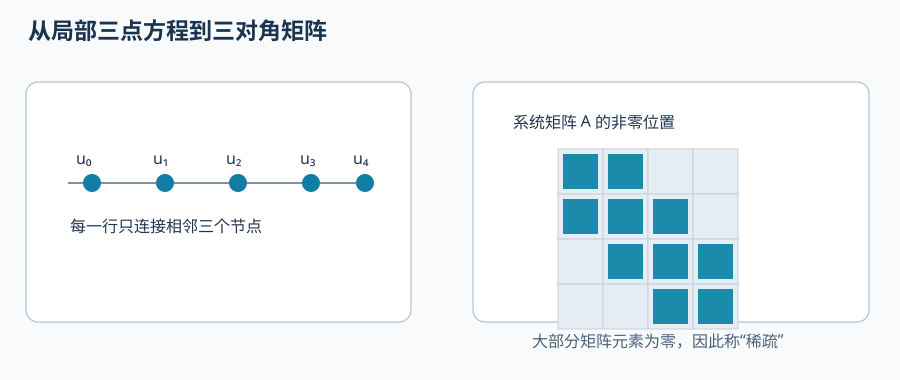



前面学过的一维解析正演，只要给定每层的厚度和电阻率，就能自下而上递推出地表阻抗。但真实地下常常出现弯曲地层、横向断层或者局部异常体，这时指数解析式就很难直接拼出答案了。我们需要另一套通用方法——**有限差分法（FDM）**：把连续的地下切成有限个网格节点，把微积分方程改写成代数方程组，交给计算机求解。本篇不预设线性代数或泰勒展开基础，从一条连续曲线和一张数值表一步步推到矩阵方程 $\mathbf A\mathbf u=\mathbf b$。

## 本篇路线图
- [4.1 为什么把连续的地下切成网格？](#sec-03a-grid)
- [4.2 为什么三个节点能够近似二阶导数？](#sec-03b-differences)
- [4.3 网格不等间距怎么办：从左右斜率到电磁方程](#sec-03c-nonuniform)
- [4.4 矩阵是什么：从两条方程到电磁场数值解](#sec-03d-matrix)

---

## 4.1 为什么把连续的地下切成网格？

当地下结构变得复杂时，计算机可以帮我们算出电磁场响应，但首先得解决一个根本矛盾：**地下电场 $E_x(z)$ 是定义在连续深度上的光滑函数，而计算机内存只能存下有限个数字。** 怎么在两者之间搭起桥梁？

### 一、把一条连续曲线变成一张数值表

设想地表以下有一条电场分布曲线 $E_x(z)$。理论上我们可以追问任意深度的电场，比如 $z=1.234567\,\mathrm m$ 处的值，但计算机不可能把无穷多个深度全记下来。

退一步，我们只沿深度挑选一串固定位置，例如每隔 $100\,\mathrm m$ 设一个点：

| 深度 $z$ | 0 m | 100 m | 200 m | 300 m |
|---|---:|---:|---:|---:|
| 电场 $E_x$ | $u_0$ | $u_1$ | $u_2$ | $u_3$ |

这里的 $u_0,u_1,u_2,\dots$ 就是这些选定深度处的电场复振幅（暂时未知，等会儿求解）。我们把选定的位置叫作**网格节点**，把相邻节点之间的距离叫作**网格间距**。

原本我们要找的是一整条连续函数，现在转化成了先求出有限个节点上的数字 $u_j$，需要时再用插值估计节点之间的数值——这就是**离散化**最直观的意思。（示意图里把节点连成折线只是为了看清轮廓，有限差分真正起作用的是用邻近节点近似导数。）

### 二、网格切得越细，结果就一定越好吗？

假设地下某处夹着一层很薄的低阻带，电场在它附近剧烈弯曲，而在上下厚层里变化平缓。如果节点间距足有 $100\,\mathrm m$，四个节点恰好全落在平缓区，就会把薄层的影响漏掉。

把网格间距从 $100\,\mathrm m$ 加密到 $10\,\mathrm m$，确实能更细致地捕捉局部变化，但代价也很直接：节点总数增加约十倍，计算机要联立求解的未知数和内存开销随之成倍上升。

**加密网格是用计算成本换取更高的空间分辨率。** 但它并不能单枪匹马保证得到精确答案——如果边界截断太浅、地表求导太粗糙，或者线性求解器收敛不够，单靠加密内部网格依然会留下误差。

### 三、差分的真正任务是替代微积分导数

回忆导数的定义：

$$
E_x'(z)=\lim_{\Delta z\to 0}\frac{E_x(z+\Delta z)-E_x(z)}{\Delta z}.
$$

在离散网格上，我们只知道相邻节点 $u_j$ 和 $u_{j+1}$ 的值，没法真的取无穷小的 $\Delta z$，但可以用有限间距 $h$ 算出相邻两点间的平均斜率来近似：

$$
E_x'(z_j)\approx \frac{u_{j+1}-u_j}{h}.
$$

**有限差分法的核心思想，就是用邻近节点上的代数加减乘除，去近似代替微分方程里的导数运算。** 举个例子，如果两个节点相距 $2\,\mathrm m$，电场值分别为 $5$ 和 $3$，那么这段区间上的平均变化率就是

$$
\frac{3-5}{2}=-1.
$$

不需要引入任何新定理，本质就是“变化量除以距离”。

### 四、核心控制方程依然没有变

在每一块均匀、各向同性的导电介质内部，低频单频电场依然服从我们第 02 篇推导过的一维控制方程：

$$
\frac{d^2E_x}{dz^2}-i\omega\mu_0\sigma E_x=0.
$$

其中 $i^2=-1$，$\omega$ 为角频率，$\mu_0$ 为真空磁导率，$\sigma$ 为电导率，时间约定统一采用 $e^{+i\omega t}$。

正演计算的任务很明确：给定地下各处的电导率 $\sigma$、频率 $\omega$ 以及上下边界条件，先求出每个网格节点上的复电场 $u_j$，再算出地表磁场和阻抗。由于方程里出现的是**二阶导数** $\dfrac{d^2E_x}{dz^2}$，下一步我们就得学会用三个相邻节点来近似二阶导数。

### 自我小测

**1.** 节点深度依次为 $z=0,5,10,15\,\mathrm m$，相邻网格间距是多少？  
**答：** $5\,\mathrm m$。

**2.** 深度 $10\,\mathrm m$ 和 $15\,\mathrm m$ 处的电场分别为 $9$ 与 $4$，这段区间的平均变化率是多少？  
**答：** $(4-9)/5=-1$（单位为电场单位每米）。

**3.** 如果把网格间距缩小十倍，能否断言数值解的误差一定严格缩小十倍？  
**答：** 不能。误差随网格缩放的比例取决于差分格式本身的收敛阶数，以及边界条件、地表求导等其他误差项是否占主导。

---

知道了网格节点怎样替代连续曲线，接下来我们就用左右两段斜率的差值，亲手推导出离散二阶导数的三点中心差分公式，并用泰勒展开看看它的误差到底有多小。

[继续阅读：4.2 为什么三个节点能够近似二阶导数？](#sec-03b-differences)

---

## 4.2 为什么三个节点能够近似二阶导数？

上一节我们用两个节点算出了平均斜率（一阶导数），可控制方程里需要的是**二阶导数** $\dfrac{d^2E_x}{dz^2}$。为什么恰恰需要三个节点才能算出二阶导数？我们先不碰电磁方程，拿一个普通函数 $u(z)$ 算一遍。

### 一、二阶导数就是“斜率的变化率”

沿着深度取三个等间距节点 $z_{j-1},\,z_j,\,z_{j+1}$，相邻距离均为 $h$，对应的函数值记为 $u_{j-1},\,u_j,\,u_{j+1}$。

我们可以分别算出节点 $z_j$ 左侧一小段和右侧一小段的平均斜率：
- 左段平均斜率：$s_L=\dfrac{u_j-u_{j-1}}{h}$；
- 右段平均斜率：$s_R=\dfrac{u_{j+1}-u_j}{h}$。

想想看：如果右段斜率 $s_R$ 比左段斜率 $s_L$ 更大，说明曲线正在往上翘，二阶导数为正；如果 $s_R$ 比 $s_L$ 更小，说明曲线往下弯，二阶导数为负。左段中点与右段中点恰好相距一个步长 $h$，因此用“右斜率减左斜率再除以 $h$”，就得到了 $z_j$ 处的二阶导数近似：

$$
u''(z_j)\approx\frac{s_R-s_L}{h}
=\frac{1}{h}\left[\frac{u_{j+1}-u_j}{h}-\frac{u_j-u_{j-1}}{h}\right].
$$

把括号里的两个分式合并：

$$
\boxed{u''(z_j)\approx\frac{u_{j-1}-2u_j+u_{j+1}}{h^2}}.
$$

中间为什么出现 $-2u_j$？因为右斜率里有一个 $-u_j$，减去左斜率时又冒出一个 $-u_j$，合起来正好是 $-2u_j$。明白这个来历，就再也不用死记硬背系数了。

### 二、拿抛物线代数字验证一遍

取最熟悉的抛物线 $u(z)=z^2$，选节点 $z=1,2,3$（间距 $h=1$），函数值分别为 $u_{j-1}=1$、$u_j=4$、$u_{j+1}=9$。代入三点差分公式：

$$
\frac{1-2\times 4+9}{1^2}=2.
$$

而微积分告诉我们 $\dfrac{d^2(z^2)}{dz^2}=2$，两者分毫不差！（二次函数之所以精确成立，是因为它的三阶及以上导数全为零；对于一般曲线，三点差分会留下微小的截断误差。）

### 三、泰勒展开在表达什么？

要看清三点差分的误差有多大，得请出微积分里的**泰勒展开**。它的直觉很朴素：如果你站在 $z$ 点，不仅知道当前高度 $u(z)$，还知道坡度 $u'(z)$、弯曲程度 $u''(z)$ 以及更高阶的变化率，就能一层层修正，预测出旁边 $z+h$ 处的函数值：

$$
u(z+h)=u(z)+hu'(z)+\frac{h^2}{2}u''(z)+\frac{h^3}{6}u'''(z)+\frac{h^4}{24}u^{(4)}(z)+\cdots,
$$

其中分母 $2,6,24$ 分别来自阶乘 $2!,3!,4!$。如果往反方向走同样的距离 $h$，只需把上面式子里的 $h$ 换成 $-h$（奇数次幂变号，偶数次幂不变）：

$$
u(z-h)=u(z)-hu'(z)+\frac{h^2}{2}u''(z)-\frac{h^3}{6}u'''(z)+\frac{h^4}{24}u^{(4)}(z)-\cdots.
$$

现在把这两条式子左右相加——奇妙的事情发生了：所有奇数次项（$hu'$、$\frac{h^3}{6}u'''$ 等）一正一负全部抵消！

$$
u(z+h)+u(z-h)=2u(z)+h^2u''(z)+\frac{h^4}{12}u^{(4)}(z)+\cdots.
$$

把 $2u(z)$ 移到左边，再整体除以 $h^2$：

$$
\frac{u(z-h)-2u(z)+u(z+h)}{h^2}=u''(z)+\frac{h^2}{12}u^{(4)}(z)+\cdots.
$$

这说明三点中心差分与真实二阶导数之间的差值（截断误差），首要项与 $h^2$ 成正比。我们称这种格式具有**二阶精度**。

### 四、$O(h^2)$ 究竟是什么意思？

在数值计算中，二阶精度记作

$$
\text{误差}=O(h^2).
$$

大写 $O$ 读作“大 O 记号”，意思是当网格间距 $h$ 足够小、且函数本身足够光滑时，截断误差主要受 $Ch^2$（$C$ 为常数）控制。如果误差确实由这一项主导，那么把网格间距 $h$ 缩小一半，误差大约会变成原来的

$$
\frac{C(h/2)^2}{Ch^2}=\frac{1}{4}.
$$

不过有两个前提条件不能忽略：一是网格已经加密到进入收敛区间，二是没有其他更粗糙的环节拖后腿（例如边界条件或地表一阶求导）。

### 五、顺便对比一阶导数的两种差分写法

估算**一阶导数** $u'(z)$ 时，常见两种写法：
- **前向差分**（只用当前点和右边一点）：$u'(z)\approx\dfrac{u(z+h)-u(z)}{h}$，只有一阶精度 $O(h)$；
- **中心差分**（左右各取一点）：$u'(z)\approx\dfrac{u(z+h)-u(z-h)}{2h}$，由于泰勒展开中 $h^2$ 项抵消，具有二阶精度 $O(h^2)$。

到了地表 $z=0$ 处，地表面上方并没有地下离散网格的对称节点，因此不能直接套用中心差分，而需要使用单侧二阶差分公式（下一篇第 5.1 节会专门推导）。

### 六、什么时候不能直接套用等间距公式？

刚才的公式默认左右步长完全相等。但在实际 MT 数值模拟中，浅部地层电磁场衰减极快，我们需要把网格切得很密；深部场变化平缓，网格则逐渐拉宽。一旦相邻网格间距不相等，就不能原封不动套用同一个 $h^2$ 了。

### 自我小测

**1.** 三个等间距节点间距 $h=2$，函数值依次为 $2,\,3,\,6$，求中间节点的二阶差分近似。  
**答：** $(2-2\times 3+6)/2^2=2/4=0.5$。

**2.** 如果左右两段斜率都是 $4$，中间节点的二阶差分是多少？  
**答：** $0$，因为斜率没有发生变化。

**3.** 若二阶差分误差主要由 $Ch^2$ 主导，把网格间距 $h$ 缩小为原来的三分之一，误差大约缩小为原来的几分之几？  
**答：** $(1/3)^2=1/9$（九分之一）。

---

等间距三点公式已经很顺手了，可实际建模为了兼顾精度与速度，几乎都会采用“浅密深疏”的非均匀网格。下一节我们就用同样的“左右斜率相减”法，推导出任意不等间距网格上的差分方程。

[继续阅读：4.3 网格不等间距怎么办：从左右斜率到电磁方程](#sec-03c-nonuniform)

---

## 4.3 网格不等间距怎么办：从左右斜率到电磁方程

数值网格可以采用不等间距设计：在电磁场变化剧烈的浅部和电性界面附近把网格加密，在深部或远离异常体的区域逐渐放粗，从而用更少的节点换取更高的计算效率。这一节我们把上一节的“左右斜率相减”推广到左右步长不相等的情形。

### 一、让左边和右边拥有不同的间距

设节点 $z_j$ 左侧网格宽度为 $h_-=z_j-z_{j-1}$，右侧网格宽度为 $h_+=z_{j+1}-z_j$（两者都是正数，例如左边 $2\,\mathrm m$、右边 $5\,\mathrm m$）。

左右两段的平均斜率分别写成：

$$
s_L=\frac{u_j-u_{j-1}}{h_-},\qquad s_R=\frac{u_{j+1}-u_j}{h_+}.
$$

左段斜率代表左段中点 $z_j-h_-/2$ 处的导数，右段斜率代表右段中点 $z_j+h_+/2$ 处的导数。两个中点之间的距离为

$$
\frac{h_-}{2}+\frac{h_+}{2}=\frac{h_-+h_+}{2}.
$$

用“右斜率减左斜率，再除以两个中点的距离”，就得到了非均匀网格上的二阶导数近似：

$$
u''(z_j)\approx\frac{s_R-s_L}{(h_-+h_+)/2}
=\boxed{\frac{2}{h_-+h_+}\left(\frac{u_{j+1}-u_j}{h_+}-\frac{u_j-u_{j-1}}{h_-}\right)}.
$$

令 $h_-=h_+=h$ 检查一下，分母变成 $2h$ 与分子上的 $2$ 约掉，立刻退化回熟悉的 $\dfrac{u_{j-1}-2u_j+u_{j+1}}{h^2}$。

### 二、非均匀网格的精度细节

需要留意的是，在任意剧烈跳变的非均匀网格上，三点公式的局部截断误差可能包含与 $(h_+-h_-)$ 成正比的一阶项；只有当网格宽度平滑渐变（例如相邻网格按 $1.1$ 倍缓慢递增）时，整体收敛性才能接近二阶。此外，在电导率突变的岩层分界面处，场的一阶导数可能出现折角，专业正演程序通常会结合界面通量连续条件来构造离散格式。

### 三、节点上的电导率 $\sigma_j$ 怎么取值？

当节点 $z_j$ 恰好落在两种岩石的交界处，左右两侧电导率分别为 $\sigma_-$ 和 $\sigma_+$、宽度分别为 $h_-$ 和 $h_+$ 时，节点方程里该填哪个 $\sigma_j$？

一种直观的演示是按长度做算术加权平均。例如 $\sigma_-=1\,\mathrm{S/m}$（宽 $2\,\mathrm m$）、$\sigma_+=3\,\mathrm{S/m}$（宽 $5\,\mathrm m$）时：

$$
\bar\sigma=\frac{2\times 1+5\times 3}{2+5}=\frac{17}{7}\ \mathrm{S/m}.
$$

这里提醒一点：算术加权平均是理解网格系数的入门示例；在真实的二维、三维电磁有限差分中，跨越电导率突变界面时，依据连续性方程推导出的保守离散格式往往会用到调和平均（对电阻率加权平均），具体形式取决于电场和磁场分量在网格上的排布方式。

### 四、把一维电磁控制方程写到每个节点上

将非均匀二阶差分公式代入一维控制方程 $\dfrac{d^2E_x}{dz^2}-i\omega\mu_0\sigma E_x=0$（记 $u_j=E_x(z_j)$）：

$$
\frac{2}{h_-+h_+}\left(\frac{u_{j+1}-u_j}{h_+}-\frac{u_j-u_{j-1}}{h_-}\right)-i\omega\mu_0\sigma_j u_j=0.
$$

按 $u_{j-1}$、$u_j$、$u_{j+1}$ 的顺序整理同类项，得到标准的**三节点递推方程**：

$$
\frac{2}{h_-(h_-+h_+)}u_{j-1}
+\left[-\frac{2}{h_-h_+}-i\omega\mu_0\sigma_j\right]u_j
+\frac{2}{h_+(h_-+h_+)}u_{j+1}=0.
$$

式子里每一个系数都有明确出处：前一项系数来自左斜率，后一项系数来自右斜率，中间括号里则合并了左右斜率的 $-u_j$ 项与控制方程自带的 $-i\omega\mu_0\sigma_j$ 项。

### 五、等间距形式为什么更方便观察结构？

当网格等间距（$h_-=h_+=h$）时，上式两边同乘 $h^2$，并定义无量纲复参数 $q_j=i\omega\mu_0\sigma_j h^2$，方程就变成极其简洁的形式：

$$
\boxed{u_{j-1}-(2+q_j)u_j+u_{j+1}=0}.
$$

原本控制方程是一条关于连续函数 $E_x(z)$ 的微分方程，现在变成了每个内部节点只和自己**左、右两个紧邻节点**发生联系的代数方程。

### 自我小测

已知三个非均匀节点的电量为 $u_{j-1}=1,\,u_j=3,\,u_{j+1}=5$，左侧间距 $h_-=2$，右侧间距 $h_+=4$，用非均匀公式估算 $u''(z_j)$。  
**解：** 先算左右斜率：$s_L=(3-1)/2=1$，$s_R=(5-3)/4=0.5$；再代入公式：
$$
u''(z_j)\approx\frac{2}{2+4}(0.5-1)=\frac{1}{3}\times(-0.5)=-\frac{1}{6}.
$$
结果为负，说明右侧斜率比左侧平缓，曲线向上凸起。

---

单个节点的方程里同时包含 $u_{j-1}$、$u_j$、$u_{j+1}$ 三个未知数，单独一条方程解不出来。把几十上百个节点的方程全部列出来一起联立求解，就自然引出了下一节的主角——矩阵。

[继续阅读：4.4 矩阵是什么：从两条方程到电磁场数值解](#sec-03d-matrix)

---

## 4.4 矩阵是什么：从两条方程到电磁场数值解

上一节我们把每个内部节点的电磁方程写成了

$$
u_{j-1}-(2+q_j)u_j+u_{j+1}=0,\qquad q_j=i\omega\mu_0\sigma_j h^2.
$$

因为每个节点的方程都牵扯到左右邻居，我们必须把所有节点的方程**联立在一起同时求解**。计算机处理联立方程组的标准语言就是**矩阵**。别被名字吓到，矩阵不过是把初中解方程组的系数排成一个整齐的表格。

### 一、从初中二元一次方程组说起

看一个最简单的联立方程组：

$$
\begin{cases}
2x+y=5,\\
x+3y=7.
\end{cases}
$$

用初中代入消元法：由第二式得 $x=7-3y$，代进第一式得 $2(7-3y)+y=5 \implies -5y=-9 \implies y=1.8$，再代回得 $x=1.6$。

如果把方程左边未知数前面的系数单独抽出来排成方阵，未知数排成一列，右边的常数排成一列，就写成了矩阵乘法形式：

$$
\begin{pmatrix}2&1\\1&3\end{pmatrix}
\begin{pmatrix}x\\y\end{pmatrix}
=\begin{pmatrix}5\\7\end{pmatrix}.
$$

### 二、矩阵乘法只是“逐行对应相乘再相加”

检验一下矩阵乘法怎么还原回原方程：
- 拿系数矩阵的第一行 $(2,\,1)$，和未知数列 $(x,\,y)^T$ 对应相乘再相加，得到 $2x+1y=5$；
- 拿第二行 $(1,\,3)$ 同样操作，得到 $1x+3y=7$。

矩阵方程没有发明任何新运算，只是把成百上千条线性方程紧凑地打包成一句简写：

$$
\boxed{\mathbf A\mathbf u=\mathbf b},
$$

其中粗体大写 $\mathbf A$ 是**系数矩阵**，粗体小写 $\mathbf u$ 是**待求未知数向量**，粗体小写 $\mathbf b$ 是由边界条件构成的**已知右端向量**。

### 三、把四个电场节点排成矩阵方程

设想一条只有四个等间距节点 $u_0,u_1,u_2,u_3$ 的简短网格，假设顶边界 $u_0=1$、底边界 $u_3=0$ 已经给定（这里先作为归一化教学示例，下一篇会详细讨论边界条件怎么设才物理合理）。

中间有两个未知节点 $u_1$ 和 $u_2$，分别写出 $j=1$ 和 $j=2$ 的节点方程：

$$
\begin{cases}
u_0-(2+q_1)u_1+u_2=0,\\
u_1-(2+q_2)u_2+u_3=0.
\end{cases}
$$

把已知的边界值 $u_0$ 和 $u_3$ 移到等号右边，未知数留在左边：

$$
\begin{cases}
-(2+q_1)u_1+u_2=-u_0,\\
u_1-(2+q_2)u_2=-u_3.
\end{cases}
$$

写成矩阵形式，立刻得到：

$$
\boxed{
\begin{pmatrix}
-(2+q_1) & 1\\
1 & -(2+q_2)
\end{pmatrix}
\begin{pmatrix}u_1\\u_2\end{pmatrix}
=\begin{pmatrix}-u_0\\-u_3\end{pmatrix}
}.
$$

你看，它和刚才初中的 $2x+y=5$ 结构一模一样，只不过系数矩阵里装进了复数 $q_j=i\omega\mu_0\sigma_j h^2$。

### 四、拿一个纯实数例子亲手算一遍

为了看清求解过程，先假设 $q_1=q_2=0$（仅作代数步骤演示），并代入 $u_0=1,\,u_3=0$，方程组变成：

$$
\begin{cases}
-2u_1+u_2=-1,\\
u_1-2u_2=0.
\end{cases}
$$

由第二式得 $u_1=2u_2$，代进第一式得 $-4u_2+u_2=-1 \implies u_2=\dfrac{1}{3}$，进而 $u_1=\dfrac{2}{3}$。四个节点的解依次为

$$
u_0=1,\quad u_1=\frac{2}{3},\quad u_2=\frac{1}{3},\quad u_3=0,
$$

刚好沿着深度呈直线均匀下降（因为 $q_j=0$ 时方程退化为 $u''=0$，解就是一条直线）。在真实 MT 正演中，$q_j$ 是非零复数，算出来的节点电场也是复数，但求解线性方程组的逻辑完全一致。

### 五、为什么这个矩阵叫“三对角稀疏矩阵”？

当网格节点增加到几百个时，因为第 $j$ 行方程只涉及 $u_{j-1}$、$u_j$、$u_{j+1}$ 三个邻居，所以矩阵 $\mathbf A$ 的每一行最多只有**三个非零元素**（集中在主对角线及其紧邻的上下两条次对角线上），其余成千上万个位置全都是 $0$！

这种绝大多数元素为零、非零元素紧贴主对角线的矩阵，叫作**三对角稀疏矩阵**。利用稀疏特性，计算机不需要存储那些零元素，用追赶法（Thomas 算法）或稀疏 LU 分解，几毫秒就能解出成千上万个节点的电场。

### 六、为什么数值程序通常不直接算逆矩阵 $\mathbf A^{-1}$？

在公式推导时，人们喜欢把 $\mathbf A\mathbf u=\mathbf b$ 的解写成 $\mathbf u=\mathbf A^{-1}\mathbf b$。但在实际编程中，直接求大型稀疏矩阵的逆矩阵 $\mathbf A^{-1}$ 既慢又耗内存（稀疏矩阵求逆后往往会变成稠密矩阵），而且容易放大舍入误差。因此数值求解器通常直接用高斯消元、LU 分解或共轭梯度等迭代算法求出向量 $\mathbf u$。

### 自我小测

**1.** 矩阵简写 $\mathbf A\mathbf u=\mathbf b$ 表达了什么？  
**答：** 它把所有网格节点的线性代数方程组打包成了一个统一的矩阵乘法形式，其中 $\mathbf A$ 存放节点间的耦合系数，$\mathbf u$ 是待求节点电场向量，$\mathbf b$ 存放已知边界项。

**2.** 如果一维网格共有 $100$ 个节点，顶底两端点已知，中间有多少个未知节点？  
**答：** $100-2=98$ 个。

**3.** 为什么一维三点有限差分产生的矩阵是稀疏矩阵？  
**答：** 因为每条节点方程只关联紧邻的左、中、右三个节点，相距较远的节点之间没有直接耦合项，对应矩阵位置全为零。

---

至此，我们已经把连续微分方程成功转化成了计算机能求解的矩阵方程 $\mathbf A\mathbf u=\mathbf b$。但细心的你一定注意到了：刚才我们随手把顶边界设成 $1$、底边界设成 $0$，这两个边界条件到底合不合理？解出电场后又该怎么提取地表磁场？下一篇我们就来解决这些问题，并把有限差分推广到二维和三维地下模型。

[继续阅读：05｜数值正演进阶：边界条件、二维三维与薄层敏感性](/posts/2026/10/mt-course-03b-numerical-forward/) · [返回总目录](/posts/2026/10/mt-course/)
