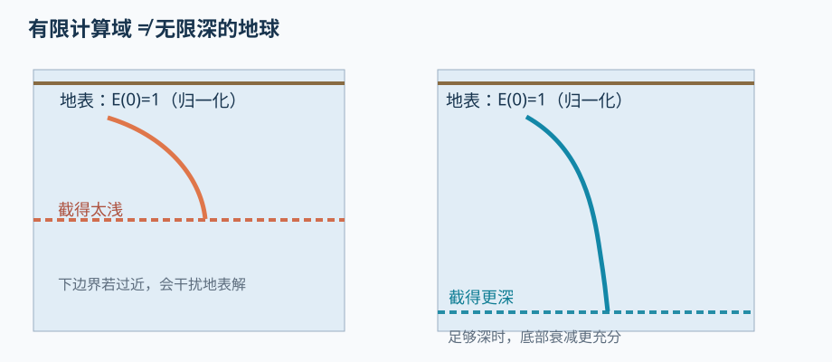
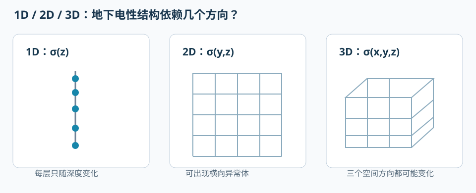
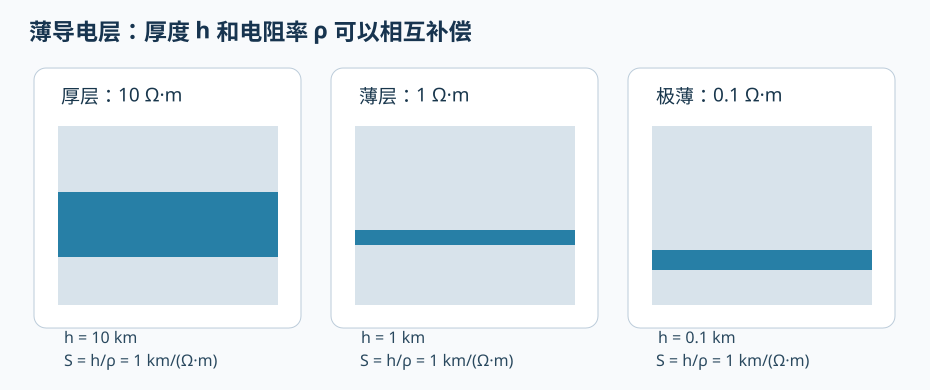



上一篇我们把一维控制方程离散成了矩阵方程 $\mathbf A\mathbf u=\mathbf b$。不过要把这套程序真正跑通并算准，还得过三道关：第一，计算区域上下两端的**边界条件**怎么设、地表磁场怎么从离散电场里高精度提取；第二，当地下变成**二维和三维**结构时，网格和极化模式会发生什么变化；第三，为什么地下明明夹了一层薄层，地表观测曲线有时却几乎看不出差别。

## 本篇路线图
- [5.1 边界条件怎样影响答案：地表磁场和误差验证](#sec-03e-boundaries)
- [5.2 从一条线到一个体：二维与三维有限差分](#sec-03f-multidimensional)
- [5.3 薄层为什么难分辨：电导、探测深度和时域波动](#sec-03g-sensitivity)

---

## 5.1 边界条件怎样影响答案：地表磁场和误差验证

控制方程规定了网格内部各点之间的联系，但计算区域最顶端和最底端两个边缘点还缺少约束——**边界条件**正是用来填补这两处空缺的。

### 一、为什么光有微分方程还定不出唯一解？

看一个极简的二阶微分方程：

$$
\frac{d^2u}{dz^2}=0.
$$

积分两次，通解是一条任意直线 $u(z)=az+b$，斜率 $a$ 和截距 $b$ 都还没定下来。只有额外给出两端边界条件，例如 $u(0)=1$ 和 $u(10)=0$，才能唯一解出 $b=1,\,a=-0.1$，得到直线 $u(z)=1-0.1z$。

**边界条件的作用，就是从无数满足控制方程的数学通解中，挑出符合当前物理场景的那一个。**

### 二、为什么地表电场常被归一化为 $1$？

MT 阻抗定义为同一频率下电场与磁场的比值 $Z_{xy}=E_x/H_y$。在线性介质中，如果把入射天然场源的强度整体放大 $c$ 倍，地下所有节点的电场和磁场都会同步放大 $c$ 倍，而比值

$$
\frac{cE_x}{cH_y}=\frac{E_x}{H_y}
$$

保持严格不变。因此，在正演计算中，我们可以直接把地表（或模型顶边界）的电场复振幅设为 $u_0=1$，这称为**场源归一化**。这个 $1$ 不是说真实自然电场恰好等于 $1\,\mathrm{V/m}$，而是计算时选定的一把统一标尺（更完备的正演软件也会在空气层顶部施加入射平面波条件）。

### 三、底边界为什么不能随便截断设零？

在均匀导电半空间中，电场随深度按 $e^{-z/\delta}$ 衰减（$\delta$ 为趋肤深度），理论上只有到 $z\to\infty$ 时才真正降为零。可计算机没法建一张无穷深的网格，只能在某个有限深度 $z=L$ 处截断，近似设

$$
E_x(L)\approx 0.
$$

底边界放得太浅会直接污染地表结果：
- 若只取 $L=\delta$，底边界处的残余振幅仍有地表的 $e^{-1}\approx 36.8\%$，强行置零相当于在地下放了一块理想导电反射板；
- 若取 $L=4\delta$，残余振幅降至 $e^{-4}\approx 1.83\%$；取 $L=6\delta$ 时降至 $e^{-6}\approx 0.25\%$。

注意，“$4\delta$ 够用”只是均匀半空间里的经验估算；如果深部存在高阻基底（趋肤深度很大），实际截断深度必须根据最低观测频率和最深层电阻率来评估。更聪明的做法是在底边界施加**阻抗边界条件**（利用底层半空间本征阻抗写出 $E$ 与 $dE/dz$ 的比例关系），这样不必把网格拉得极深也能准确模拟无穷远衰减。

### 四、算出节点电场后，怎么求地表磁场？

求出所有节点的电场 $u_0,u_1,u_2,\dots$ 之后，别忘了我们需要的是地表阻抗 $Z_{xy}(0)=E_x(0)/H_y(0)$。根据法拉第方程 $\frac{dE_x}{dz}=-i\omega\mu_0 H_y$，地表磁场取决于**地表处电场随深度的导数**：

$$
\boxed{H_y(0)=-\frac{1}{i\omega\mu_0}\left.\frac{dE_x}{dz}\right\vert_{z=0}}.
$$

这里藏着一个经典陷阱：哪怕你把地下几百个节点的电场算得非常准，只要最后在地表求导这一步用了粗糙公式，算出来的阻抗照样会有明显偏差。

### 五、地表求导：从一阶前向差分升级到二阶单侧差分

地表 $z_0=0$ 处上方没有地下网格节点，只能利用地表面及以下节点做单侧差分（设浅部前两个网格等间距为 $h$）：

1. **一阶前向差分**（只用 $E_0,E_1$ 两点）：
   $$
   E_x'(0)\approx\frac{E_1-E_0}{h},
   $$
   截断误差为 $O(h)$，精度较低。

2. **二阶单侧差分**（利用 $E_0,E_1,E_2$ 三个节点）：
   把 $E(h)$ 和 $E(2h)$ 分别在 $z=0$ 处做泰勒展开：
   $$
   E(h)=E(0)+hE'(0)+\frac{h^2}{2}E''(0)+O(h^3),
   $$
   $$
   E(2h)=E(0)+2hE'(0)+2h^2E''(0)+O(h^3).
   $$
   为了消去二阶导数 $E''(0)$，把第一式乘 $4$ 再减去第二式：
   $$
   4E(h)-E(2h)=3E(0)+2hE'(0)+O(h^3).
   $$
   移项除以 $2h$，就得到了二阶精度的单侧求导公式：
   $$
   \boxed{E_x'(0)\approx\frac{-3E_0+4E_1-E_2}{2h}}.
   $$
   （如果浅部网格不等间距，则需根据实际步长 $h_1,h_2$ 重新配系数，不能直接套用 $-3,4,-1$。）

### 六、四步排查数值解是否可靠

数值程序跑出一条光滑曲线并不代表结果正确。工程上通常用四项独立实验交叉检验：
1. **解析解对照**：先用水平层状模型测试，对比有限差分与第 03 篇层状递推解析解的偏差；
2. **网格加密收敛测试**：把网格间距逐步减半，观察误差是否按 $O(h^2)$ 规律稳定下降（约缩小为四分之一）；
3. **底边界下延测试**：把底边界深度 $L$ 再往下加深一倍，确认地表视电阻率和相位不再随截断深度改变；
4. **地表求导阶数对比**：保持地下电场解不变，对比一阶与二阶单侧求导对地表阻抗的影响。

验证时务必分别检查**视电阻率相对误差**和**相位角度误差**（两者可能对不同环节敏感）。更系统的数值误差定位方法，可延伸阅读站内专题[从解析解到数值解：为什么“算出来了”还不够](/posts/2026/09/analytical-vs-numerical-solution/)。

### 自我小测

**1.** 如果底边界只放在 $1$ 个趋肤深度（$L=\delta$）处并强行设 $E_x(L)=0$，合理吗？  
**答：** 不合理。在 $z=\delta$ 处场振幅仍保留了地表的 $e^{-1}\approx 36.8\%$，强行置零会引入严重的人为反射误差。

**2.** 为什么把地表电场归一化设为 $u_0=1$ 不会破坏阻抗计算？  
**答：** 在线性介质中，电场和磁场与场源强度成同比例缩放，计算比值 $Z=E_x/H_y$ 时归一化常数会完全约掉。

**3.** 地下所有内部节点的电场都已经算得很准了，就能保证地表阻抗一定准吗？  
**答：** 不能。地表磁场需要通过地表处的空间导数 $E_x'(0)$ 换算，如果地表求导用了低阶公式，依然会拖累最终阻抗精度。

---

一维网格是一条竖直的线，真实地质构造却有横向起伏。下一节我们把网格从一维“线”扩展到二维“面”和三维“体”，看看 TE 和 TM 两种极化模式是怎么分开的。

[继续阅读：5.2 从一条线到一个体：二维与三维有限差分](#sec-03f-multidimensional)

---

## 5.2 从一条线到一个体：二维与三维有限差分

一维模型把地球看成水平千层糕，电导率只随深度变（$\sigma=\sigma(z)$）。一旦遇到断层、褶皱、沉积盆地或隐伏岩体，电导率就会沿水平方向改变，一条竖直的节点线就不够用了。

### 一、先分清“模型维数”的真正含义

地球物理里常说的 1D、2D、3D，指的是**地下电导率随几个空间坐标发生变化**，而不是电磁场有几个分量（即使在 1D 地球上，电磁场依然存在于三维空间中）：
- **一维（1D）**：$\sigma=\sigma(z)$，只随深度变；
- **二维（2D）**：$\sigma=\sigma(y,z)$，沿水平某方向（称为地质**走向**，这里取 $x$ 轴）无限延伸不变，只在横跨走向的 $y$–$z$ 剖面上变化；
- **三维（3D）**：$\sigma=\sigma(x,y,z)$，沿三个方向都变化。

### 二、二维五点差分模板是怎么来的？

在沿 $x$ 走向不变的二维模型中，考察电场平行走向（$E_x$）的极化情形，控制方程在一维基础上多出了一项水平二阶导数：

$$
\frac{\partial^2E_x}{\partial y^2}+\frac{\partial^2E_x}{\partial z^2}-i\omega\mu_0\sigma(y,z)E_x=0.
$$

因为横向存在导电性差异，电场在水平方向也会弯曲，所以不能把每条竖直测线分开算再拼起来——$\dfrac{\partial^2E_x}{\partial y^2}$ 把左右相邻的网格线紧紧耦合在了一起。

在等间距二维方格网中，记第 $j$ 列、第 $k$ 行节点的电场为 $u_{j,k}$。水平方向和垂直方向各自套用三点中心差分：

$$
\frac{u_{j-1,k}-2u_{j,k}+u_{j+1,k}}{h_y^2}
+\frac{u_{j,k-1}-2u_{j,k}+u_{j,k+1}}{h_z^2}
-i\omega\mu_0\sigma_{j,k}u_{j,k}=0.
$$

数一数涉及的节点：中心点 $(j,k)$ 加上左、右、上、下四个直接邻居，一共五个点，因此叫作**五点差分模板**。此时系数矩阵 $\mathbf A$ 依然是稀疏矩阵，只是非零元素从三条对角线变成了五条对角线。

### 三、二维极化的双雄：TE 模式与 TM 模式

当构造走向沿 $x$ 方向时，三维麦克斯韦方程会自动解耦成两组互不干扰的独立偏振模式：

1. **TE 模式（横向电模式，Transverse Electric）**：  
   电场平行于构造走向（只有 $E_x$ 分量），磁场在横剖面内（$H_y,H_z$）。感应电流沿着构造走向顺畅流动，控制方程就是上面刚写的标量方程：
   $$
   \frac{\partial^2E_x}{\partial y^2}+\frac{\partial^2E_x}{\partial z^2}-i\omega\mu_0\sigma E_x=0.
   $$

2. **TM 模式（横向磁模式，Transverse Magnetic）**：  
   磁场平行于构造走向（只有 $H_x$ 分量），电场在横剖面内（$E_y,E_z$）。此时电流必须**横穿**不同岩性的垂直分界面，容易在电性边界处积累电荷，对横向断层和盆地边界格外敏感。

由低频安培定律 $\nabla\times\mathbf H=\sigma\mathbf E$ 的 $y,z$ 分量可得

$$
E_y=\frac{1}{\sigma}\frac{\partial H_x}{\partial z},\qquad E_z=-\frac{1}{\sigma}\frac{\partial H_x}{\partial y}.
$$

代入法拉第定律的 $x$ 分量 $\dfrac{\partial E_z}{\partial y}-\dfrac{\partial E_y}{\partial z}=-i\omega\mu_0 H_x$，整理得到 TM 模式的控制方程：

$$
\boxed{
\frac{\partial}{\partial y}\left(\frac{1}{\sigma}\frac{\partial H_x}{\partial y}\right)
+\frac{\partial}{\partial z}\left(\frac{1}{\sigma}\frac{\partial H_x}{\partial z}\right)
-i\omega\mu_0 H_x=0
}.
$$

**特别注意两处细节：** 第一，最后一项的负号与全系列统一的 $e^{+i\omega t}$ 时间因子严格对应（若改用 $e^{-i\omega t}$，该项会变成正号）；第二，电阻率 $\rho=1/\sigma$ 必须留在外层偏导括号里面，因为它在空间中随 $y,z$ 变化，若随手提到导数外面，就会丢失地层交界面上的电荷积累信息。

### 四、二维边界条件怎么设置？

二维网格有上、下、左、右四条边界。通常做法是：
- **左右侧边界**：向两侧外扩得足够远，远离研究区的横向异常体，使两侧近似回到一维层状背景，直接用一维解析解作为侧边界条件；
- **底边界**：设在足够深处（远大于最低频率的趋肤深度）；
- **顶边界**：对 TM 模式，由于空气近似绝缘（$\sigma_{\text{air}}\approx 0$），地表处水平磁场 $H_x$ 几乎为常数，可直接设 $H_x(y,0)=1$；对 TE 模式，电磁场在空气层中也会随异常体发生畸变，因此通常需要在地表上方额外包含一层空气网格，在空气层顶部施加平面波边界。

### 五、三维有限差分与交错网格（Staggered Grid）

进入三维 $\sigma(x,y,z)$ 后，电场的三个分量 $(E_x,E_y,E_z)$ 和磁场的三个分量 $(H_x,H_y,H_z)$ 全部耦合在一起，无法再拆成独立的 TE 和 TM。

如果把六个分量全塞在同一个网格顶点上，旋度差分容易产生伪解。三维有限差分最经典的解决方案是 **Yee 氏交错网格**：
- 把电场分量 $E_x,E_y,E_z$ 放在立方体网格的**棱边**中点上；
- 把磁场分量 $H_x,H_y,H_z$ 放在立方体网格的**面心**上。

这样排布的物理美感在于：每个网格面四周的四条棱边刚好围成一圈闭合回路，直接对应法拉第定律的环流积分；每条棱边周围的四个面心刚好环绕它一圈，直接对应安培定律的环流积分，天然保证了场分量在界面上的切向连续性。

### 自我小测

**1.** 二维 TE 模式的五点差分模板为什么涉及五个节点？  
**答：** 水平方向和垂直方向各自需要左右（或上下）两个邻居来近似二阶导数，加上中心节点本身，共五个节点。

**2.** 二维模型中的 TE 和 TM 模式，只是把坐标轴 $x$ 和 $y$ 换个字母吗？  
**答：** 不是。TE 模式求解沿走向的电场 $E_x$，电流顺着走向流动；TM 模式求解沿走向的磁场 $H_x$，电流横穿地质界面流动，控制方程中电导率的位置和物理敏感性完全不同。

**3.** 三维交错网格为什么要把电场放在网格棱边、磁场放在网格面心？  
**答：** 这种几何排布使每个网格面的四条棱边自然构成闭合环路，直接契合麦克斯韦旋度方程的积分形式，并自动满足跨界面的切向场连续条件。

---

学会了正演，我们就可以在计算机里任意修改地下电阻率模型，观察地表曲线的变化。但做实验时很快会遇到一个让人困惑的现象：地下明明换了一个模型，地表算出来的视电阻率和相位曲线却几乎一模一样。下一节我们就来揭开“薄层等效性”的面纱。

[继续阅读：5.3 薄层为什么难分辨：电导、探测深度和时域波动](#sec-03g-sensitivity)

---

## 5.3 薄层为什么难分辨：电导、探测深度和时域波动

有了正演程序，我们就可以像做物理实验一样，改动地下某一层的厚度、电阻率或埋深，观察地表视电阻率和相位曲线怎么跟着变。这里会碰到一个贯穿地球物理反演的深刻现象：**地下结构明明改了，地表观测曲线有时却纹丝不动。**

### 一、什么是参数的“灵敏度”？

先看一个简单函数 $y=2x$：自变量 $x$ 增加 $1$，输出 $y$ 就增加 $2$；如果另一个参数 $z$ 怎么改，$y$ 几乎都不变，我们就说 $y$ 对 $z$ 不敏感。

在 MT 正演中，地下各层的电阻率 $\rho_j$ 是输入参数，各频率的视电阻率 $\rho_a$ 和相位 $\phi$ 是输出数据。如果把某一层电阻率改了 $20\%$，预测曲线的变化却小于测量误差，说明地表数据对该层的**灵敏度**很低。

### 二、三个完全不同的薄导电层，为什么会给出几乎一样的数据？

来看一组经典对比实验：在高阻围岩中夹着一层导电薄层，我们构造 A、B、C 三个厚度和电阻率完全不同的模型：

| 模型 | 电阻率 $\rho$ | 厚度 $h$ | 比值 $h/\rho$ |
|---|---:|---:|---:|
| A | $10\,\Omega\cdot\mathrm m$ | $10\,\mathrm{km}$ | $1\,\mathrm{km}/(\Omega\cdot\mathrm m)$ |
| B | $1\,\Omega\cdot\mathrm m$ | $1\,\mathrm{km}$ | $1\,\mathrm{km}/(\Omega\cdot\mathrm m)$ |
| C | $0.1\,\Omega\cdot\mathrm m$ | $0.1\,\mathrm{km}$ | $1\,\mathrm{km}/(\Omega\cdot\mathrm m)$ |

注意到最后一列 $h/\rho$ 在三个模型中完全相等！这个物理量叫作薄层的**纵向电导**（longitudinal conductance），通常记作 $S$：

$$
\boxed{S=\sigma h=\frac{h}{\rho}},
$$

单位是西门子（$\mathrm S$，上表三个模型换算到国际单位制后纵向电导均为 $1000\,\mathrm S$）。

物理直觉非常形象：薄导电层就像一条水平铺设的扁平导线，电流顺着它横向流动时，导电层越厚（截面积越大）、或者材料本身电阻率越低，电流通过就越顺畅——两者对总导电能力的贡献是互补的。当导电层厚度远小于趋肤深度时，地表 MT 响应主要受**纵向电导 $S=h/\rho$ 的乘积**控制。只要 $S$ 相同，这三个模型的地表曲线在很宽频带内都会高度重合。

### 三、相同纵向电导，地下岩石真的一样吗？

显然完全不一样！$10\,\mathrm{km}$ 厚的低阻带和 $100\,\mathrm m$ 厚的极低阻带，在地质规模和成因上天差地别。“等效性”的意思是：**在有限观测频带和常规噪声水平下，单凭地表 MT 数据很难把“更厚一点”和“更导电一点”单独拆开。** 想要打破这种等效性，往往需要补充更高频观测、钻孔约束，或者联合地震、重力等其他地球物理资料。

### 四、为什么 MT 对“低阻薄层”比对“高阻薄层”更敏感？

在常见地壳模型中，如果地下夹着一层薄导电层，它会强烈吸引感应涡流集中通过，显著拉低视电阻率并抬高相位，很容易被 MT 捕捉到；相反，如果夹着一层薄高阻层，感应电流会绕开它而在上下导电围岩中流动，地表响应往往非常微弱。

这并不意味着“所有导电层都能看到”或“所有高阻层都看不到”——如果导电层埋得极深、超出了观测频带的趋肤深度范围，一样分辨不出来；而如果高阻层足够厚（如厚大的花岗岩体或致密克拉通岩石圈），在 MT 剖面上同样表现得非常清晰。

### 五、薄层埋得越深，异常为什么往低频方向移动？

回顾趋肤深度公式 $\delta\approx 503\sqrt{\rho/f}$：只有频率 $f$ 足够低（周期足够长），电磁波才能穿透较厚的上覆地层抵达深处。因此，同一个导电层埋藏越深，它在视电阻率和相位曲线上引起极值异常的频段就越往低频（长周期）一端移动。

### 六、视电阻率与相位为什么必须联合拟合？

复阻抗 $Z=\lvert Z\rvert e^{i\phi}$ 拆成了模长（对应视电阻率 $\rho_a=\lvert Z\rvert^2/(\omega\mu_0)$）和辐角（对应相位 $\phi$）。
- 如果浅部存在局部畸变把整个电场放大或缩小了常数倍（第 11 篇要讲的静态位移），视电阻率曲线会整体上下平移，而**相位曲线却不受影响**；
- 相位对电导率随深度的**相对变化梯度**尤为敏感（向下进入更导电地层时，在 $e^{+i\omega t}$ 约定下相位通常会大于 $45^\circ$；进入更阻地层时则会小于 $45^\circ$）。

因此，正反演分析必须同时拟合视电阻率和相位两条曲线，缺一不可。

### 七、收尾：把复指数解还原回真实随时间波动的电场

最后我们把第 02 篇和第 03 篇推导出的均匀半空间复振幅解 $E_x(z)=Ae^{-kz}$（其中 $k=\alpha+i\beta$，$\alpha=\beta=\sqrt{\frac{\omega\mu_0\sigma}{2}}$）乘回时间因子 $e^{+i\omega t}$，取实部还原出随时间和深度变化的真实物理电场（设 $A=\lvert A\rvert e^{i\phi_A}$）：

$$
E_x(z,t)=\operatorname{Re}\left[\lvert A\rvert e^{i\phi_A}e^{-(\alpha+i\beta)z}e^{i\omega t}\right]
=\boxed{\lvert A\rvert e^{-\alpha z}\cos(\omega t-\beta z+\phi_A)}.
$$

看清式子里的两项分工：
- **振幅因子 $\lvert A\rvert e^{-\alpha z}$**：随着深度 $z$ 增加呈指数衰减；
- **相位因子 $\omega t-\beta z+\phi_A$**：随着深度 $z$ 增加不断滞后（相速度 $v_{\rm ph}=\omega/\beta$，但在导电岩石中电磁场以扩散衰减为主，不能把相速度直接等同于真空光速那样的无损能量传播速度）。

### 自我小测

**1.** 两个薄层模型的纵向电导 $S=h/\rho$ 相等，是否意味着它们在所有频率下的 MT 曲线都绝对一模一样？  
**答：** 不是。只有当薄层厚度远小于趋肤深度时两者才近似等效；一旦高频段趋肤深度缩短到与层厚相当，两条曲线就会分开。

**2.** 某测点阻抗相位恰好测得 $45^\circ$，能否直接断言该测点下方一定是均匀半空间？  
**答：** 不能。在有限频带和观测误差范围内，多层结构也可能在局部频段凑出接近 $45^\circ$ 的相位，必须结合全频段视电阻率与相位综合判断。

**3.** 调整模型某一层的参数后，正演计算出的视电阻率和相位曲线几乎没有任何变化，说明什么？  
**答：** 说明当前观测频带和数据误差水平对该层参数的灵敏度极低，单靠这组数据无法有效约束该层。

---

到这里，正演理论（从解析递推到二维、三维数值模拟）已经全部走通。接下来我们走出计算机房，扛起仪器走进野外，看看地表的五个电磁通道究竟是怎么一伏特一伏特测出来的。

[继续阅读：06｜野外观测、仪器原理与测站设计](/posts/2026/10/mt-course-04-field-observation/) · [返回总目录](/posts/2026/10/mt-course/)
