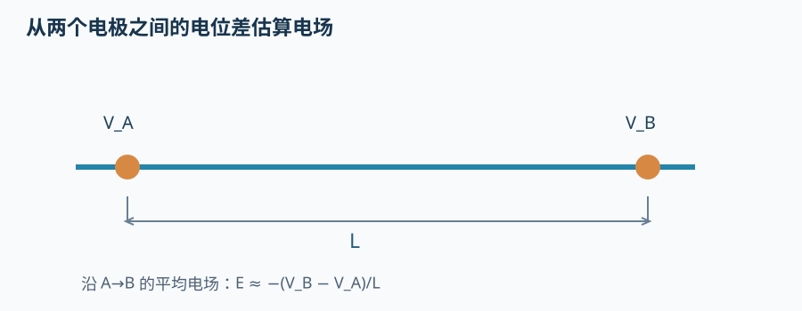
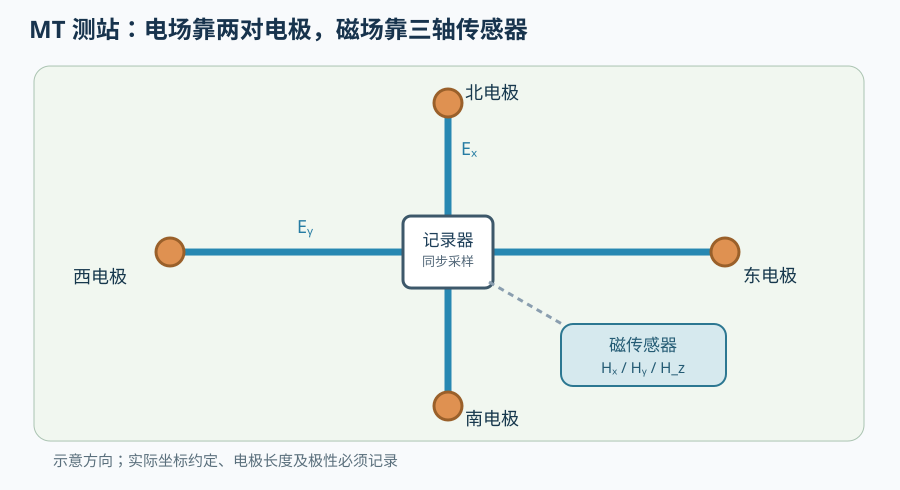



前面五篇我们一直在公式和网格里讨论 $E_x$、$H_y$ 和 $Z_{xy}$。现在要把抽象符号和真实仪器接上头：**地表电场难道是用温度计那样的探头直接读出来的吗？五个通道为什么要依靠 GPS 严格同步？为什么同一套设备架在高压线旁边和架在安静荒野里，录出来的数据天差地别？** 本篇先从电压表与电极布设讲起，再梳理野外观测设计、噪声识别与现场质量控制。

## 本篇路线图
- [6.1 五个通道究竟在测什么？](#sec-04a-measure)
- [6.2 从研究目标到测站布设：噪声与数据质控](#sec-04b-station)

---

## 6.1 五个通道究竟在测什么？

来到野外测点，仪器并没有一个能直接显示“当地电场 $E_x=0.02\,\mathrm{V/m}$”的探头。电场是通过测量地面两点之间的电压换算出来的，我们先从最基础的电压与电场关系说起。

### 一、电压和电场不是同一个物理量

设想沿南北方向（$x$ 轴）在地面埋下两根不极化电极 $A$ 和 $B$，两者相距 $L$ 米，中间用导线连到记录器的电压测量端口。

电位 $V$ 的单位是伏特（$\mathrm V$），电场强度 $E$ 的单位是伏特每米（$\mathrm{V/m}$）。假设 $A$ 处电位为 $3\,\mathrm V$，$B$ 处电位为 $1\,\mathrm V$，两根电极相距 $L=100\,\mathrm m$。沿着 $A$ 指向 $B$ 的方向，电位平均每米下降了

$$
\frac{V_B-V_A}{L}=\frac{1-3}{100}=-0.02\ \mathrm{V/m}.
$$

物理上电场始终指向电位降低的方向（正电荷受电场力从高电位流向低电位），因此平均电场分量与电位差之间带有一个负号：

$$
\boxed{\overline E_{A\to B}\approx -\frac{V_B-V_A}{L}}.
$$

代入刚才的数字，得到 $\overline E_{A\to B}=+0.02\,\mathrm{V/m}$。

为什么公式里写的是“平均电场”？因为两根电极之间隔着几十到上百米，真实电场在沿途未必处处均匀；记录器测到的总电位差实际上是整条导线路径上电场的线积分：

$$
V_B-V_A=-\int_A^B \mathbf E\cdot d\boldsymbol\ell.
$$

只有当电极距 $L$ 远小于电磁场在水平方向的变化尺度时，沿途电场近似均匀，积分才简化成 $-EL$。

### 二、为什么电极距和方位角一点都不能记错？

举例来说，记录器读出某通道两电极间的电位差为 $2\,\mathrm{mV}$（即 $0.002\,\mathrm V$），而你记下的电极间距是 $L=100\,\mathrm m$，换算出的电场强度为

$$
\lvert E\rvert=\frac{0.002}{100}=2\times 10^{-5}\ \mathrm{V/m}.
$$

如果野外拉线时实际只拉了 $80\,\mathrm m$，记录本上却错写成 $100\,\mathrm m$，算出来的电场振幅就会凭空缩小 $20\%$，进而导致视电阻率偏差超过 $35\%$！

同样地，如果导线没有严格沿着正北（$x$ 轴）铺设，而是偏转了夹角 $\theta$，那么它测到的就不是纯正的 $E_x$，而是真实水平电场在导线方向上的投影分量 $E\cos\theta$。因此野外必须用罗盘或高精度 GNSS 测准每条电道的实际方位角。

### 三、标准 MT 五通道到底是哪五个？

常规大地电磁测站同时布设两组互相垂直的水平电极偶极子，以及三个互相垂直的磁传感器，同步记录五路时间序列（沿用北—东—下 NED 坐标系）：

$$
E_x(t),\quad E_y(t),\quad H_x(t),\quad H_y(t),\quad H_z(t).
$$

- **$E_x,E_y$**：北向和东向水平电场通道；
- **$H_x,H_y$**：北向和东向水平磁场通道；
- **$H_z$**：垂向磁场通道（用于后续计算倾子 tipper，诊断地下横向电性变化）。

**硬件与单位细节提醒：** 宽频和音频 MT 通常使用**感应式磁棒（induction coil）**，它直接感应的是磁场随时间的变化率 $\partial\mathbf B/\partial t$；长周期 MT 则常使用**磁通门磁力仪（fluxgate）**，直接测量磁感应强度 $\mathbf B$。原始记录数据必须先经过**仪器响应标定文件（calibration）**还原成真实的物理场量。另外，许多处理软件习惯直接存储磁感应强度 $\mathbf B$（单位 $\mathrm{nT}$），在非磁性岩石中 $\mathbf B=\mu_0\mathbf H$，用 $E/B$ 算出来的系数与用 $E/H$ 定义的阻抗相差一个 $\mu_0$ 因子，后续对比时务必统一单位。

### 四、为什么五个通道必须依靠 GPS 严格同步？

后面我们要通过电场和磁场的**相位差**（比如那经典的 $45^\circ$）来推断地下结构。设想如果电场记录器的时钟比磁场记录器慢了 $\Delta t$ 秒，哪怕真实电场和磁场波峰同时到达，记录下来的波形也会错开一段距离。

对于频率为 $f$ 的单频正弦信号，时间同步偏差 $\Delta t$ 引起的虚假相位差为

$$
\Delta\phi=2\pi f\Delta t.
$$

算一个惊人的数字：如果信号频率 $f=1\,\mathrm{Hz}$，两通道时钟仅仅错开了 $0.25\,\mathrm s$，就会凭空制造出

$$
\Delta\phi=2\pi\times 1\times 0.25=\frac{\pi}{2}=90^\circ
$$

的巨大假相位！因此现代 MT 采集站全部依赖高精度 GPS 授时脉冲实现微秒级同步。

### 自我小测

**1.** 测得两电极间电位差为 $1\,\mathrm{mV}$，电极间距为 $50\,\mathrm m$，平均电场大小是多少？  
**答：** $0.001\,\mathrm V / 50\,\mathrm m = 2\times 10^{-5}\,\mathrm{V/m}$。

**2.** 为什么不能在预处理时把五个通道各自单独平滑到“曲线看起来很光滑”为止？  
**答：** 各自独立滤波或过度平滑会破坏电场与磁场之间原有的振幅比例和相位差，而这些跨通道关系正是计算阻抗张量的核心信息。

---

弄清了五路通道的物理原理，接下来我们把视角切换到野外工作现场：面对具体的地质勘探目标，该选什么频段的仪器？点距设多密？又该如何躲开无处不在的人文电磁干扰？

[继续阅读：6.2 从研究目标到测站布设：噪声与数据质控](#sec-04b-station)

---

## 6.2 从研究目标到测站布设：噪声与数据质控

拿到仪器走出实验室，第一个现实问题就是：**测点该布在哪里、布多密、录多久，才能收回来一份干净可用的数据？**

### 一、让探测目标决定频段与站距

不同的地质任务，对探测深度和横向分辨率的要求完全不同：
- 研究几百米到几千米深的浅部断裂或矿体，需要高频信号，通常采用**音频大地电磁（AMT，约 $10^4\sim 1\,\mathrm{Hz}$）**，测点间距几十米到几百米，单点观测几十分钟到数小时；
- 研究地壳尺度构造，采用**宽频带大地电磁（BBMT，约 $300\sim 10^{-3}\,\mathrm{Hz}$）**，点距几千米，单点连续观测 $1\sim 3$ 天；
- 研究几十到数百千米深的岩石圈与上地幔，需要极低频信号，采用**长周期大地电磁（LMT，周期可达 $10\sim 10^4\,\mathrm s$ 以上）**，点距几十千米，单点往往需要连续记录数周。

我们可以用趋肤深度公式 $\delta\approx 503\sqrt{\rho/f}$ 粗略估算目标深度所需的最低频率，但要记住它只是量级参考，并不是“想看 $10\,\mathrm{km}$ 深就把点距设成 $10\,\mathrm{km}$”。

### 二、选址踏勘：把干扰挡在采集之前

正式布站前，先在卫星影像和地形图上初选点位，再到实地踏勘。选址时必须尽量远离以下常见干扰源：
- 高压输电线、变电站、电气化铁路、地铁与工厂大型电机；
- 通信基站、风力发电机组、地下金属管线和有源阴极保护设施；
- 地形极其陡峭的位置（剧烈地形会扭曲局部电场分布）。

同时要兼顾交通可达性、地表土层是否适合埋设电极以及土地使用许可。即使地图上看着偏僻，野外仍可能存在隐蔽光缆或农田水泵，因此正式记录前做一次现场试测非常必要。

### 三、布设电场通道：低接地电阻与防风固定

铺设两组尽量正交（通常南北、东西向）的电极线时，需要注意：
- 使用低极化漂移的**不极化电极**（如铅–氯化铅或硫酸铜电极），埋入湿润细土中；干燥砂石地表可适当浇注淡盐水改善耦合，降低接地电阻；
- 测量并记录电极间的自然直流电位差和接地电阻；
- 导线必须贴地走线并用土块或沙袋压稳——一旦导线被大风吹动，在地球磁场中切割磁力线就会产生强烈的风致感应噪声；同时要避开牲畜踩踏和车辆碾压路线。

### 四、布设磁传感器：水平、定向与防震恒温

磁棒或磁通门传感器对机械震动和温度变化极其敏感：
- 严格按照罗盘定向并调平（垂向磁棒 $H_z$ 必须垂直打入地下或放入专用垂直井筒中）；
- 传感器要远离铁栅栏、汽车、铁锹以及采集主机电源；
- 所有磁传感器都应挖坑浅埋并覆土压实，既防止风吹草动引起的微震，也隔绝昼夜剧烈温差造成的零点漂移。

### 五、噪声从哪里来？哪些好处理、哪些最致命？

野外干扰主要分三类：
1. **人文电磁噪声**：如 $50\,\mathrm{Hz}$（或 $60\,\mathrm{Hz}$）工频电及其谐波、直流电车脉冲、抽水机启停干扰；
2. **环境与仪器噪声**：风吹线缆抖动、磁棒受震、电极干燥导致的电位漂移，以及传感器自身本底噪声；
3. **天然弱信号带（Dead Band）**：天然场源能量并非在所有频率都一样强，在 $0.5\sim 5\,\mathrm{Hz}$ 附近（以及 AMT 的 $1\sim 5\,\mathrm{kHz}$ 附近）天然信号天生偏弱，信噪比容易大幅下降。

如果干扰是**间歇性**的（比如白天有车经过、夜里安静），后期可以通过分窗筛选和稳健统计剔除坏时段；但如果干扰是**持续且电、磁通道高度相关**的（比如紧挨着高压线），后期算法几乎无力回天。**高质量数据是野外选址“省”出来的，不是靠后处理软件“修”出来的。**

### 六、规范的野外记录表与安全底线

每次收放站都应填写完整的纸质或电子班报，确保数据**可追溯**：记录站号、经纬度与高程、磁偏角、各道偶极长度与实际方位角、接地电阻、传感器编号与通道对应关系、采样率、起止时间、天气及周边干扰情况，并拍摄布站照片。

最后，**野外安全永远排在第一位**：雷雨天气严禁布设或回收长距离金属导线（极易引雷）；跨路布线必须设置醒目警示标志并做好防护；山区与荒漠作业遵守结伴、报备与应急通信规范。

### 自我小测

**1.** 探测上地幔深部构造的长周期 MT，为什么单个测站往往需要连续记录几周甚至更久？  
**答：** 因为目标深度越大，所需信号周期越长（可达数千秒）；为了在频谱分析中累积足够多个完整周期以压低统计误差，必须大幅延长观测时间。

**2.** 野外布线时电极方向偏离正北 $5^\circ$，后处理时可以直接忽略吗？  
**答：** 不能。$5^\circ$ 偏转会把东向电场分量混入北向通道，必须如实记录实际方位角，在后续张量分析中通过坐标旋转公式校正。

**3.** 野外质控时看到原始时间序列曲线“很平滑、没有毛刺”，是否就说明数据质量优秀？  
**答：** 不一定。过于平滑有时反而意味着传感器饱和、电池断电死机或者被强周期性工频信号淹没，必须结合频谱图、相干度与试算阻抗曲线综合判断。

---

现在五路时间序列已经安全存进了存储卡里。下一篇我们正式进入**数据处理**阶段，看看如何用傅里叶变换和切窗技术，把一团乱糟糟的时间波形拆解成一个个频率上的复数振幅。

[继续阅读：07｜从时间序列到频谱：傅里叶变换、采样与切窗](/posts/2026/10/mt-course-05a-fourier-sampling/) · [返回总目录](/posts/2026/10/mt-course/)
