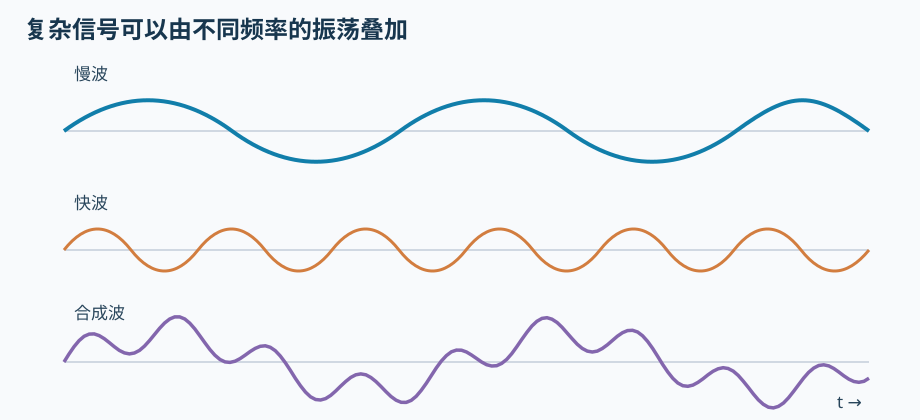
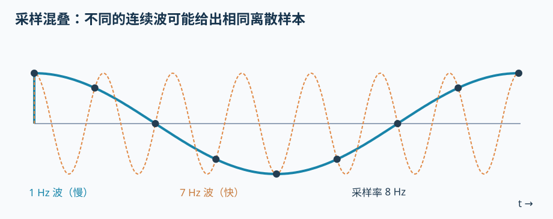
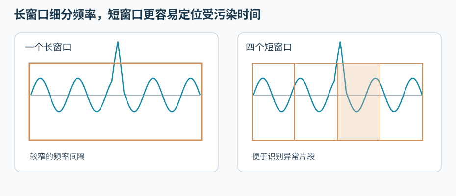



野外记录器带回来的并不是直接画好的“视电阻率—周期曲线”，而是五条密密麻麻随时间跳动的电场和磁场数字序列，里面混杂着成百上千种频率的天然信号和各种干扰。要把时间序列变成频率相关的阻抗张量，必须走通下面这条完整处理链：

$$
\text{五路时间序列}\longrightarrow \text{分窗与傅里叶变换}\longrightarrow \text{复数阻抗张量}\longrightarrow \text{视电阻率与相位}.
$$

本篇专注走好前两步：先弄明白傅里叶变换怎么把混合波拆成单个频率；再认识离散采样、奈奎斯特频率与 FFT；最后学会为什么要把长记录切成短窗口，以及如何通过去趋势和加窗抑制频谱泄漏。

## 本篇路线图
- [7.1 一段乱糟糟的信号，怎样拆成不同频率？](#sec-05a-fourier)
- [7.2 采样、奈奎斯特频率和 FFT 究竟是什么？](#sec-05b-sampling)
- [7.3 为什么要切窗口：去均值、加窗与频谱泄漏](#sec-05c-windowing)

---

## 7.1 一段乱糟糟的信号，怎样拆成不同频率？

面对一段上下起伏的时间记录 $x(t)$，我们的核心任务是：**找出里面分别藏着哪些频率的成分，每种频率的振幅和相位又是多少？** 这就是傅里叶分析的拿手好戏。

### 一、先听两个音叉同时发声

想象两个音叉同时敲响：第一个每秒振动 $1$ 次（$1\,\mathrm{Hz}$），振幅为 $2$；第二个每秒振动 $3$ 次（$3\,\mathrm{Hz}$），振幅为 $1$。记录器采到的是两者叠加后的混合波形：

$$
x(t)=2\cos(2\pi t)+\cos(6\pi t).
$$

叠加后的曲线不再是简单的余弦波，但我们清楚它的配方。真实野外遇到的是反过来的难题：手里只有混合后的 $x(t)$，要从中把 $1\,\mathrm{Hz}$ 和 $3\,\mathrm{Hz}$ 的配方重新分离出来。

### 二、频率投影与正交性：怎么把某个频率“筛”出来？

借用几何里的投影直觉：想知道一根斜向量在 $x$ 轴上的分量，只需拿它和 $x$ 轴单位向量做点积。类似地，想知道混合信号 $x(t)$ 里含有多少 $1\,\mathrm{Hz}$ 成分，我们可以拿 $x(t)$ 去乘以 $1\,\mathrm{Hz}$ 的标准参照波 $\cos(2\pi t)$，然后在整整 $1$ 秒周期内积分求平均：

$$
\int_0^1 x(t)\cos(2\pi t)\,dt.
$$

微积分里的正交性告诉我们，在完整周期 $[0,1]$ 内，不同整数频率的余弦波相乘积分时，正负部分刚好完全抵消：

$$
\int_0^1 \cos(6\pi t)\cos(2\pi t)\,dt=0,
$$

而只有频率完全相同的余弦波相乘积分时，才会留下非零结果：

$$
\int_0^1 \cos^2(2\pi t)\,dt=\frac{1}{2}.
$$

代入混合信号 $x(t)$：

$$
\int_0^1 x(t)\cos(2\pi t)\,dt=2\times\frac{1}{2}+1\times 0=1.
$$

结果乘以 $2$，精准找回了 $1\,\mathrm{Hz}$ 成分的振幅 $2$，而 $3\,\mathrm{Hz}$ 成分被彻底过滤掉了！这种“同频共振保留、异频正负抵消”的性质叫作**正交性**（注意：严格正交需要积分区间包含整数个周期；如果截断了半个周期，其他频率就会漏进来一点，这就是第 7.3 节要讲的频谱泄漏）。

### 三、只用余弦够不够？还需要正弦

如果某个信号带着初相位 $\varphi$，例如 $x(t)=3\cos(2\pi t+\varphi)$，用三角恒等式 $\cos(a+b)=\cos a\cos b-\sin a\sin b$ 展开：

$$
x(t)=(3\cos\varphi)\cos(2\pi t)-(3\sin\varphi)\sin(2\pi t).
$$

可见，要完整捕捉任意初相位的信号，在每个频率上都必须同时测量**余弦系数**和**正弦系数**。恰好，复数也拥有实部和虚部两个分量。

### 四、复数形式的傅里叶变换

利用欧拉公式 $e^{-i2\pi ft}=\cos(2\pi ft)-i\sin(2\pi ft)$，我们可以把余弦参照波（实部）和正弦参照波（虚部）打包进同一个复指数里。连续时间信号 $x(t)$ 的**正向傅里叶变换**定义为

$$
\boxed{X(f)=\int_{-\infty}^{+\infty}x(t)e^{-i2\pi ft}\,dt}.
$$

不要被积分上下限吓到，它做的事情和刚才一模一样：把信号 $x(t)$ 乘上频率为 $f$ 的复参照波 $e^{-i2\pi ft}$，在时间上累加投影。算出来的复数 $X(f)$ 叫作**频谱**，它的模长 $|X(f)|$ 反映该频率的振幅大小，辐角 $\arg X(f)$ 反映初相位。对应的**逆傅里叶变换**则是把所有频率的复指数波重新叠回时间信号：

$$
x(t)=\int_{-\infty}^{+\infty}X(f)e^{i2\pi ft}\,df.
$$

### 五、双边频谱里为什么会出现“负频率”？

由欧拉公式可知，一个纯实数余弦波可以拆成一对旋转方向相反的复指数之和：

$$
\cos(2\pi ft)=\frac{1}{2}\left(e^{i2\pi ft}+e^{-i2\pi ft}\right).
$$

因此在复数傅里叶变换的双边频谱上，会同时出现 $+f$（逆时针旋转）和 $-f$（顺时针旋转）两个分量。对于真实的实值时间序列，正负频率的频谱互为**复共轭**（实部相同、虚部变号）：

$$
X(-f)=X(f)^*.
$$

负频率纯粹是复平面旋转方向的数学表达，并不是说野外存在一台发出“$-5\,\mathrm{Hz}$”电磁波的机器。既然负频率信息完全对称，实际看图时通常只画正频率一侧就够了。

### 六、回到 MT：为什么要对五路信号全做傅里叶变换？

野外测到的 $E_x(t),E_y(t),H_x(t),H_y(t),H_z(t)$ 经过预处理和傅里叶变换后，在每个频率 $f$ 上都得到一组复频谱系数 $\widetilde E_x(f),\dots,\widetilde H_z(f)$。只有在同一个频率下比较复电场与复磁场，才能定义阻抗 $Z_{xy}(f)=\widetilde E_x(f)/\widetilde H_y(f)$；千万不能拿时间序列某一秒的电场电压直接除以那一秒的磁场读数。

### 自我小测

**1.** 信号 $x(t)=4\cos(2\pi t)+2\cos(10\pi t)$ 中包含哪两个频率的成分？  
**答：** $2\pi f_1=2\pi \implies f_1=1\,\mathrm{Hz}$；$2\pi f_2=10\pi \implies f_2=5\,\mathrm{Hz}$。

**2.** 为什么做频率投影时不能只乘余弦波，还必须搭配正弦波（或复指数）？  
**答：** 因为信号通常带有非零初相位，移相后的余弦波会分解出正弦分量，需要余弦和正弦两个正交基函数（即复数的实部与虚部）才能同时确定振幅和相位。

**3.** 对于实数时间序列，正频率 $X(f)$ 与负频率 $X(-f)$ 的傅里叶系数有什么关系？  
**答：** 互为复共轭，即 $X(-f)=X(f)^*$。

---

理解了连续时间的傅里叶变换，下一步要面对计算机的现实：记录器只能每隔 $\Delta t$ 秒吐出一个离散数字。采样太慢会发生什么怪事？计算机又是怎么用 FFT 瞬间算出频谱的？下一节接着拆解。

[继续阅读：7.2 采样、奈奎斯特频率和 FFT 究竟是什么？](#sec-05b-sampling)

---

## 7.2 采样、奈奎斯特频率和 FFT 究竟是什么？

现代数字记录器不可能连续不断地存下每一个瞬间，它只能按固定节拍“每隔 $\Delta t$ 秒读一次数”。把连续积分变成离散求和，就进入了数字信号处理的世界。

### 一、采样间隔 $\Delta t$ 与采样率 $f_s$

假设记录器每隔 $\Delta t=0.125\,\mathrm s$ 采集一个数据点，那么每秒采集的点数称为**采样频率**（简称采样率）$f_s$：

$$
f_s=\frac{1}{\Delta t}=\frac{1}{0.125}=8\ \mathrm{Hz}.
$$

务必区分**采样率 $f_s$**（仪器每秒按多少次快门）和**信号频率 $f$**（天然电磁场每秒振荡多少圈）。例如用 $8\,\mathrm{Hz}$ 的采样率去录一个 $1\,\mathrm{Hz}$ 的余弦波，相当于信号每摆动一圈，仪器在沿途拍下 $8$ 张快照。

### 二、采样太慢会闹什么笑话？——混叠（Aliasing）

还是以 $f_s=8\,\mathrm{Hz}$ 为例，仪器的采样时刻固定为 $t_n=n/8$（$n=0,1,2,\dots$）。现在同时送入两条频率完全不同的余弦波：
- 慢波：$x_1(t)=\cos(2\pi t)$，频率 $1\,\mathrm{Hz}$；
- 快波：$x_2(t)=\cos(14\pi t)$，频率 $7\,\mathrm{Hz}$。

把采样时刻 $t_n=n/8$ 代入 $7\,\mathrm{Hz}$ 的快波：

$$
x_2(t_n)=\cos\left(\frac{14\pi n}{8}\right)
=\cos\left(2\pi n-\frac{2\pi n}{8}\right)
=\cos\left(\frac{2\pi n}{8}\right)=x_1(t_n).
$$

因为 $n$ 是整数，余弦函数加减整数倍的 $2\pi$ 数值完全不变！这意味着在 $8\,\mathrm{Hz}$ 采样器的眼里，**$7\,\mathrm{Hz}$ 的高频信号和 $1\,\mathrm{Hz}$ 的低频信号在所有采样点上严丝合缝地重合**，采出来的数字序列一模一样！

这种“高频信号伪装成低频信号”的现象叫作**混叠（aliasing）**，就像电影里快速向前旋转的车轮有时看起来像在倒转。

### 三、奈奎斯特频率 $f_N$ 与抗混叠滤波

香农–奈奎斯特采样定理指出：要不失真地还原连续信号，采样率 $f_s$ 必须严格大于信号最高频率的两倍。我们把采样率的一半定义为**奈奎斯特频率** $f_N$：

$$
\boxed{f_N=\frac{f_s}{2}}.
$$

例如 $f_s=8\,\mathrm{Hz}$ 时，奈奎斯特频率 $f_N=4\,\mathrm{Hz}$；任何高于 $4\,\mathrm{Hz}$ 的频率成分都会折返混叠进 $0\sim 4\,\mathrm{Hz}$ 的频段里。一旦混叠进离散数字里，后期算法就再也分不清真假了——因此所有合格的 MT 采集器在模数转换（ADC）之前，硬件电路里都必须装有**抗混叠低通滤波器**，提前把高于 $f_N$ 的高频成分滤除干净。

### 四、离散傅里叶变换（DFT）

在一段包含 $N$ 个采样点 $x_0,x_1,\dots,x_{N-1}$ 的时间窗口上，把连续积分替换为有限项求和，就得到**离散傅里叶变换（DFT）**：

$$
\boxed{X_k=\sum_{n=0}^{N-1}x_n e^{-i2\pi kn/N}},\qquad k=0,1,\dots,N-1.
$$

逐个认一下记号：$n$ 是时间采样点编号，$k$ 是离散频率格点编号，$X_k$ 是第 $k$ 个频点上的复频谱值。

### 五、亲手算一个四点 DFT

取四个简单的离散数据 $(x_0,x_1,x_2,x_3)=(1,0,-1,0)$（$N=4$），算一遍前两个频点：
- **$k=0$（零频/直流分量）**：指数因子 $e^0=1$，所以
  $$
  X_0=1+0+(-1)+0=0.
  $$
- **$k=1$（基频分量）**：随着 $n=0,1,2,3$，旋转因子 $e^{-i2\pi n/4}$ 依次取 $1,\,-i,\,-1,\,i$，逐项相乘再相加：
  $$
  X_1=1\cdot 1 + 0\cdot(-i) + (-1)\cdot(-1) + 0\cdot i = 1+0+1+0=2.
  $$
（同理可得 $X_2=0$，$X_3=2$，其中 $X_3$ 对应负基频，与 $X_1$ 共轭对称。注意，要把 DFT 输出的 $X_1=2$ 还原成实际物理余弦振幅，还需除以样本数 $N$ 并考虑正负频率合并。）

### 六、频率间隔 $\Delta f$ 与奈奎斯特频率 $f_N$ 各管什么？

如果窗口共有 $N$ 个点，采样率为 $f_s$，那么这段窗口的总持续时间为

$$
T_{\rm win}=N\Delta t=\frac{N}{f_s}.
$$

相邻两个离散频点之间的**频率间隔（频率分辨率）** $\Delta f$ 取决于窗口总时长：

$$
\boxed{\Delta f=\frac{1}{T_{\rm win}}=\frac{f_s}{N}}.
$$

举个例子：若 $f_s=8\,\mathrm{Hz}$，$N=80$ 点，则窗口时长 $T_{\rm win}=10\,\mathrm s$：
- **奈奎斯特频率 $f_N=f_s/2=4\,\mathrm{Hz}$**：管的是频谱“能看多高”（最高可分析频率）；
- **频率间隔 $\Delta f=1/T_{\rm win}=0.1\,\mathrm{Hz}$**：管的是频谱“分得多细”（相邻频点的刻度间距）。

注意：如果窗口总时长 $T_{\rm win}$ 固定不变，单纯调高采样率 $f_s$ 只会提高上限 $f_N$，并不会让频率间隔 $\Delta f$ 变细；想看清更精细的低频结构，唯一办法是拉长观测时间窗口 $T_{\rm win}$。

### 七、FFT 究竟做了什么？

直接按 DFT 定义计算 $N$ 个频点需要约 $N^2$ 次乘法，当 $N=10^6$ 时计算量高达万亿次。**FFT（快速傅里叶变换）**并不是一种新的数学变换，而是利用旋转因子 $e^{-i2\pi kn/N}$ 的周期对称性，把大矩阵拆成小蝶形运算的高效算法，把计算量从 $N^2$ 骤降到 $N\log_2 N$ 量级，算出来的数学结果与 DFT 完全一致。

### 自我小测

**1.** 仪器每隔 $0.01\,\mathrm s$ 采样一次，采样率 $f_s$ 和奈奎斯特频率 $f_N$ 分别是多少？  
**答：** 采样率 $f_s=1/0.01=100\,\mathrm{Hz}$；奈奎斯特频率 $f_N=100/2=50\,\mathrm{Hz}$。

**2.** 采样率 $100\,\mathrm{Hz}$，一次处理 $1000$ 个采样点，窗口时长 $T_{\rm win}$ 和频率间隔 $\Delta f$ 是多少？  
**答：** 窗口时长 $T_{\rm win}=1000/100=10\,\mathrm s$；频率间隔 $\Delta f=1/10=0.1\,\mathrm{Hz}$。

**3.** 为什么在 $8\,\mathrm{Hz}$ 采样率下，真实的 $7\,\mathrm{Hz}$ 正弦波会被误认成 $1\,\mathrm{Hz}$？  
**答：** 因为在采样时刻 $t_n=n/8$ 处，$7\,\mathrm{Hz}$ 波与 $1\,\mathrm{Hz}$ 波的采样数值完全相同，发生了频率混叠。

---

既然 FFT 算得这么快，能不能把野外连续录了三天的整段数据直接塞进 FFT 一次性算完？答案是不行——野外干扰往往一阵一阵地来，把整天数据揉成一团会让几分钟的强干扰毁掉整天结果。下一节我们就学习如何把长记录切成短窗口。

[继续阅读：7.3 为什么要切窗口：去均值、加窗与频谱泄漏](#sec-05c-windowing)

---

## 7.3 为什么要切窗口：去均值、加窗与频谱泄漏

野外测站往往连续记录十几个小时甚至几天。在这漫长的时间里，信号质量时刻在变：凌晨三点万籁俱寂，天然信号纯净；早上八点附近公路开始堵车，下午两点可能刮起大风。如果我们把整天数据一次性做 FFT，所有好时段和坏时段就会全混在一起，再也分不开。**时间分窗（windowing）**正是解决这个问题的关键步骤。

### 一、什么是时间窗口？——时间定位与频率分辨率的权衡

假设记录器连续采集了 $1000$ 秒数据。我们可以一次性处理整段 $1000$ 秒，也可以把它切成 $10$ 段，每段 $100$ 秒，分别做 FFT。

切分短窗口的好处立竿见影：如果第 $4$ 段（$300\sim 400\,\mathrm s$）刚好有拖拉机经过，我们可以单独降低第 $4$ 段的权重甚至直接剔除，其余 $9$ 段干净数据毫发无损。

但窗口切短也伴随着代价：由 $\Delta f=1/T_{\rm win}$ 可知：
- 窗口长 $1000\,\mathrm s$ 时，频率间隔 $\Delta f=0.001\,\mathrm{Hz}$；
- 窗口缩短到 $100\,\mathrm s$ 时，频率间隔变粗为 $\Delta f=0.01\,\mathrm{Hz}$。

**窗口越短，锁定干扰发生时刻的时间分辨率越高，但频谱刻度越粗；窗口越长，频率分辨率越精细，但抗突发干扰的灵活性下降。** 实际处理必须在两者之间寻找平衡。

### 二、为什么不能拿剪刀硬剪一段就直接做 FFT？——频谱泄漏

DFT/FFT 在数学上有一个隐含动作：它会默认把你送进去的这一小段数据首尾相接、无限周期延拓下去。

设想一段纯粹的 $1\,\mathrm{Hz}$ 正弦波，但你的窗口刚好截取了 $2.3$ 个周期——窗口左端从波峰开始，右端却停在半山腰。首尾拼在一起时，接缝处就会出现一个剧烈的**悬崖跳变**！为了凑出这个人为的悬崖，FFT 不得不调动周围一大片相邻频率的正弦波来拟合，导致原本集中在单一频率上的能量向四周扩散，这种现象叫作**频谱泄漏（spectral leakage）**。

解决办法是在做 FFT 之前，先把窗口数据乘上一条两头平滑归零的**窗函数（taper）**，例如最常用的 **Hann 窗（汉宁窗）**：

$$
w_n=\frac{1}{2}\left[1-\cos\left(\frac{2\pi n}{N-1}\right)\right],\qquad n=0,1,\dots,N-1.
$$

新序列 $y_n=w_n x_n$ 在窗口中间保留接近 $1$ 的权重，而在左右两端平滑衰减到 $0$，彻底消除了首尾拼接时的悬崖跳变，大幅压制了频谱泄漏。（当然，加窗会略微展宽主谱峰并改变总能量，后续软件会按窗函数的能量因子进行标定补偿。）

### 三、FFT 之前的两个标准动作：去均值与去趋势

在加窗之前，通常还要对每个窗口做两步基础清洗：
1. **去均值（demean）**：减去本窗口所有采样点的平均值 $\overline x=\frac{1}{N}\sum_{n=0}^{N-1}x_n$，得到 $y_n=x_n-\overline x$。这样可以剔除记录器的直流偏置，防止巨大的零频能量泄漏到低频段。
2. **去线性趋势（detrend）**：如果窗口内存在电极接触电位缓慢漂移，数据会呈斜坡状上升或下降。用最小二乘法拟合一条直线 $a+bt$ 并减去它（$y(t)=x(t)-(a+bt)$），能有效消除线性漂移。（注意：研究超长周期信号时要谨慎使用高阶去趋势，以免把真正的超低频自然信号当成漂移删掉。）

### 四、研究低频时，为什么要先滤波再降采样（Decimation）？

想分析周期 $T=1000\,\mathrm s$（即 $f=0.001\,\mathrm{Hz}$）的深部信号，时间窗口至少要覆盖好几个完整周期（比如 $3000\sim 5000\,\mathrm s$）。如果依然保持 $100\,\mathrm{Hz}$ 的高频采样率，一个窗口就会包含五十万个点，计算起来极其笨重。

宽频带 MT 处理软件通常采用**多级降采样（cascade decimation）**策略：
1. 先用数字低通滤波器滤除高频成分（防止降采样后发生混叠）；
2. 再每隔几个点抽取一个样本（例如从 $100\,\mathrm{Hz}$ 降为 $10\,\mathrm{Hz}$，再降为 $1\,\mathrm{Hz}$）；
3. 在每一级降采样序列上，分别用合适长度的时间窗口做 FFT。

这样高频段用短窗密集统计，低频段用降采样后的长窗高效覆盖，兼顾了全频段的分辨率与计算速度。

### 五、切窗与 FFT 之后，我们手里拿到了什么？

所有窗口处理完毕后，原本的一维时间曲线就变成了一张二维复数数据表：**横轴是频率 $f_k$，纵轴是时间窗口编号 $j=1,2,\dots,M$**。在每一个目标频率上，我们都拥有几十甚至上百组复数电场和复数磁场观测值：

$$
(E_{x,j},E_{y,j},H_{x,j},H_{y,j},H_{z,j}),\qquad j=1,2,\dots,M.
$$

### 自我小测

**1.** 为什么在做 FFT 之前要先对数据做“去均值”？  
**答：** 仪器直流偏置会产生强烈的零频分量，如果不提前减去，零频能量会通过频谱泄漏污染相邻的低频信号。

**2.** 时间窗口切得越短，是不是越容易把两个紧挨着的相近频率分开？  
**答：** 恰恰相反。由 $\Delta f=1/T_{\rm win}$ 可知，窗口越短，频率间隔 $\Delta f$ 越大，频率分辨率反而越粗。

**3.** 做降采样（decimation）时，能不能直接“每隔 $10$ 个点留 $1$ 个、其余直接扔掉”？  
**答：** 不能。直接抽取相当于降低采样率，原信号中高于新奈奎斯特频率的高频成分会发生严重混叠，必须先经过抗混叠低通滤波再抽取。

---

现在，每个频率上都已经攒下了一大把时间窗口的复数电场和磁场系数。下一篇我们就来解决统计估计问题：当这些窗口里混杂着观测噪声甚至极端野值时，怎样用最小二乘、远参考和稳健回归，算出最靠谱的复数阻抗张量？

[继续阅读：08｜从频谱到阻抗：最小二乘、远参考与稳健估计](/posts/2026/10/mt-course-05b-impedance-estimation/) · [返回总目录](/posts/2026/10/mt-course/)
