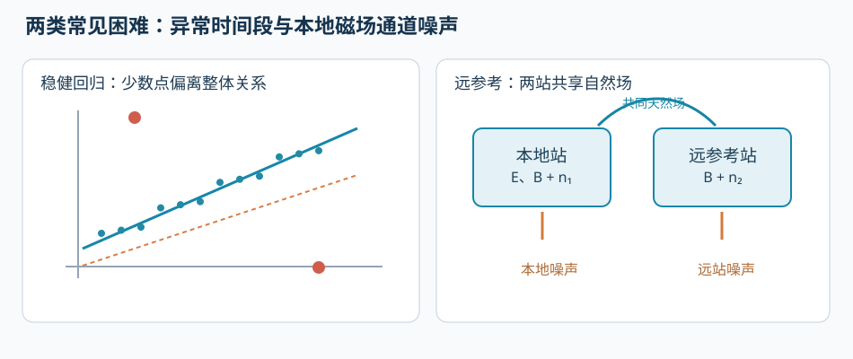



经过切窗和傅里叶变换，我们在每一个目标频率上都攒下了几十甚至上百个时间窗口的复数电场与复数磁场系数。如果世界没有噪声，随便挑两个窗口一除就能算出阻抗；但真实野外数据里不仅电场有噪声，磁场也有噪声，偶尔还会蹦出几个拖拉机或电焊机制造的极端“野值”。本篇从画一条过原点的直线出发，一步步推导复数最小二乘、远参考互相关与迭代重加权稳健回归。

## 本篇路线图
- [8.1 从画一条直线开始学阻抗的最小二乘估计](#sec-05d-least-squares)
- [8.2 最小二乘为什么会算偏：远参考与稳健回归](#sec-05e-robust)

---

## 8.1 从画一条直线开始学阻抗的最小二乘估计

先把复杂的复数矩阵放一边，从初中就见过的正比例直线 $y=ax$ 开始理解“最小二乘”。

### 一、给定三组带误差的数据，怎么定出最佳斜率？

假设物理规律是 $y=ax$，我们想知道未知斜率 $a$。由于测量有误差，三组观测数据并没有严格落在同一条过原点的直线上：

| 观测次数 $j$ | 1 | 2 | 3 |
|---|---:|---:|---:|
| 输入 $x_j$ | 1 | 2 | 3 |
| 实测 $y_j$ | 2.1 | 3.9 | 6.2 |

第一组给出 $y/x=2.1$，第二组给出 $1.95$，第三组给出 $2.067$。用哪个斜率 $a$ 才能最公平地兼顾所有数据？

### 二、残差与最小二乘准则

选定一个候选斜率 $a$ 后，第 $j$ 次测量的预测值为 $ax_j$，实测值与预测值之差称为**残差**：

$$
r_j=y_j-ax_j.
$$

如果直接把残差相加，正负偏差会互相抵消；把每个残差先平方再相加，既能保证每项非负，又能对偏离太远的坏点施加更大惩罚。我们定义**残差平方和**目标函数：

$$
S(a)=\sum_{j=1}^N (y_j-ax_j)^2.
$$

寻找使 $S(a)$ 达到最小值的斜率 $\widehat a$，这就是大名鼎鼎的**最小二乘法（least squares）**。

### 三、用微积分求导推导出最佳斜率公式

把平方展开：

$$
S(a)=\sum_{j=1}^N \left(y_j^2-2ax_jy_j+a^2x_j^2\right).
$$

在开口向上的抛物线最低点处，一阶导数为零。把 $S(a)$ 对待求参数 $a$ 求导（$x_j,y_j$ 视为已知常数）：

$$
\frac{dS}{da}=\sum_{j=1}^N \left(-2x_jy_j+2ax_j^2\right)=0.
$$

移项整理，解出估计斜率 $\widehat a$（头上戴“帽子”表示由样本估计出的数值）：

$$
2a\sum_{j=1}^N x_j^2=2\sum_{j=1}^N x_jy_j \implies \boxed{\widehat a=\frac{\sum_{j=1}^N x_jy_j}{\sum_{j=1}^N x_j^2}}.
$$

把刚才的三组数字代进去算一遍：
- 分子：$\sum x_jy_j=1\times 2.1 + 2\times 3.9 + 3\times 6.2=2.1+7.8+18.6=28.5$；
- 分母：$\sum x_j^2=1^2+2^2+3^2=14$；
- 最佳斜率：$\widehat a=28.5/14\approx 2.036$。

### 四、电磁阻抗方程在数学上就是过原点的线性回归

在一维理想情况下，某频率的电场和磁场满足 $E_x=Z_{xy}H_y$，形式上正是 $y=ax$。推广到一般三维地下结构，每个水平电场分量同时受两个水平磁场分量控制，第 $j$ 个时间窗口的观测方程为（以 $E_x$ 通道为例）：

$$
E_{xj}=Z_{xx}H_{xj}+Z_{xy}H_{yj}+\varepsilon_{xj},
$$

其中 $\varepsilon_{xj}$ 是第 $j$ 个窗口的残差，$Z_{xx},Z_{xy}$ 是两个待求的复数阻抗元素（$E_y$ 通道同理对应 $Z_{yx},Z_{yy}$）。

### 五、把 $N$ 个时间窗口排成矩阵方程

把 $N$ 个时间窗口的水平磁场系数排成一个 $N\times 2$ 矩阵 $\mathbf H$，电场系数排成 $N\times 1$ 列向量 $\mathbf e_x$，待求阻抗排成 $2\times 1$ 列向量 $\mathbf z_x$：

$$
\mathbf H=\begin{pmatrix}
H_{x1} & H_{y1}\\
H_{x2} & H_{y2}\\
\vdots & \vdots\\
H_{xN} & H_{yN}
\end{pmatrix},\qquad
\mathbf e_x=\begin{pmatrix}E_{x1}\\E_{x2}\\\vdots\\E_{xN}\end{pmatrix},\qquad
\mathbf z_x=\begin{pmatrix}Z_{xx}\\Z_{xy}\end{pmatrix}.
$$

所有窗口的方程便合并成一句矩阵形式：

$$
\mathbf e_x=\mathbf H\mathbf z_x+\boldsymbol\varepsilon.
$$

### 六、复数最小二乘矩阵公式

因为电场和磁场都是复数，残差平方应该用**模长平方** $|r|^2=r^*r$（上标 $*$ 表示复共轭，虚部变号）来衡量：

$$
S(\mathbf z_x)=\sum_{j=1}^N |E_{xj}-Z_{xx}H_{xj}-Z_{xy}H_{yj}|^2=(\mathbf e_x-\mathbf H\mathbf z_x)^*(\mathbf e_x-\mathbf H\mathbf z_x),
$$

这里向量右上角的 $*$ 表示**共轭转置**（先取复共轭再行列转置）。对复向量 $\mathbf z_x$ 求导令零，就得到了复数最小二乘估计的标准公式：

$$
\boxed{\widehat{\mathbf z}_x=(\mathbf H^*\mathbf H)^{-1}\mathbf H^*\mathbf e_x}.
$$

观察它的结构，正是前面标量公式 $\dfrac{\sum x_jy_j}{\sum x_j^2}$ 的矩阵版！（实际编写数值程序时，通常采用 QR 分解或奇异值分解 SVD 求解，比直接求矩阵逆数值更稳定。）

### 七、为什么不仅要窗口多，还要场源极化方向多变？

一个窗口只提供一条复数方程，却要解 $Z_{xx}$ 和 $Z_{xy}$ 两个未知复数，显然欠定；所以需要几十上百个窗口联立。

但光数量多还不够：如果所有时间窗口里天然磁场的方向一成不变（比如 $H_y$ 永远等于 $2H_x$），那么矩阵 $\mathbf H$ 的两列就会严格成比例，导致 $\mathbf H^*\mathbf H$ 变成奇异矩阵（行列式为零，无法求逆）。幸运的是，天然电磁场源的偏振方向会随时间自然变化，只要在足够多不同偏振状态的窗口上做回归，就能把 $Z_{xx}$ 和 $Z_{xy}$ 稳稳分开。

### 自我小测

**1.** 已知两组实数观测 $(x_1,y_1)=(1,2)$、$(x_2,y_2)=(2,5)$，求过原点直线 $y=ax$ 的最小二乘斜率。  
**答：** $\widehat a=\dfrac{1\times 2+2\times 5}{1^2+2^2}=\dfrac{12}{5}=2.4$。

**2.** 若复数残差 $r=1+2i$，它的模长平方 $|r|^2=r^*r$ 是多少？  
**答：** $(1-2i)(1+2i)=1^2+2^2=5$。

**3.** 为什么只靠 $1$ 个时间窗口的数据无法唯一解出一般三维地下的 $Z_{xx}$ 和 $Z_{xy}$？  
**答：** 因为单个时间窗口在某个频率上只能列出一条复数方程 $E_{x1}=Z_{xx}H_{x1}+Z_{xy}H_{y1}$，一条方程无法同时唯一确定两个未知复数系数。

---

最小二乘法看起来无懈可击，但它暗中藏着一个理想假设：**自变量（输入磁场 $H_x,H_y$）是绝对精准、没有噪声的，所有测量误差全集中在输出电场 $E_x$ 里。** 真实野外磁场同样带有噪声，这会导致什么系统性后果？下一节我们用两行公式揭晓答案。

[继续阅读：8.2 最小二乘为什么会算偏：远参考与稳健回归](#sec-05e-robust)

---

## 8.2 最小二乘为什么会算偏：远参考与稳健回归

在真实野外环境下，普通最小二乘会遇到两个致命麻烦：第一，本地磁场通道本身也含有噪声，会导致阻抗估计产生系统性向下偏差；第二，少数几个受强干扰污染的“野值窗口”，会把整条拟合直线拉歪。这一节我们分别看看**远参考（Remote Reference）**和**稳健回归（Robust Regression）**是怎么逐一破局的。

### 一、输入磁场带有噪声时，最小二乘为什么会系统性算偏？

为了把统计机理看得一清二楚，先考虑单分量标量模型（此处用磁感应强度 $B$ 表示输入通道，$Z$ 为对应的 $E/B$ 传递系数）。设真实无噪的天然磁场为 $B_s$，真实电场为 $E_s=ZB_s$。

实际仪器测到的信号都混入了局部噪声：

$$
B=B_s+\eta,\qquad E=E_s+\varepsilon,
$$

其中 $\eta$ 是磁场通道噪声，$\varepsilon$ 是电场通道噪声。在大量独立窗口上，单分量最小二乘估计写作（尖括号 $\langle\cdot\rangle$ 表示跨窗口求平均）：

$$
\widehat Z=\frac{\langle B^*E\rangle}{\langle B^*B\rangle}.
$$

把含噪表达式代进去展开。假设局部噪声 $\eta,\varepsilon$ 均值为零，且与天然信号 $B_s$ 互不相关、彼此也不相关，那么所有交叉乘积项在大量窗口平均后趋近于零：
- **分子**：$\langle(B_s+\eta)^*(ZB_s+\varepsilon)\rangle = Z\langle |B_s|^2\rangle$；
- **分母**：$\langle(B_s+\eta)^*(B_s+\eta)\rangle = \langle |B_s|^2\rangle + \langle |\eta|^2\rangle$。

记真实天然信号功率为 $S=\langle |B_s|^2\rangle$，磁场噪声功率为 $N=\langle |\eta|^2\rangle$，于是得到：

$$
\boxed{\widehat Z\approx Z\frac{S}{S+N}}.
$$

看清这个分式！因为噪声功率 $N\ge 0$，比值 $\dfrac{S}{S+N}$ 永远小于或等于 $1$。**只要本地磁场通道有噪声，分母就会变大而分子不变，导致最小二乘算出来的阻抗模长系统性偏小**，进而把视电阻率 $\rho_a\propto |Z|^2$ 往下拉低（这就是经典的向下偏差 downward bias）。

### 二、远参考（Remote Reference）：借远方好友的干净磁场照亮本地

怎么把分母里那个讨厌的 $\langle |\eta|^2\rangle$ 消掉？Gamble 等人在 1979 年提出了一个绝妙的思路：**在几十甚至上百千米外的安静地区，同步架设一台远参考站，记录远站磁场 $B_r=B_{s,r}+\eta_r$。**

天然电磁场源来自高空电离层和磁层，尺度动辄数千千米，因此远站天然磁场 $B_{s,r}$ 与本地天然磁场 $B_s$ 高度相关；但本地测站旁边抽水机或公路车辆产生的局部噪声 $\eta$，绝不会传到一百千米外的远参考站去，所以本地噪声与远站信号完全不相关！

用远站磁场的复共轭 $B_r^*$ 替换公式里的本地 $B^*$，构造**远参考互相关估计**：

$$
\boxed{\widehat Z_{\rm RR}=\frac{\langle B_r^*E\rangle}{\langle B_r^*B\rangle}}.
$$

再展开一次：由于远站噪声 $\eta_r$ 与本地信号、本地噪声全都不相关，分子只剩下 $Z\langle B_{s,r}^*B_s\rangle$，分母只剩下 $\langle B_{s,r}^*B_s\rangle$——分母里的本地磁场噪声功率彻底消失了，上下公共项约掉后，无偏地恢复出了真实阻抗 $Z$！

（提醒：远参考的前提是“两站局部噪声互不相关”。如果两站刚好挨着同一条贯穿全区的超高压直流输电线或电气化铁路，相关人文噪声依然会穿透远参考。）

### 三、少数极端野值窗口，为什么能绑架普通最小二乘？

解决了系统偏差，再看第二个麻烦：假如 $100$ 个时间窗口里，有 $99$ 个都很正常（标准化残差约为 $1$），只有 $1$ 个窗口刚好有重型卡车经过，残差高达 $10$。

在普通最小二乘的平方目标函数 $\ell(r)=r^2/2$ 下，这 $1$ 个异常窗口贡献的惩罚是 $10^2=100$，顶得上整整 $100$ 个正常窗口的总和！为了迁就这一个野值，拟合直线会被硬生生扯偏。

### 四、Huber 损失函数：对小误差宽容，对大野值“封顶增速”

稳健统计学给出的解决方案是修改损失函数，其中最经典的是 **Huber 损失函数**：

$$
\ell_\kappa(r)=
\begin{cases}
\dfrac{1}{2}r^2, & |r|\le \kappa,\\[6pt]
\kappa|r|-\dfrac{1}{2}\kappa^2, & |r|>\kappa,
\end{cases}
$$

其中 $\kappa>0$ 是设定的门限阈值（例如 $\kappa=1.5$）。
- 当残差很小（$|r|\le\kappa$）时，它和普通最小二乘一模一样，保持高斯噪声下的最优统计效率；
- 一旦残差超过阈值（$|r|>\kappa$），惩罚从二次方增长切换为**线性增长**，不再让野值的惩罚呈平方级爆炸。

### 五、迭代重加权最小二乘（IRLS）是怎么自动降权的？

优化 Huber 损失在数值上等价于做**迭代重加权最小二乘（IRLS）**：给残差越大的可疑窗口分配越小的权重 $w(r)$（正常窗口权重为 $1$，异常窗口权重按 $\kappa/|r|$ 缩小）。具体计算分五步循环：
1. 先用普通最小二乘（所有窗口权重相等）算出一个初始阻抗估计；
2. 代回每个窗口，算出各自的残差大小 $|r_j|$；
3. 根据残差大小重新计算每个窗口的权重 $w_j$（残差越大，权重压得越低）；
4. 用加权最小二乘重新求解阻抗；
5. 重复第 2～4 步，直到阻抗估计收敛稳定。

### 六、实际处理软件在背后做了什么？

主流开源与商业 MT 处理软件（如 **EMTF**、**Aurora**、**BIRRP** 等）正是把上述整套流程封装成了自动化流水线：从读取多通道时间序列、多级降采样切窗、去趋势加 Hann 窗、FFT 变换、扣除仪器响应标定曲线，再到结合远参考站进行两阶段稳健回归（常用 Huber 权重与更狠的 Thomson 降权函数组合），最终输出每个频率的复阻抗张量、倾子以及误差棒（error bars）。

处理完成后，操作者仍需人工核查相干度、远参考前后的曲线对比以及死频带（dead band）数据质量，确保交给反演程序的是一份干净可靠的频域响应。

### 自我小测

**1.** 为什么本地磁场通道存在独立噪声时，普通最小二乘算出的阻抗模长会系统性偏小？  
**答：** 因为磁场噪声功率会额外叠加进回归公式的分母 $\langle |B_s|^2\rangle+\langle |\eta|^2\rangle$ 中，而分子在独立噪声假设下不变，导致估计结果乘上了小于 $1$ 的衰减因子 $S/(S+N)$。

**2.** 远参考方法主要利用了天然场源和局部噪声的什么统计差异？  
**答：** 利用了天然电磁场在数十至上百千米尺度上具有高度空间相关性，而测站周边的局部人文或仪器噪声在两站之间互不相关的特性。

**3.** 稳健回归（IRLS）等于直接把所有看起来偏离的窗口统统删掉吗？  
**答：** 不等于。它是通过设计随残差增大而递减的权重函数，连续平滑地降低异常窗口对回归结果的影响，比粗暴的硬剔除更加稳定。

---

到这里，第二阶段（正演、野外观测与信号处理）已经全部收官——我们手里已经拿到了每个测站、每个频率的 $2\times 2$ 复阻抗张量 $\mathbf Z(f)$。下一篇开启第三阶段，学习如何解剖这四个复数，从中读出地下电性维数、近地表畸变与区域地质走向。

[继续阅读：09｜阻抗张量、地质维度与坐标旋转](/posts/2026/10/mt-course-06a-tensor-dimensions/) · [返回总目录](/posts/2026/10/mt-course/)
