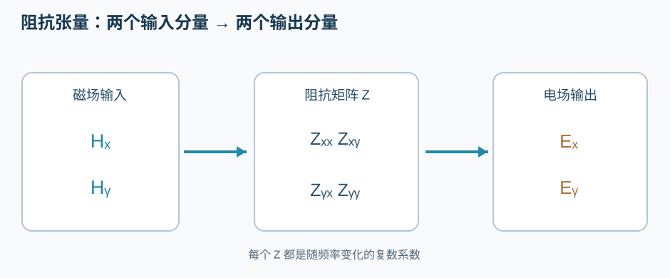
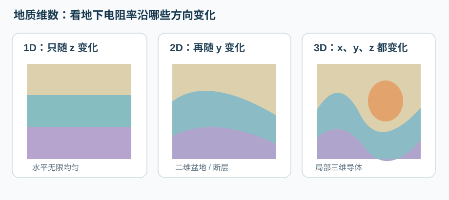
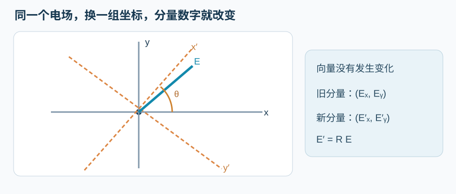



第二阶段我们已经学会了如何从五路时间序列中提取每个频率的复数电场和磁场，并通过最小二乘或稳健回归估计出频率响应。现在进入第三阶段，最核心的问题随之而来：**拿着每个频率算出来的四个复数阻抗，怎么判断脚下的地质构造是一维、二维还是三维？野外电极铺歪了角度怎么办？近地表的小型导电异常体有没有把深部信号“带歪”？**

本篇先从最朴素的 $2\times 2$ 矩阵乘法练起，理解阻抗张量与倾子（tipper）的物理意义，理清地下电性维数与 TE/TM 极化，最后亲手推导张量坐标旋转公式 $\mathbf Z'=\mathbf R\mathbf Z\mathbf R^T$。

## 本篇路线图
- [9.1 阻抗张量为什么是四个复数：从矩阵乘法开始](#sec-06a-tensor)
- [9.2 一维、二维、三维怎么判断？TE 和 TM 又是什么？](#sec-06b-dimensionality)
- [9.3 为什么旋转阻抗张量，要左右各乘一个矩阵？](#sec-06c-rotation)

---

## 9.1 阻抗张量为什么是四个复数：从矩阵乘法开始

在理想一维水平层状地球中，单凭一个比值 $Z_{xy}=E_x/H_y$ 就能刻画一种极化的响应。可一旦地下岩层在水平方向不再均匀，每个水平电场分量就可能同时受到北向和东向两个水平磁场分量的影响，于是需要四个复数系数才能完整描述。

### 一、从“一输入一输出”推广到“两输入两输出”

在理想一维模型中，某个频率的北向电场 $E_x$ 只由东向磁场 $H_y$ 决定：

$$
E_x=Z_{xy}H_y.
$$

这只是最简单的“输出 $=$ 比例系数 $\times$ 输入”。例如 $H_y=2$、$Z_{xy}=3+4i$，算出来 $E_x=6+8i$，复数系数把振幅比例和相位差同时打包在了一起。

当地下出现横向电性差异时，磁场沿 $x$ 方向（北向）的变化同样会感应出 $x$ 方向的电场，因此 $E_x$ 必须同时依赖 $H_x$ 和 $H_y$ 两个输入：

$$
E_x=Z_{xx}H_x+Z_{xy}H_y.
$$

同理，东向输出电场 $E_y$ 也需要两个系数：

$$
E_y=Z_{yx}H_x+Z_{yy}H_y.
$$

把这两行方程叠在一起，就组成了**阻抗张量**（impedance tensor）。

### 二、矩阵只是两行线性方程的紧凑写法

$$
\boxed{
\begin{pmatrix}E_x\\E_y\end{pmatrix}
=\begin{pmatrix}Z_{xx} & Z_{xy}\\ Z_{yx} & Z_{yy}\end{pmatrix}
\begin{pmatrix}H_x\\H_y\end{pmatrix}
}.
$$

按矩阵乘法“行乘列再相加”的规则展开，第一行正是 $Z_{xx}H_x+Z_{xy}H_y$，第二行正是 $Z_{yx}H_x+Z_{yy}H_y$。

**下标记忆口诀：** 阻抗元素 $Z_{ij}$ 的**第一个下标**标明输出电场的方向，**第二个下标**标明输入磁场的方向（比如 $Z_{xy}$ 表示“$y$ 方向磁场输入所引起的 $x$ 方向电场输出”），它们从来都不是测站编号。

### 三、拿一组简单数字亲手算一遍

先用纯实数练习一下矩阵乘法，设

$$
\mathbf Z=\begin{pmatrix}1 & 2\\ 3 & 4\end{pmatrix},\qquad \mathbf H=\begin{pmatrix}5\\ 6\end{pmatrix}.
$$

第一行输出 $E_x=1\times 5 + 2\times 6=17$；第二行输出 $E_y=3\times 5 + 4\times 6=39$，因此

$$
\mathbf E=\begin{pmatrix}17\\ 39\end{pmatrix}.
$$

真实阻抗的四个元素都是复数，但乘法规则分毫不差。**一个 $2\times 2$ 复矩阵包含 $4$ 个复数，每个复数有实部和虚部 $2$ 个数字，合起来一共是 $8$ 个实数。** 后面要学的维度判断和坐标旋转，本质上就是在研究这 $8$ 个实数之间的约束关系。

### 四、磁场用 $H$ 还是 $B$？注意单位换算

部分处理软件直接存储磁感应强度 $\mathbf B$（单位 $\mathrm{nT}$）。在非磁性介质中 $\mathbf B=\mu_0\mathbf H$，若把 $\mathbf E=\mathbf Z_H\mathbf H$ 改写成用 $\mathbf B$ 表示，则

$$
\mathbf E=\underbrace{\frac{\mathbf Z_H}{\mu_0}}_{\mathbf M}\mathbf B.
$$

可见，用 $E/H$ 定义的阻抗（单位 $\Omega$）与用 $E/B$ 定义的传递函数（单位 $\mathrm{m/s}$ 或 $\mathrm{km/(s\cdot nT)}$）之间相差一个真空磁导率 $\mu_0$ 因子，跨软件比较前务必先统一单位约定。

### 五、第五个通道 $H_z$ 怎么用？——倾子（Tipper）

除了四个水平场通道，野外还测了垂向磁场 $H_z$。在平面波近似下，垂向磁场同样可以通过水平磁场线性预测：

$$
H_z=T_xH_x+T_yH_y.
$$

由两个复数 $(T_x,T_y)$ 组成的向量称为**倾子（tipper）**。在水平均匀的一维地球上，天然水平磁场不会感应出垂向磁场，因此 $T_x=T_y=0$；一旦附近存在横向电性边界或陡倾导电带，就会产生明显的 $H_z$ 响应。把倾子的实部或虚部画成平面箭头，就得到**感应箭头（induction arrows）**（绘图前需核对 Parkinson 指向导体还是 Wiese 背离导体的符号约定）。

### 六、特殊的一维模型长什么样？

对于水平层状、各向同性的一维地球，阻抗矩阵简化为反对称形式：

$$
\mathbf Z_{1D}=\begin{pmatrix}0 & Z\\ -Z & 0\end{pmatrix}.
$$

即两个主对角元 $Z_{xx}=Z_{yy}=0$，两个非对角元大小相等、符号相反（$Z_{xy}=-Z_{yx}$）。对角元消失不是因为仪器没测到，而是水平各方向完全对称的必然结果。

### 自我小测

已知 $\mathbf Z=\begin{pmatrix}1 & 2\\ 3 & 4\end{pmatrix}$，当输入磁场为 $\mathbf H=(0,5)^T$ 时，输出电场 $\mathbf E$ 是多少？  
**答：** $\mathbf E=(1\times 0+2\times 5,\; 3\times 0+4\times 5)^T=(10,20)^T$。当 $H_x=0$ 时，只有矩阵的第二列对输出起作用。

---

理解了阻抗矩阵的四个元素，接下来我们就要回答实际勘探中最关心的分类问题：拿到一张观测张量，怎样区分地下是“千层糕”式的一维、条带状延伸的二维，还是立体复杂的三维？

[继续阅读：9.2 一维、二维、三维怎么判断？TE 和 TM 又是什么？](#sec-06b-dimensionality)

---

## 9.2 一维、二维、三维怎么判断？TE 和 TM 又是什么？

电磁场永远在三维空间里传播；地球物理里说的“一维、二维、三维”，指的是**地下电导率随几个空间坐标发生变化**。把这个前提理顺，阻抗张量的各种形态就很好认了。

### 一、一维（1D）模型：水平转一圈，响应全不变

一维地球的电阻率只随深度变（$\rho=\rho(z)$）。在同一水平面上，朝北、朝东、朝东北看过去岩石性质一模一样，无论怎么水平旋转坐标轴，电阻率分布都不会改变。因此理想无噪的一维阻抗张量和倾子满足：

$$
\mathbf Z_{1D}=\begin{pmatrix}0 & Z\\ -Z & 0\end{pmatrix},\qquad T_x=T_y=0.
$$

（实际野外数据总带有测量噪声，主对角元不会严格等于绝对的 $0$，而是表现为远小于非对角元的微小波动。）

### 二、二维（2D）模型：引入“地质走向”

假设地下有一条沿 $x$ 方向无限延伸的断层或狭长盆地，沿 $x$ 方向岩石性质不变，只在横跨断层的 $y$ 方向和深度 $z$ 方向变化：

$$
\rho=\rho(y,z).
$$

这条构造延伸不变的水平方向（这里是 $x$ 轴），称为**地质走向（geological strike）**。当我们把测量坐标轴恰好对齐地质走向及其垂直方向时，理想二维阻抗张量呈现简洁的反对角形式：

$$
\mathbf Z_{2D}=\begin{pmatrix}0 & Z_{xy}\\ Z_{yx} & 0\end{pmatrix}.
$$

主对角元依然为零，但此时 **$Z_{xy}$ 与 $-Z_{yx}$ 不再相等**——因为电流顺着构造走向流动和横穿构造界面流动，感受到的阻力截然不同。

### 三、TE 模式与 TM 模式的物理直觉

仍设地质走向沿 $x$ 方向，二维响应自然分成两种独立极化模式：
- **TE 模式（横向电模式）**：水平电场平行于构造走向（$E_x$），对应阻抗元素 **$Z_{xy}=E_x/H_y$**。感应电流顺着走向畅通无阻地流动，对沿走向延伸的深部导电带很敏感；
- **TM 模式（横向磁模式）**：水平磁场平行于构造走向（$H_x$），水平电场横穿构造走向（$E_y$），对应阻抗元素 **$Z_{yx}=E_y/H_x$**。由于电流必须横穿不同电性岩层的垂直边界，界面上会积累电荷，因此 TM 模式对断层位置和浅部横向电性边界格外敏感。

（注意：如果有的文献把地质走向定义在 $y$ 轴，TE 和 TM 对应的 $xy$ 与 $yx$ 下标就会互换。记住“电场平行走向是 TE、磁场平行走向是 TM”，比死记下标更稳妥。）

### 四、如果电极线没对准地质走向，二维数据会长什么样？

野外布站时，我们事先并不知道地下深处构造的精确走向，电极往往按正北、正东铺设，与真实地质走向之间夹着一个偏角 $\theta$。

在这个“歪着”的观测坐标系里，虽然地下构造明明是纯正的二维，算出来的阻抗张量却会出现**四个元素全都不为零**（$Z_{xx}\ne 0,\,Z_{yy}\ne 0$）！原因很简单：我们用了一套没对齐对称轴的尺子去量一个对称物体。只要通过下一节的坐标旋转把张量转回走向方向，主对角元就会重新归零。所以千万别一看到 $Z_{xx}\ne 0$ 就草率下结论说“地下一定是三维”。

### 五、三维（3D）模型：任意方向都不再对称

如果地下异常体在长、宽、深三个方向上都是有限尺度（比如一个孤立的岩浆囊或盐丘），电阻率随三个坐标同时变化 $\rho=\rho(x,y,z)$。此时无论你把水平坐标轴转到哪个角度，阻抗张量的四个元素通常都无法同时化零，倾子的两个分量也都显著非零。

需要补充的是，真实地球往往具有多尺度叠合特征：高频段可能反映浅部三维局部不均匀体，中频段呈现区域二维构造走向，超低频段又逐渐过渡到深部一维背景。

### 自我小测

**1.** 某频率无噪声阻抗矩阵为 $\mathbf Z=\begin{pmatrix}0 & 3+2i\\ -3-2i & 0\end{pmatrix}$，它符合哪种维度的特征？  
**答：** 符合理想一维各向同性介质的特征（主对角元为零，且 $Z_{xy}=-Z_{yx}$）。

**2.** 如果改成 $\mathbf Z=\begin{pmatrix}0 & 3+2i\\ -5-i & 0\end{pmatrix}$，它最接近哪种情形？  
**答：** 最接近坐标轴已对准地质走向的二维模型特征（主对角元为零，但 $|Z_{xy}|\ne |Z_{yx}|$）。不过单凭单个频率的数据还不能排除特殊三维对称构造的可能，需结合多频段综合判断。

---

既然野外测站坐标系常常和地下地质走向差着一个偏角 $\theta$，那么把坐标轴水平旋转 $\theta$ 角度后，新的阻抗张量 $\mathbf Z'$ 该怎么算？下一节我们就用高中三角函数和矩阵乘法，亲手推导出 $\mathbf Z'=\mathbf R\mathbf Z\mathbf R^T$。

[继续阅读：9.3 为什么旋转阻抗张量，要左右各乘一个矩阵？](#sec-06c-rotation)

---

## 9.3 为什么旋转阻抗张量，要左右各乘一个矩阵？

几乎每本大地电磁教材都会给出一条核心变换公式：

$$
\boxed{\mathbf Z'=\mathbf R\mathbf Z\mathbf R^T}.
$$

物理空间里的电场和磁场箭头其实一动没动，动的只是我们架在地面上的坐标尺子。既然物理场没变，为什么换一套坐标轴后，阻抗矩阵 $\mathbf Z$ 的左右两边要各乘一次旋转矩阵？我们从二维向量的投影一步步推出来。

### 一、物理箭头没动，变的只是坐标投影数字

想象地面上有一支指向东北方的电场箭头，长度为 $\sqrt{2}$。在旧坐标系（$x$ 指北、$y$ 指东）中，它的分量是 $\mathbf v=(1,1)^T$。现在我们把坐标尺逆时针（从北向东）旋转 $45^\circ$，让新的 $x'$ 轴正好对准东北方，新的 $y'$ 轴垂直指向东南方。箭头还是原来那支箭头，但他在新尺子上的读数变成了 $(\sqrt{2},0)^T$。**坐标变换改变的只是分量数字，不是物理场本身。**

### 二、用三角函数写出旋转矩阵 $\mathbf R(\theta)$

在北—东—下（NED）右手坐标系中，设新坐标轴 $(x',y')$ 相对旧坐标轴 $(x,y)$ 顺时针（即从北 $x$ 向东 $y$）旋转角度 $\theta$。利用平面直角坐标投影，旧分量 $(v_x,v_y)$ 换算成新分量 $(v_x',v_y')$ 的关系为：

$$
v_x'=v_x\cos\theta+v_y\sin\theta,\qquad v_y'=-v_x\sin\theta+v_y\cos\theta.
$$

写成矩阵乘法 $\mathbf v'=\mathbf R(\theta)\mathbf v$，就得到了标准的二维**旋转矩阵**：

$$
\mathbf R(\theta)=\begin{pmatrix}\cos\theta & \sin\theta\\ -\sin\theta & \cos\theta\end{pmatrix}.
$$

代入 $\theta=45^\circ$（$\cos 45^\circ=\sin 45^\circ=1/\sqrt{2}$）和 $\mathbf v=(1,1)^T$ 验证一下：

$$
v_x'=\frac{1}{\sqrt{2}}+\frac{1}{\sqrt{2}}=\sqrt{2},\qquad v_y'=-\frac{1}{\sqrt{2}}+\frac{1}{\sqrt{2}}=0,
$$

和刚才的几何直觉分毫不差。

### 三、什么叫转置？为什么旋转矩阵的逆就是它的转置？

把一个矩阵的行和列互换，叫作**矩阵转置**，记作上标 $T$。对旋转矩阵 $\mathbf R$ 取转置：

$$
\mathbf R^T=\begin{pmatrix}\cos\theta & -\sin\theta\\ \sin\theta & \cos\theta\end{pmatrix}.
$$

算一下 $\mathbf R^T\mathbf R$：
- 第一行乘第一列：$\cos^2\theta+\sin^2\theta=1$；
- 第一行乘第二列：$\cos\theta\sin\theta-\sin\theta\cos\theta=0$；
- 其余两项同理，结果恰好是单位矩阵 $\mathbf I=\begin{pmatrix}1 & 0\\ 0 & 1\end{pmatrix}$！

因此旋转矩阵是一个**正交矩阵**，它的逆矩阵直接等于它的转置：

$$
\mathbf R^{-1}=\mathbf R^T.
$$

物理意义极其直观：把坐标尺顺时针转过 $\theta$ 角（乘以 $\mathbf R$），再逆时针转回 $\theta$ 角（乘以 $\mathbf R^T$），一切原封不动回到起点。

### 四、完整推导 $\mathbf Z'=\mathbf R\mathbf Z\mathbf R^T$

在旧坐标系中，电场和磁场满足 $\mathbf E=\mathbf Z\mathbf H$。现在把同一个电场和同一个磁场都投影到新坐标系里：

$$
\mathbf E'=\mathbf R\mathbf E,\qquad \mathbf H'=\mathbf R\mathbf H.
$$

利用 $\mathbf R^{-1}=\mathbf R^T$，从第二式把旧磁场用新磁场反表出来：$\mathbf H=\mathbf R^T\mathbf H'$。把它代进第一式：

$$
\mathbf E'=\mathbf R\mathbf E=\mathbf R(\mathbf Z\mathbf H)=\mathbf R\mathbf Z\mathbf R^T\mathbf H'.
$$

对照新坐标系下阻抗张量的定义 $\mathbf E'=\mathbf Z'\mathbf H'$，立刻得到

$$
\boxed{\mathbf Z'=\mathbf R\mathbf Z\mathbf R^T}.
$$

**从右往左读这条公式，每一步动作都非常清楚：** 最右边的 $\mathbf R^T$ 先把新坐标系下的磁场输入“翻译”回旧坐标；中间的 $\mathbf Z$ 在旧坐标里算出对应的电场；最左边的 $\mathbf R$ 再把算出来的电场“翻译”到新坐标。左右各乘一个矩阵，本质就是做了一次“输入转回去、输出转过来”的坐标翻译。

### 五、亲手算一个旋转 $90^\circ$ 的例子

设原阻抗张量为 $\mathbf Z=\begin{pmatrix}a & b\\ c & d\end{pmatrix}$，旋转 $\theta=90^\circ$（此时 $\cos 90^\circ=0,\,\sin 90^\circ=1$），旋转矩阵为 $\mathbf R_{90}=\begin{pmatrix}0 & 1\\ -1 & 0\end{pmatrix}$，其转置为 $\mathbf R_{90}^T=\begin{pmatrix}0 & -1\\ 1 & 0\end{pmatrix}$。

分两步相乘：
1. 先算 $\mathbf R_{90}\mathbf Z=\begin{pmatrix}0 & 1\\ -1 & 0\end{pmatrix}\begin{pmatrix}a & b\\ c & d\end{pmatrix}=\begin{pmatrix}c & d\\ -a & -b\end{pmatrix}$；
2. 再右乘 $\mathbf R_{90}^T$：
   $$
   \mathbf Z'=\begin{pmatrix}c & d\\ -a & -b\end{pmatrix}\begin{pmatrix}0 & -1\\ 1 & 0\end{pmatrix}=\boxed{\begin{pmatrix}d & -c\\ -b & a\end{pmatrix}}.
   $$

看！把坐标轴顺时针旋转 $90^\circ$ 后，原来的 $Z_{xy}$（即 $b$）和 $Z_{yx}$（即 $c$）不仅互换了位置，还各自翻了一个负号！这也解释了为什么二维走向分析总是存在 $90^\circ$ 的角歧义（分不清哪条轴是走向、哪条是倾向）。

### 六、认识三个“怎么转都不变”的旋转不变量

虽然单个矩阵元素会随着旋转角度 $\theta$ 变来变去，但下面三个组合量在任意水平正交旋转下严格保持不变：
- **迹（Trace）**：$\operatorname{tr}\mathbf Z=Z_{xx}+Z_{yy}$（因为 $\operatorname{tr}(\mathbf R\mathbf Z\mathbf R^T)=\operatorname{tr}(\mathbf Z\mathbf R^T\mathbf R)=\operatorname{tr}\mathbf Z$）；
- **反迹（Antitrace）**：$\operatorname{atr}\mathbf Z=Z_{xy}-Z_{yx}$；
- **行列式（Determinant）**：$\det\mathbf Z=Z_{xx}Z_{yy}-Z_{xy}Z_{yx}$（因为 $\det\mathbf R=1$）。

### 自我小测

**1.** 向量 $\mathbf v=(1,0)^T$ 在本节顺时针旋转 $90^\circ$ 约定下，新坐标分量 $\mathbf v'$ 是多少？  
**答：** $\mathbf v'=\begin{pmatrix}0 & 1\\ -1 & 0\end{pmatrix}\begin{pmatrix}1\\ 0\end{pmatrix}=\begin{pmatrix}0\\ -1\end{pmatrix}$。

**2.** 为什么阻抗张量旋转不是简单的 $\mathbf Z'=\mathbf R\mathbf Z$，而要在右边多乘一个 $\mathbf R^T$？  
**答：** 因为 $\mathbf Z$ 联系的是“输入磁场”与“输出电场”两个矢量，不仅输出电场要转换到新坐标系，输入磁场也必须从新坐标系变换回旧坐标系。

**3.** 两个阻抗张量的迹与反迹完全相同，能否证明它们在物理上完全等价？  
**答：** 不够。迹和反迹只锁定了四个复数中的两个线性组合，还不足以完整确定全部四个元素。

---

既然单个元素会随电极方向改变，那么能不能利用这些“旋转不变量”，在还没找到地质走向之前就先诊断出地下到底是一维、二维还是三维？下一篇我们就来学习更系统的 WAL 不变量、近地表畸变分解以及强大的相位张量。

[继续阅读：10｜旋转不变量、Groom–Bailey 畸变与相位张量](/posts/2026/10/mt-course-06b-tensor-interpretation/) · [返回总目录](/posts/2026/10/mt-course/)
