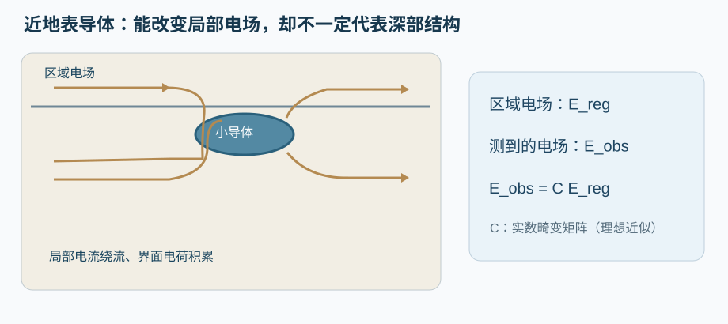
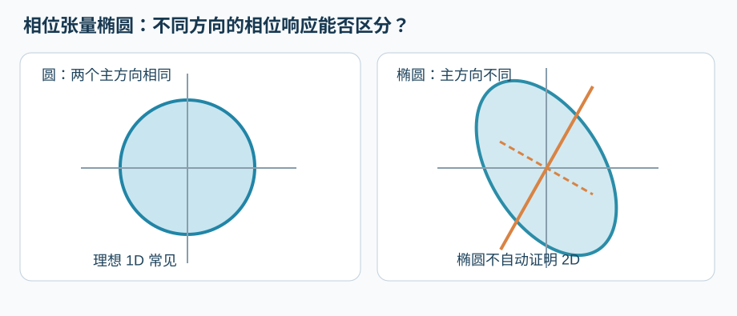



上一篇我们推导了阻抗张量的旋转公式 $\mathbf Z'=\mathbf R\mathbf Z\mathbf R^T$，也认识了迹和反迹两个基础旋转不变量。但在真实野外分析中，我们经常面临两个棘手局面：第一，电极方向还没旋转对齐地质走向时，如何先客观判断地下维数；第二，测站旁边如果埋着一块尺幅很小的浅部导电体，它会把区域电场扭曲得面目全非。本篇依次介绍系统的 WAL 不变量、Groom–Bailey 畸变分解，以及能够自动消除实数电流性畸变的相位张量。

## 本篇路线图
- [10.1 WAL 不变量：不旋转坐标也能看出什么？](#sec-06d-invariants)
- [10.2 近地表导体怎样扭曲电场：Groom–Bailey 畸变](#sec-06e-distortion)
- [10.3 相位张量怎么来的：先用数字理解矩阵求逆](#sec-06f-phase-tensor)

---

## 10.1 WAL 不变量：不旋转坐标也能看出什么？

一份阻抗张量包含 $4$ 个复数，也就是 $8$ 个实数。只要旋转一下测量坐标系，这些数字就会跟着变。为了不让“地下是不是二维”的判断受限于电极线恰好朝哪个方向铺设，Weaver、Agarwal 和 Lilley 提出了一套完备的旋转不变量体系——**WAL 不变量**。

### 一、先把八个实数重新排成四个复数组合

回顾迹和反迹这两个最简单的旋转不变量，我们把 $4$ 个复阻抗元素做如下线性重组：

$$
\begin{aligned}
c_1&=\frac{1}{2}(Z_{xx}+Z_{yy})=\xi_1+i\eta_1,\\
c_2&=\frac{1}{2}(Z_{xy}+Z_{yx})=\xi_2+i\eta_2,\\
c_3&=\frac{1}{2}(Z_{xx}-Z_{yy})=\xi_3+i\eta_3,\\
c_4&=\frac{1}{2}(Z_{xy}-Z_{yx})=\xi_4+i\eta_4.
\end{aligned}
$$

这里希腊字母 $\xi$（读作 xi）和 $\eta$（读作 eta）分别代表对应复数的**实部**和**虚部**。注意，这里没有引入任何新物理量，只是把原有的 $8$ 个实数换了一种更对称的排列方式（$c_1$ 是迹的一半，$c_4$ 是反迹的一半）。

### 二、WAL 前四个不变量 $I_1 \sim I_4$

由前一篇可知，在纯水平旋转下 $c_1$ 和 $c_4$ 严格不变，因此它们的实部模长和虚部模长也是旋转不变量：

$$
\boxed{I_1=\sqrt{\xi_1^2+\xi_4^2}},\qquad \boxed{I_2=\sqrt{\eta_1^2+\eta_4^2}}.
$$

$I_1$ 和 $I_2$ 刻画了阻抗实部与虚部的总体能量尺度。接下来再看 $c_2$ 和 $c_3$：在坐标旋转时，$(\xi_2,\xi_3)$ 像二维平面向量一样旋转，其长度 $\sqrt{\xi_2^2+\xi_3^2}$ 保持不变；$(\eta_2,\eta_3)$ 同理。用总体尺度归一化后，得到无量纲不变量 $I_3$ 和 $I_4$：

$$
\boxed{I_3=\frac{\sqrt{\xi_2^2+\xi_3^2}}{I_1}},\qquad \boxed{I_4=\frac{\sqrt{\eta_2^2+\eta_3^2}}{I_2}}.
$$

在理想无噪声的一维各向同性地球中，$Z_{xx}=Z_{yy}=0$ 且 $Z_{xy}=-Z_{yx}$，于是 $c_2=c_3=0$，直接推出 $I_3=I_4=0$。因此 $I_3$ 和 $I_4$ 衡量的是实部与虚部偏离理想一维模型的程度。

### 三、后面三个不变量 $I_5 \sim I_7$ 与派生指标 $Q$

为了进一步检测复阻抗实部与虚部的方向是否一致、以及是否存在近地表电流性畸变，WAL 体系对 $i,j\in\{1,2,3,4\}$ 定义两组反对称与对称交叉组合：

$$
d_{ij}=\frac{\xi_i\eta_j-\xi_j\eta_i}{I_1I_2},\qquad s_{ij}=\frac{\xi_i\eta_j+\xi_j\eta_i}{I_1I_2}.
$$

在此约定下，后三个旋转不变量写为：

$$
I_5=s_{41},\qquad I_6=d_{41},
$$

$$
\boxed{I_7=\frac{d_{41}-d_{23}}{\sqrt{(d_{12}-d_{34})^2+(d_{13}+d_{24})^2}}},
$$

同时定义派生指标 $Q=\sqrt{(d_{12}-d_{34})^2+(d_{13}+d_{24})^2}$。

这套公式在数学上非常完备：原本 $8$ 个依赖坐标角度的实数，被提取成了 $7$ 个与坐标方向无关的旋转不变量（$I_1\sim I_7$），剩下的唯一自由度正好对应地质走向角！**计算提醒：** 当分母（如 $I_1,I_2$ 或 $Q$）接近零时，某些比值指标会趋于奇异或被噪声剧烈放大，此时应结合误差棒判断，不能机械填零。

### 四、不同维度下 WAL 指标的特征

- **理想一维（1D）**：$I_3=I_4=I_5=I_6=0$，$I_7$ 因分母为零而无定义；
- **理想二维（2D）**（无局部畸变）：$I_3$ 或 $I_4$ 非零，但 $I_5=I_6=0$，$I_7=0$（或 $Q=0$ 无定义）；
- **带电流性畸变的二维**：$I_5,I_6$ 可能非零，但在特定条件下 $I_7=0$；
- **一般三维（3D）**：$I_7$ 显著偏离零。

（实际应用中常取 $0.1$ 或 $0.15$ 作为判定“统计上接近零”的经验门槛，但具体阈值必须结合数据误差大小来评估。）

### 五、经典的 Swift 偏斜度（Swift Skew）

在 WAL 体系出现之前，地球物理学家最常用的是计算极其简便的 **Swift skew**：

$$
\boxed{\mathrm{skew}_S=\frac{\lvert Z_{xx}+Z_{yy}\rvert}{\lvert Z_{xy}-Z_{yx}\rvert}}.
$$

例如某频率测得 $Z_{xx}=0.1,\,Z_{yy}=0.1,\,Z_{xy}=4,\,Z_{yx}=-4$，则 $\mathrm{skew}_S=0.2/8=0.025$。无论在理想 1D 还是理想 2D 模型中，无论坐标系怎么旋转，主对角元之和 $Z_{xx}+Z_{yy}$ 恒为零，因此理论 Swift skew 恒等于 $0$；历史上常把 $\mathrm{skew}_S<0.2$ 作为二维近似的粗略筛查门槛。不过 Swift skew 容易受浅部三维畸变干扰（即使深部是标准二维，浅部小异常体也能让它大于 $0.2$）。

### 自我小测

**1.** 推导 WAL 不变量时，为什么要大费周章把阻抗拆成 $I_1\sim I_7$？  
**答：** 因为单个阻抗元素会随野外电极铺设方位角的改变而变化，通过构造旋转不变量，可以在不知道地质走向的前提下，客观提取出仅反映地下电性结构维数的特征指标。

**2.** 某测点算出的 Swift skew 为 $0.08$（小于 $0.2$），能否百分之百确定该地区地下一定是二维结构？  
**答：** 不能。小于 $0.2$ 只是与近一维或二维模型相容的经验门槛，某些对称三维结构也可能产生较小的 Swift skew，仍需结合相位张量、倾子和相邻测站综合判断。

---

刚才我们多次提到“浅部小异常体”会把深部二维信号搅乱。这种近地表畸变究竟是怎么产生的？它又是如何把南北电场和东西电场拧在一起的？下一节我们就用 Groom–Bailey 畸变模型来解剖它。

[继续阅读：10.2 近地表导体怎样扭曲电场：Groom–Bailey 畸变](#sec-06e-distortion)

---

## 10.2 近地表导体怎样扭曲电场：Groom–Bailey 畸变

设想我们的目标是探测 $15\,\mathrm{km}$ 深处的地壳构造，可野外布站时，测站旁边几十米处恰好埋着一块几百米宽的浅部含水黏土囊或小矿体。这个小异常体的尺度远小于区域构造，却像一块磁石一样把周围的天然电流吸过去或者推开。结果仪器测到的电场，成了**区域真实电场经过局部障碍物重新分配后的扭曲版本**。

### 一、为什么浅部小异常体主要扭曲“电场”？——电流性畸变

当电流穿过电导率不同的岩性界面时，电荷会在界面上积累，产生一个附加的局部静电场（这种效应称为**电流性畸变，galvanic distortion**）。当异常体尺度远小于研究频带的趋肤深度时，这种局部电荷分布几乎不随频率变化，且对磁场的影响相对微弱，主要表现为把区域水平电场 $\mathbf E_{\rm reg}$ 乘上一个与频率无关的 **$2\times 2$ 实数畸变矩阵** $\mathbf C$：

$$
\boxed{\mathbf E_{\rm obs}=\mathbf C\mathbf E_{\rm reg}}.
$$

举个直观例子：假设 $\mathbf C=\begin{pmatrix}2 & 0\\ 0 & 1\end{pmatrix}$，区域真实电场为 $\mathbf E_{\rm reg}=(3,4)^T$，经过浅部异常体放大后，测站实测电场变成了 $\mathbf E_{\rm obs}=(6,4)^T$——北向电场被凭空拉长了两倍。

### 二、阻抗张量如何被畸变矩阵“污染”？

假设磁场未受明显畸变，且区域背景满足 $\mathbf E_{\rm reg}=\mathbf Z_{\rm reg}\mathbf H$。代入上式：

$$
\mathbf E_{\rm obs}=\mathbf C(\mathbf Z_{\rm reg}\mathbf H)=(\mathbf C\mathbf Z_{\rm reg})\mathbf H.
$$

于是测站观测到的表观阻抗张量变成了

$$
\boxed{\mathbf Z_{\rm obs}=\mathbf C\mathbf Z_{\rm reg}}.
$$

即使区域深部结构明明是理想二维（$\mathbf Z_{\rm reg}$ 主对角元为零），只要左乘一个非对角的实数矩阵 $\mathbf C$，实测阻抗 $\mathbf Z_{\rm obs}$ 的四个元素就会全都不为零！浅部导电小体就像让原本独立的南北、东西两个通道互相“串了门”。

### 三、Groom–Bailey（GB）分解：把畸变拆成四个几何动作

Groom 和 Bailey（1989）把抽象的 $2\times 2$ 实数畸变矩阵 $\mathbf C$ 分解成四个具有明确物理几何意义的基本操作：

$$
\boxed{\mathbf C=g\,\mathbf T\,\mathbf S\,\mathbf A},
$$

1. **扭转矩阵 $\mathbf T(t)$（Twist）**：将区域电场向量整体旋转一个小角度 $\arctan t$：
   $$
   \mathbf T(t)=\frac{1}{\sqrt{1+t^2}}\begin{pmatrix}1 & -t\\ t & 1\end{pmatrix}.
   $$
2. **剪切矩阵 $\mathbf S(s)$（Shear）**：沿对称轴方向把正交的电场轴向彼此挤压成斜交，使两个方向的分量互相混入：
   $$
   \mathbf S(s)=\frac{1}{\sqrt{1+s^2}}\begin{pmatrix}1 & s\\ s & 1\end{pmatrix}.
   $$
   （展开可见 $E_x'=\frac{E_x+sE_y}{\sqrt{1+s^2}}$，$E_y'=\frac{sE_x+E_y}{\sqrt{1+s^2}}$，剪切角为 $\arctan s$。）
3. **局部各向异性矩阵 $\mathbf A(a)$（Anisotropy）**：对两个正交方向施加一增一减的比例缩放：
   $$
   \mathbf A(a)=\frac{1}{\sqrt{1-a^2}}\begin{pmatrix}1+a & 0\\ 0 & 1-a\end{pmatrix},\qquad \lvert a\rvert<1.
   $$
4. **测站增益 $g$（Site Gain）**：一个标量常数，把整个水平电场统一放大或缩小 $g$ 倍（它直接导致下一篇要讲的静态位移）。

### 四、为什么单个测站、单个频率无法把畸变完全解开？

数一下自由度就明白了：在单个频率上，我们只测到 $4$ 个复数（$8$ 个实数）；而一个被畸变的二维模型同时包含区域走向角 $\theta$、区域二维阻抗的 $2$ 个复数（$4$ 个实数），再加上 $g,t,s,a$ 四个畸变参数，一共 $9$ 个未知数！更糟糕的是，局部各向异性 $\mathbf A$ 和测站增益 $g$ 会和区域二维阻抗的模长完全耦合在一起，单靠 MT 阻抗本身永远无法唯一分开（必须借助多频段联合拟合约束 $t,s$，并依靠外部资料约束增益 $g$）。

### 自我小测

若局部畸变矩阵为 $\mathbf C=\begin{pmatrix}1 & 0.5\\ 0 & 1\end{pmatrix}$，区域真实电场为 $\mathbf E_{\rm reg}=(2,4)^T$，测站实际记录到的电场 $\mathbf E_{\rm obs}$ 是多少？  
**答：** $\mathbf E_{\rm obs}=\begin{pmatrix}1 & 0.5\\ 0 & 1\end{pmatrix}\begin{pmatrix}2\\ 4\end{pmatrix}=\begin{pmatrix}2+0.5\times 4\\ 0+1\times 4\end{pmatrix}=\begin{pmatrix}4\\ 4\end{pmatrix}$。北向通道混进了 $0.5$ 倍的东向电场。

---

既然实数畸变矩阵 $\mathbf C$ 这么难从单个测站里直接解出来，数学家们灵机一动：**能不能设计一种矩阵组合，在运算过程中让矩阵 $\mathbf C$ 自己和自己的逆矩阵 $\mathbf C^{-1}$ 相遇，从而自动抵消掉？** 这就是现代 MT 分析中最受欢迎的利器——相位张量（Phase Tensor）。

[继续阅读：10.3 相位张量怎么来的：先用数字理解矩阵求逆](#sec-06f-phase-tensor)

---

## 10.3 相位张量怎么来的：先用数字理解矩阵求逆

Caldwell、Bibby 和 Brown（2004）提出的**相位张量（Phase Tensor）**，完美回答了上一节结尾的设想：**在实数电流性畸变 $\mathbf Z_{\rm obs}=\mathbf C\mathbf Z_{\rm reg}$ 下，通过把阻抗矩阵拆成实部和虚部再做矩阵求逆，能让未知的畸变矩阵 $\mathbf C$ 自动约掉！** 我们从最基础的二阶矩阵求逆一步步推演。

### 一、把复数阻抗矩阵拆成“实部矩阵”和“虚部矩阵”

任何复阻抗矩阵都可以按实部和虚部拆成两个 $2\times 2$ **实数矩阵**之和：

$$
\boxed{\mathbf Z=\mathbf X+i\mathbf Y},
$$

其中 $\mathbf X=\operatorname{Re}(\mathbf Z)$ 存放四个元素的实部，$\mathbf Y=\operatorname{Im}(\mathbf Z)$ 存放四个元素的虚部（注意这里的粗体 $\mathbf X,\mathbf Y$ 是 $2\times 2$ 矩阵，不要和坐标轴 $x,y$ 混淆）。

例如，若 $\mathbf Z=\begin{pmatrix}1+2i & 3+i\\ 2-i & 4+3i\end{pmatrix}$，则

$$
\mathbf X=\begin{pmatrix}1 & 3\\ 2 & 4\end{pmatrix},\qquad \mathbf Y=\begin{pmatrix}2 & 1\\ -1 & 3\end{pmatrix}.
$$

### 二、二阶矩阵的“倒数”——逆矩阵怎么算？

实数里 $3$ 的倒数是 $1/3$，满足 $(1/3)\times 3=1$。矩阵里的“倒数”叫作**逆矩阵** $\mathbf X^{-1}$，满足

$$
\mathbf X^{-1}\mathbf X=\mathbf I=\begin{pmatrix}1 & 0\\ 0 & 1\end{pmatrix}.
$$

对于 $2\times 2$ 矩阵 $\mathbf X=\begin{pmatrix}a & b\\ c & d\end{pmatrix}$，只要行列式 $D=ad-bc\ne 0$，它的逆矩阵就有一个极其好记的口诀（主对角线互换，副对角线变号，再除以行列式）：

$$
\boxed{\mathbf X^{-1}=\frac{1}{ad-bc}\begin{pmatrix}d & -b\\ -c & a\end{pmatrix}}.
$$

拿对角矩阵 $\mathbf X=\begin{pmatrix}2 & 0\\ 0 & 4\end{pmatrix}$ 验证一下：行列式 $D=2\times 4-0=8$，于是 $\mathbf X^{-1}=\frac{1}{8}\begin{pmatrix}4 & 0\\ 0 & 2\end{pmatrix}=\begin{pmatrix}1/2 & 0\\ 0 & 1/4\end{pmatrix}$，相乘刚好等于单位矩阵 $\mathbf I$。

### 三、相位张量 $\boldsymbol\Phi$ 的定义与手算演示

相位张量定义为实部矩阵的逆乘以虚部矩阵：

$$
\boxed{\boldsymbol\Phi=\mathbf X^{-1}\mathbf Y}.
$$

拿刚才的 $\mathbf X=\begin{pmatrix}2 & 0\\ 0 & 4\end{pmatrix}$ 和 $\mathbf Y=\begin{pmatrix}1 & 0\\ 0 & 2\end{pmatrix}$ 算一遍：

$$
\boldsymbol\Phi=\begin{pmatrix}1/2 & 0\\ 0 & 1/4\end{pmatrix}\begin{pmatrix}1 & 0\\ 0 & 2\end{pmatrix}=\begin{pmatrix}1/2 & 0\\ 0 & 1/2\end{pmatrix}.
$$

注意它是一个纯粹的 $2\times 2$ **实数矩阵**，元素全为无量纲实数（在一维模型中 $\Phi_{xx}=\Phi_{yy}=\tan\phi$，这也是它得名“相位张量”的原因）。

### 四、核心见证：为什么近地表畸变矩阵 $\mathbf C$ 会自动抵消？

现在设观测阻抗受到实数电流性畸变矩阵 $\mathbf C$ 的污染：

$$
\mathbf Z_{\rm obs}=\mathbf C\mathbf Z_{\rm reg}=\mathbf C(\mathbf X+i\mathbf Y).
$$

**关键就在这里：因为 $\mathbf C$ 是纯实数矩阵，它不会把实部和虚部搅在一起！** 因此观测到的实部矩阵和虚部矩阵直接满足：

$$
\mathbf X_{\rm obs}=\mathbf C\mathbf X,\qquad \mathbf Y_{\rm obs}=\mathbf C\mathbf Y.
$$

代入相位张量的定义 $\boldsymbol\Phi_{\rm obs}=\mathbf X_{\rm obs}^{-1}\mathbf Y_{\rm obs}$：

$$
\boldsymbol\Phi_{\rm obs}=(\mathbf C\mathbf X)^{-1}(\mathbf C\mathbf Y).
$$

利用矩阵乘积求逆的“穿脱鞋法则” $(\mathbf A\mathbf B)^{-1}=\mathbf B^{-1}\mathbf A^{-1}$（先穿袜子再穿鞋，脱的时候必须先脱鞋再脱袜子；验证：$(\mathbf A\mathbf B)(\mathbf B^{-1}\mathbf A^{-1})=\mathbf A\mathbf I\mathbf A^{-1}=\mathbf I$）：

$$
\begin{aligned}
\boldsymbol\Phi_{\rm obs}
&=\mathbf X^{-1}\mathbf C^{-1}\mathbf C\mathbf Y\\
&=\mathbf X^{-1}\mathbf I\mathbf Y\\
&=\boxed{\boldsymbol\Phi_{\rm reg}}.
\end{aligned}
$$

中间的 $\mathbf C^{-1}\mathbf C$ 完美抵消成了单位矩阵！这意味着**无论浅部小异常体把电场扭曲成什么样子（只要畸变矩阵 $\mathbf C$ 可逆且在研究频段内近似为实数、磁场无畸变），算出来的相位张量 $\boldsymbol\Phi_{\rm obs}$ 都和深部未受畸变的区域相位张量 $\boldsymbol\Phi_{\rm reg}$ 完全一致！**

### 五、把相位张量画成椭圆（Phase Tensor Ellipse）

$2\times 2$ 实矩阵 $\boldsymbol\Phi=\begin{pmatrix}a & b\\ c & d\end{pmatrix}$ 在几何上可以把一个单位圆映射成一个椭圆。科研论文中几乎都会把每个测站、每个周期的相位张量画成椭圆：
- **理想一维各向同性地球**：$\boldsymbol\Phi$ 与单位矩阵成比例，画出来是一个**正圆**；
- **理想二维地球**：椭圆被拉长，主轴方向（由方向角 $\alpha-\beta$ 决定）指示区域地质走向（或垂直走向），椭圆内部通常用**偏斜角 $\beta$** 填色：
  $$
  \beta=\frac{1}{2}\operatorname{atan2}(b-c,\,a+d).
  $$
  在理想二维结构中 $\beta=0$；一旦地下进入三维构造，$\beta$ 就会显著偏离零（经验上 $\lvert\beta\rvert>3^\circ\sim 5^\circ$ 常提示存在明显三维性）。

### 六、相位张量不是万能的：它丢掉了什么信息？

原始复阻抗 $\mathbf Z$ 包含 $8$ 个实数，而相位张量 $\boldsymbol\Phi$ 只有 $4$ 个实数——在 $\mathbf X^{-1}\mathbf Y$ 相除的过程中，**阻抗的绝对振幅标尺（即整体电阻率高低信息）被约掉了**。因此，相位张量是诊断地质维数、走向和三维性的黄金工具，但要做定量电阻率成像，最终仍需结合完整阻抗幅相数据进行三维反演。

### 自我小测

**1.** 推导 $\boldsymbol\Phi_{\rm obs}=\boldsymbol\Phi_{\rm reg}$ 时，为什么要求畸变矩阵 $\mathbf C$ 必须是“实数矩阵”？  
**答：** 只有当 $\mathbf C$ 是实数矩阵时，$\mathbf C(\mathbf X+i\mathbf Y)=\mathbf C\mathbf X+i\mathbf C\mathbf Y$ 才能保证实部和虚部各自独立左乘 $\mathbf C$，从而在 $\mathbf X_{\rm obs}^{-1}\mathbf Y_{\rm obs}$ 中精准消去。如果 $\mathbf C$ 含有虚部（电感性畸变），实部与虚部就会交叉混合，无法直接约掉。

**2.** 已知 $\mathbf X=2\mathbf I$、$\mathbf Y=3\mathbf I$，求相位张量 $\boldsymbol\Phi$，它画出来是什么形状？  
**答：** $\boldsymbol\Phi=(2\mathbf I)^{-1}(3\mathbf I)=\frac{3}{2}\mathbf I$，主对角元相等、非对角元为零，对应理想一维各向同性介质，画出来是一个**正圆**。

---

相位张量为我们拨开了近地表电流性畸变的迷雾。下一篇是第三阶段的收官篇：我们将综合运用 Swift、Bahr、WAL 和相位张量来寻找区域地质走向，并专门剖析那个最容易骗过反演程序的“静态位移”现象。

[继续阅读：11｜地质走向估计、极坐标图与静态位移](/posts/2026/10/mt-course-06c-strike-static/) · [返回总目录](/posts/2026/10/mt-course/)
