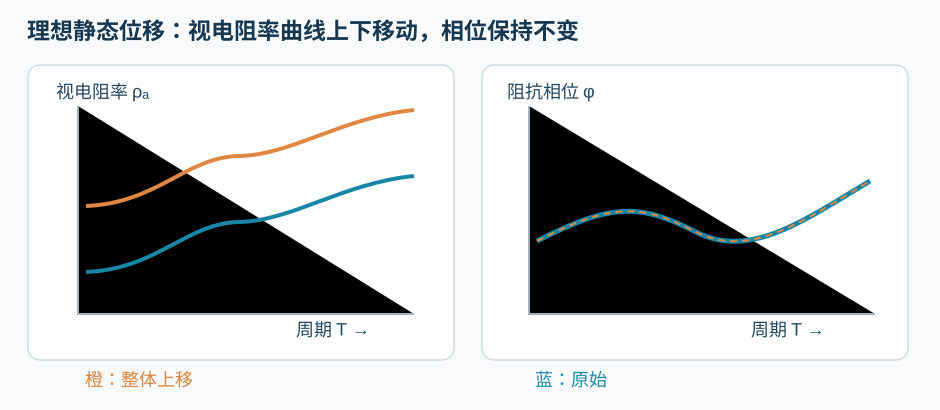



拿到无畸变的相位张量后，如果测区整体接近二维构造，我们很希望把测量坐标旋转到**地质走向**方向，把 TE 和 TM 两种极化分离开来做二维反演。然而实际工作中常有两个拦路虎：第一，不同方法算出来的走向角有时并不一致，还自带 $90^\circ$ 歧义；第二，浅部局部小异常会让整条视电阻率曲线沿纵轴整体上下平移（即**静态位移**），一不小心就会在反演剖面里造出虚假的深部异常。本篇把这两个实战难题彻底理清。

## 本篇路线图
- [11.1 怎样找地质走向：偏斜、极坐标图与相位张量](#sec-06g-strike)
- [11.2 静态位移为什么能骗过反演：从一条上下移动的曲线开始](#sec-06h-static-shift)

---

## 11.1 怎样找地质走向：偏斜、极坐标图与相位张量

在理想二维地球中，只要把坐标系旋转到地质走向方向，阻抗矩阵的主对角元 $Z'_{xx}$ 和 $Z'_{yy}$ 就会同时为零。寻找地质走向的核心思路，就是**在 $0^\circ\sim 360^\circ$ 范围内寻找那个能让阻抗矩阵结构最简洁的方向**。

### 一、最朴素的思路：Swift 走向估计

给观测阻抗 $\mathbf Z$ 乘上一系列候选角度 $\theta$ 的旋转矩阵，得到 $\mathbf Z'(\theta)=\mathbf R(\theta)\mathbf Z\mathbf R^T(\theta)$。经典的 **Swift 方法**试图寻找使非对角元能量最大化（等价于主对角元能量最小化）的角度 $\theta$：

$$
F(\theta)=\lvert Z'_{xy}(\theta)\rvert^2+\lvert Z'_{yx}(\theta)\rvert^2.
$$

这种算法只依赖振幅大小，计算简单，但缺点也很明显：只要测站附近存在近地表电流性畸变（twist 或 shear），非对角元能量就会被扭曲，算出来的 Swift 走向就会明显偏离真实的深部构造方向。

### 二、为什么任何纯阻抗走向分析都存在 $90^\circ$ 歧义？

设想一条东西延伸的二维断层：
- 向东和向西指向同一条直线，存在天然的 $180^\circ$ 方向对称性；
- 更关键的是，由第 09 篇旋转 $90^\circ$ 的算例可知，把坐标轴再转 $90^\circ$ 只不过是把 $Z'_{xy}$ 和 $Z'_{yx}$ 互换位置并变号，矩阵依然保持“主对角元为零”的纯二维形式！

因此，仅凭单站阻抗张量本身，永远无法区分“地质走向”和“垂直走向”（存在 **$90^\circ$ 角度歧义**）。实际工作中必须结合**倾子（感应箭头）**、地表地质填图区域构造线，或者多测站剖面分布来最终敲定哪一个才是真正的走向。

### 三、极坐标图（Polar / Peanut Diagram）

让旋转角 $\theta$ 从 $0^\circ$ 转满 $360^\circ$，在极坐标系中以 $\theta$ 为方位角、以 $\lvert Z'_{xx}(\theta)\rvert$ 或 $\lvert Z'_{xy}(\theta)\rvert$ 为半径画图，就得到经典的**阻抗极坐标图**：
- **一维模型**：$\lvert Z'_{xy}(\theta)\rvert$ 处处相等，画出来是一个**正圆**，$\lvert Z'_{xx}\rvert$ 缩成原点；
- **二维模型**：$\lvert Z'_{xy}(\theta)\rvert$ 常呈对称的**花生状（peanut）**，$\lvert Z'_{xx}(\theta)\rvert$ 呈对称的**四叶草状**，四叶草的零点凹陷方向直接指示走向与倾向；
- **三维模型**：图形失去对称性，出现明显歪斜。

### 四、抗畸变的走向算法：Bahr 法、WAL 法与相位张量主轴

为了克服近地表电流性畸变的干扰，现代分析主要采用基于**相位**或**旋转不变量**的走向算法：

1. **Bahr 相位敏感走向**：定义四个复组合 $S_1=Z_{xx}+Z_{yy},\,S_2=Z_{xy}+Z_{yx},\,D_1=Z_{xx}-Z_{yy},\,D_2=Z_{xy}-Z_{yx}$，以及两个复数的相位叉积 $[A,B]=\operatorname{Re}(A)\operatorname{Im}(B)-\operatorname{Im}(A)\operatorname{Re}(B)$，通过下式求解 Bahr 走向角 $\theta_B$：
   $$
   \boxed{\tan(2\theta_B)=\frac{[S_1,S_2]-[D_1,D_2]}{[S_1,D_1]+[S_2,D_2]}}.
   $$
   由于利用了实部与虚部的相对相位关系，Bahr 法能有效抵抗实数电流性畸变。
2. **WAL 走向角**：利用上一篇定义的实部不变量 $\xi_2,\xi_3$（或相位组合），可直接写出走向估计公式（例如 $\tan(2\theta_{W1})=-\xi_3/\xi_2$，计算时需检查分母是否接近零）。
3. **相位张量椭圆主轴**：正如上一篇证明，相位张量 $\boldsymbol\Phi=\mathbf X^{-1}\mathbf Y$ 天然免疫实数电流性畸变，因此其椭圆主轴方位角 $\alpha-\beta$ 是目前最稳健的走向指示器之一（同样保留 $90^\circ$ 歧义）。

### 五、综合判断走向的实用建议

不同频段（对应不同深度）或不同方法算出的走向角出现差异时，不要机械地把所有测站、所有频段求一个“平均走向”——平均出来的结果可能哪条构造都没指向。更科学的做法是分频段绘制玫瑰图（Rose Diagram）与相位张量椭圆图，观察浅部、中地壳和岩石圈的走向是否随深度发生构造转换。

### 自我小测

**1.** 理想一维模型无论怎么旋转坐标轴，阻抗模长都保持不变，它存在唯一的“地质走向”吗？  
**答：** 不存在。一维层状介质在水平各个方向上完全等价，任意水平方向都是对称轴。

**2.** 如果某测站高频段（浅部）和低频段（深部）算出的走向角相差 $40^\circ$，能否直接宣布“地下构造走向随深度旋转了 $40^\circ$”？  
**答：** 不能直接下定论。首先要排查高频或低频死频带噪声、近地表三维电感性畸变等因素；排除干扰后，如果相邻多个测站都呈现一致的随周期偏转规律，才能作为深浅部构造体制不同的有力线索。

---

确定了坐标系之后，我们终于可以画出每个测站的视电阻率 $\rho_a$ 和相位 $\phi$ 曲线了。但对比相邻两个测站的曲线时，你可能会发现一个怪现象：两站相位曲线几乎重合，视电阻率曲线形状也一模一样，唯独其中一条整体往上或往下平移了一大截——这就是大名鼎鼎的**静态位移**。

[继续阅读：11.2 静态位移为什么能骗过反演：从一条上下移动的曲线开始](#sec-06h-static-shift)

---

## 11.2 静态位移为什么能骗过反演：从一条上下移动的曲线开始

静态位移（static shift）是大地电磁数据处理与反演中最常见、也最容易把解释人员带进沟里的现象之一。我们用最简单的代数乘法看清它的来龙去脉。

### 一、假设整个阻抗被乘上了一个正实数 $g$

回顾上一篇的 Groom–Bailey 畸变模型，当测站下方存在尺幅很小的浅部导电体或高阻体时，局部积累的静电荷会把区域电场整体放大或缩小一个正实数倍（即测站增益 $g>0$）：

$$
Z_{\rm obs}(\omega)=g\,Z_{\rm reg}(\omega),
$$

其中 $Z_{\rm reg}$ 是未受浅部干扰的区域真实阻抗，$g$ 在整个研究频段内近似为常数。

取 $g=2$ 看看会发生什么：
- **模长翻倍**：$\lvert Z_{\rm obs}\rvert=2\lvert Z_{\rm reg}\rvert$；
- **相位纹丝不动**：因为 $2$ 是正实数，乘上正实数只会拉长复平面上的箭头，不会改变箭头的角度，因此
  $$
  \arg Z_{\rm obs}(\omega)=\arg Z_{\rm reg}(\omega).
  $$

### 二、视电阻率曲线为什么会出现“平行上下平移”？

把 $Z_{\rm obs}=gZ_{\rm reg}$ 代入视电阻率定义 $\rho_a=\dfrac{\lvert Z\rvert^2}{\omega\mu_0}$：

$$
\rho_{a,\rm obs}=\frac{\lvert gZ_{\rm reg}\rvert^2}{\omega\mu_0}=g^2\frac{\lvert Z_{\rm reg}\rvert^2}{\omega\mu_0}
\implies \boxed{\rho_{a,\rm obs}=g^2\rho_{a,\rm reg}}.
$$

因为公式里有平方，当 $g=2$ 时，整条视电阻率曲线会放大 $2^2=4$ 倍；当 $g=0.5$ 时，整条曲线会缩小为原来的 $1/4$！

大地电磁测深曲线通常画在双对数坐标纸上（纵轴是 $\log_{10}\rho_a$）。两边同时取对数：

$$
\log_{10}\rho_{a,\rm obs}=\log_{10}\rho_{a,\rm reg}+2\log_{10}g.
$$

因为 $2\log_{10}g$ 是一个与频率无关的常数，画在双对数图上，就表现为**整条视电阻率曲线形态不变，只是沿着纵轴平行向上或向下平移了一截**——“静态位移”的名字正是由此而来。

### 三、如果不加处理直接反演，会发生什么灾难？

反演程序是死板的数学优化器，它并不知道你喂给它的数据乘过 $g^2$。如果某个测站的视电阻率被浅部小高阻体整体抬高了 $4$ 倍（而相位正常），反演程序为了强行拟合偏高的视电阻率数值，就会在地下深处凭空捏造出一个不存在的巨大高阻体，或者把所有地层的深度整体拉深一倍！

### 四、二维地堑模型中 TE 与 TM 的静态位移表现

不要以为“静态位移只影响 TM 模式”或“只有一维才会有静态位移”。在浅部存在有限宽度导电地堑或盆地的二维构造中：
- **TM 模式**的电流直接横穿盆地边界，界面电荷积累极强，往往表现出显著的静态位移；
- **TE 模式**的电流虽然沿走向流动，但如果异常体沿走向长度有限（实际属于局部三维浅部体），TE 曲线同样会遭受不同程度的静态平移。

### 五、如何识别与校正静态位移？

1. **多站对比诊断**：观察同一条测线上相邻测站的曲线——如果相邻几站的**相位曲线高度一致**，视电阻率曲线的起伏形态也一模一样，唯独某一站的视电阻率曲线在全频段平行错开，基本可以锁定存在静态位移。
2. **不要盲目手动硬拉曲线**：虽然有时可以通过“长周期渐近拉齐”或“短周期浅层归一”做经验校正，但如果区域深部本身存在横向电性梯度，强行把所有曲线拉到同一水平线，反而会抹杀真实的深部构造变化。
3. **借助独立辅助数据与联合反演**：最可靠的校正手段是在同一点位补充不受浅部电场畸变影响的**瞬变电磁（TEM）**或磁法测深，利用 TEM 高频段曲线标定 MT 曲线的准确绝对位置；或者在现代二维/三维反演软件中把静态位移因子作为待求解的自由参数与地下电阻率同步反演。

### 六、用 MTpy 梳理从数据质控到反演前的检查清单

Python 生态中的 **MTpy** 是目前最常用的大地电磁数据分析与可视化工具包。在把整理好的 EDI 数据送入正式反演前，建议按以下五步做一遍全面体检：
1. 核对所有测站的经纬度、高程、磁偏角与单位（确认 $E/H$ 与 $E/B$ 换算无误）；
2. 绘制全频段视电阻率与相位曲线，标记死频带（dead band）与强噪声飞点，适当放大其误差棒（error floor）；
3. 绘制相位张量椭圆与感应箭头平面图，判断不同频段的维数特征与区域构造走向；
4. 排查相邻测站间的静态位移迹象，记录需重点关注的测站；
5. 根据维数诊断结果，合理选择 1D、2D（旋转至走向后分离 TE/TM）或全 3D 反演策略。

### 自我小测

**1.** 某测站阻抗受浅部小异常体影响整体乘以正实数 $g=3$，视电阻率和相位分别如何变化？  
**答：** 视电阻率整体放大为原来的 $3^2=9$ 倍（在双对数图上平行上移），而阻抗相位保持完全不变。

**2.** 如果相邻两个测站的相位曲线在全频段几乎完全重合，能否断定两站下方的真实电阻率剖面一模一样？  
**答：** 不能。静态位移只改变阻抗模长而不改变相位，两站可能存在常数倍的静态偏移；此外不同厚度的相似层状组合也可能产生相近相位。

**3.** 发现某测站疑似存在静态位移时，最稳妥的做法是直接用鼠标手动把曲线上下拖拽对齐吗？  
**答：** 不宜直接主观拖拽。应先结合相邻测站规律、局部地形地质、TEM 辅助观测或在反演中引入静态位移参数进行客观约束。

---

到这里，第三阶段（阻抗张量分析）已经全部打通——我们不仅拿到了高质量的频域响应，还摸清了数据的维数、走向和畸变底细。下一篇开启全书最核心、也最具挑战性的第四阶段：**地球物理反演**，看看计算机是如何从有限且带误差的地表数据中，一步步反推出地下三维电阻率图像的。

[继续阅读：12｜反演基础：反问题、零空间、误差与 RMS](/posts/2026/10/mt-course-07a-inverse-theory/) · [返回总目录](/posts/2026/10/mt-course/)
