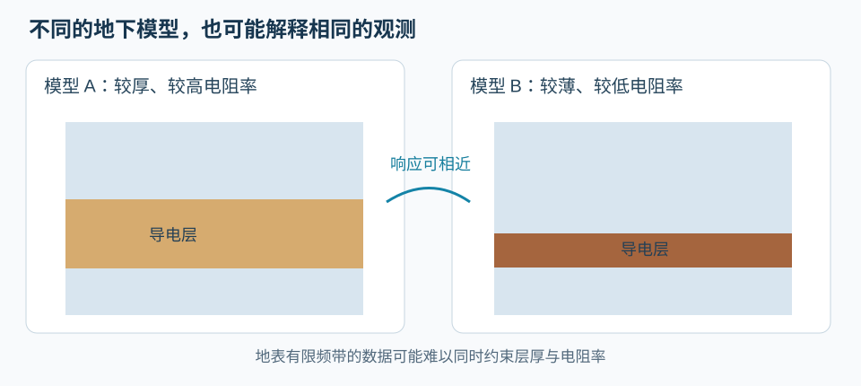



前面十一篇，我们已经学会了“正演”（给定地下电阻率，算地表电磁响应）和“数据处理”（从野外时间序列提取阻抗、相位与视电阻率）。现在终于来到整套课程最核心的一步——**地球物理反演（Inversion）**：**手里只有地表测得的有限、带误差的响应曲线，如何倒推出地下深处看不见摸不着的电阻率分布？**

表面上看，反演似乎只是把正演的箭头倒过来，但一动手就会撞上存在性、唯一性、稳定性和噪声干扰四大难关。本篇先不急着写复杂的优化矩阵，而是从最朴素的代数小例子出发，理清反问题为什么难、什么叫“零空间”，以及反演软件天天报告的 RMS 到底是怎么算出来的。

## 本篇路线图
- [12.1 知道结果，为什么很难倒推出原因？](#sec-07a-inverse-problem)
- [12.2 零空间是什么：为什么数据看不到某些地下变化？](#sec-07b-nullspace)
- [12.3 RMS 怎么来的：误差、残差和加权最小二乘](#sec-07c-misfit)

---

## 12.1 知道结果，为什么很难倒推出原因？

为什么正演只要一套公式就能直接算出答案，反演却需要迭代几十轮、还要加各种平滑约束？答案藏在一个小学应用题里。

### 一、同样耗时 $1$ 小时的旅程，能反推出车速吗？

假设一辆汽车跑完一段路，手表显示一共花了 $1$ 小时：
- 如果事先知道总路程是 $60\,\mathrm{km}$，且车速恒定，立刻就能反算出车速 $v=60/1=60\,\mathrm{km/h}$；
- 可如果**只知道耗时 $1$ 小时，总路程未知**，车速就彻底算不出来了——因为“车速 $40\,\mathrm{km/h}$、路程 $40\,\mathrm{km}$”和“车速 $80\,\mathrm{km/h}$、路程 $80\,\mathrm{km}$”都能完美解释这 $1$ 小时的观测！

这个小例子点破了反演的第一个本质：**倒推的困难往往不是因为计算机算得不够快，而是因为现有观测携带的信息量根本不足以唯一锁定所有未知数。**

### 二、把正演和反演写成标准的地球物理语言

把地下需要求解的所有网格电阻率（或电导率）排成一列，称为**模型向量** $\mathbf m$（共 $M$ 个未知参数）；把野外测得的所有频率的视电阻率、相位或阻抗数据排成一列，称为**观测数据向量** $\mathbf d_{\rm obs}$（共 $N$ 条数据）：

$$
\mathbf m=\begin{pmatrix}m_1\\ m_2\\ \vdots\\ m_M\end{pmatrix},\qquad
\mathbf d_{\rm obs}=\begin{pmatrix}d_1\\ d_2\\ \vdots\\ d_N\end{pmatrix}.
$$

- **正演（Forward Modeling）**：给定地下模型 $\mathbf m$，通过麦克斯韦方程计算理论预测数据 $\mathbf d_{\rm pred}$：
  $$
  \boxed{\mathbf d_{\rm pred}=F(\mathbf m)},
  $$
  其中 $F$ 代表正演物理算子（如第 03 篇的层状递推或第 04 篇的有限差分求解器）。
- **反演（Inversion）**：已知带噪声的实测数据 $\mathbf d_{\rm obs}$，反过来寻找合适的地下模型 $\mathbf m$，使正演预测尽可能吻合实测：
  $$
  F(\mathbf m)\approx \mathbf d_{\rm obs}.
  $$

### 三、为什么不能直接写出反函数 $\mathbf m=F^{-1}(\mathbf d_{\rm obs})$？

简单函数 $y=2x$ 可以直接移项写成 $x=y/2$，但地球物理正演算子 $F$ 通常不存在唯一的逆函数。哪怕是简单的平方函数 $y=x^2$，给出 $y=9$ 也同时对应 $x=3$ 和 $x=-3$ 两个解；而在大地电磁中，我们在第 05 篇见过的**薄层纵向电导等效性**（厚而略高阻的层与薄而极低阻的层产生几乎相同的地表曲线），更是让无数个不同的地下模型都能吻合同一组观测数据。

### 四、反问题（Inverse Problem）著名的三大难题

数学家 Hadamard 指出，一个“适定”的问题必须同时满足存在性、唯一性和稳定性；而地球物理反演恰恰是典型的**不适定（ill-posed）问题**，三关全都有麻烦：

1. **存在性（Existence）**：由于野外数据含有噪声，而正演网格和 1D/2D 维度假设又做了近似，可能根本不存在某个模型能让 $F(\mathbf m)$ 与实测数据 $\mathbf d_{\rm obs}$ 一字不差地严格相等——因此反演追求的是“在误差允许范围内合理拟合”，而不是死抠零误差。
2. **唯一性（Non-uniqueness）**：有限的测点、有限的频带和测量误差，允许成千上万个不同的地下模型同时满足数据拟合要求。
3. **稳定性（Instability / Ill-conditioning）**：观测数据只发生极其微小的噪声抖动，反演出来的地下模型却可能剧烈震荡、面目全非。例如方程 $y=0.001x$，当 $y=1$ 时 $x=1000$；若 $y$ 受到 $0.01$ 的微小噪声变成 $1.01$，$x$ 就会剧烈跳变到 $1010$，噪声被放大了整整一千倍！

### 五、参数估计与成像反演的差别

如果地下只有寥寥几个未知数（比如已知地下只有三层，只反演三层的电阻率和厚度共 $5$ 个参数），属于**少参数估计**；而现代二维、三维反演把地下切成成千上万个网格单元，未知数 $M$ 往往远超独立观测数据条数 $N$，属于**成像反演（tomographic inversion）**，必须引入正则化约束才能稳定求解。

### 自我小测

假设只有一条观测方程 $d=m_1+m_2=10$，那么 $(m_1,m_2)=(3,7)$、$(6,4)$、$(8,2)$ 是否都符合观测？仅靠这条数据能确定哪一个是真实模型吗？  
**答：** 三组模型算出的 $m_1+m_2$ 全都等于 $10$，完全符合观测；单靠这一条观测永远无法唯一确定真实模型，必须补充新的独立观测，或者引入先验地质信息与平滑选择原则。

---

刚才这个 $m_1+m_2=10$ 的方程里藏着一个极具启发性的现象：如果把 $m_1$ 增加 $2$、同时把 $m_2$ 减少 $2$，总和依然等于 $10$，观测数据对此毫无察觉！这些“数据完全看不见的模型变化”，在数学上就构成了正演算子的**零空间**。

[继续阅读：12.2 零空间是什么：为什么数据看不到某些地下变化？](#sec-07b-nullspace)

---

## 12.2 零空间是什么：为什么数据看不到某些地下变化？

用“两数相加等于 $10$”这个初中方程，就能把抽象的线性代数概念——**零空间（null space）**彻底讲透。

### 一、找两组不同但预测结果完全相同的模型

针对观测方程 $d=m_1+m_2=10$，构造两个不同的模型向量：

$$
\mathbf m_A=\begin{pmatrix}3\\ 7\end{pmatrix},\qquad \mathbf m_B=\begin{pmatrix}5\\ 5\end{pmatrix}.
$$

计算两者之间的模型改变量：

$$
\Delta\mathbf m=\mathbf m_B-\mathbf m_A=\begin{pmatrix}2\\ -2\end{pmatrix}.
$$

你看，模型实实在在地改变了（第一层加了 $2$，第二层减了 $2$），但两者的改动对观测数据 $d$ 的贡献一正一负刚好完全抵消，观测仪器什么变化都看不到！

### 二、用矩阵写出零空间的定义

把方程 $d=m_1+m_2$ 写成矩阵乘法 $d=\mathbf G\mathbf m$，其中正演矩阵 $\mathbf G=(1\quad 1)$。把刚才的模型改变量 $\Delta\mathbf m$ 代进去：

$$
\mathbf G\Delta\mathbf m=\begin{pmatrix}1 & 1\end{pmatrix}\begin{pmatrix}2\\ -2\end{pmatrix}=2-2=0.
$$

**只要一个非零的模型变化向量 $\Delta\mathbf m$ 乘以正演矩阵后等于零向量，地表观测数据就对这个方向上的变化彻底“失明”。** 所有满足

$$
\boxed{\mathbf G\Delta\mathbf m=\mathbf 0}
$$

的模型变化向量 $\Delta\mathbf m$ 组成的集合，就叫作正演算子 $\mathbf G$ 的**零空间**。

这意味着，只要你找到了一个能拟合数据的特解 $\mathbf m_0$，那么给 $\mathbf m_0$ 加上任意一个零空间向量 $\Delta\mathbf m$，得到的新模型 $\mathbf m=\mathbf m_0+\Delta\mathbf m$ 都会产生一模一样的预测数据——这就是反演非唯一性的数学根源。

### 三、多加一条观测，一定能消灭零空间吗？

- 如果我们能补充一条真正独立的新观测，例如 $m_1-m_2=2$，联立方程组就能唯一解出 $m_1=6,\,m_2=4$，零空间被彻底消除；
- 但如果新增的观测只是第一条的简单重复，例如 $2m_1+2m_2=20$，它没有提供任何新的独立信息，零空间依然存在。

**重要启示：** 野外测量的数据条数多，不等于独立约束信息就一定多。如果多个频点挤在很窄的频段内，或者多个测站挤在同一个角落，它们的灵敏度高度相关，依然会留下庞大的零空间。

### 四、真实 MT 里的“近似零空间”与平滑约束

在非线性 MT 反演中，局部扰动满足 $\Delta\mathbf d\approx\mathbf J\Delta\mathbf m$（$\mathbf J$ 为下一篇要推的雅可比矩阵）。即使某个深部薄层的改动不会让 $\mathbf J\Delta\mathbf m$ 严格等于零，但只要它引起的地表视电阻率变化小于测量噪声，在实践上就属于数据无法约束的**近似零空间（弱约束方向）**。

如果不对这些弱约束方向加以限制，反演程序为了迎合数据里的随机噪声，就会在深部制造出剧烈震荡的虚假高阻、低阻斑块。因此，现代反演（如第 14 篇的 Occam 反演）必须引入平滑正则化约束，把零空间里的自由度按“最简单、最平滑”的原则固定下来。

### 自我小测

**1.** 已知线性正演矩阵 $\mathbf G=(2\quad 1)$，请写出一个非零的零空间向量 $\Delta\mathbf m$。  
**答：** 取 $\Delta\mathbf m=(1,-2)^T$（或其任意非零常数倍），验证 $\mathbf G\Delta\mathbf m=2\times 1+1\times(-2)=0$。

**2.** 为什么反演问题中“观测数据条数 $N$ 大于模型参数个数 $M$”，有时依然会出现多解性和不稳定？  
**答：** 因为多条观测数据之间可能高度相关（提供的独立信息不足），或者某些深部参数对所有观测的灵敏度都极低，导致矩阵依然病态。

---

既然野外数据总有噪声、我们不能死抠零残差，那么反演程序究竟怎么判断“拟合得已经够好了，该停下来了”？这就需要引入衡量数据拟合好坏的统一标尺——加权数据失配与归一化均方根误差（nRMS）。

[继续阅读：12.3 RMS 怎么来的：误差、残差和加权最小二乘](#sec-07c-misfit)

---

## 12.3 RMS 怎么来的：误差、残差和加权最小二乘

反演文献里几乎每张剖面图旁边都会标一个数字，比如 `nRMS = 1.05`。这个决定反演什么时候停止迭代的核心指标，究竟是怎么算出来的？我们用两条观测数据算一遍。

### 一、同样偏差 $2$ 个单位，好数据和坏数据应该一视同仁吗？

假设某个正演模型预测出两条数据，都比实测值高了 $2$ 个单位：$F_1(\mathbf m)-d_1=2$，$F_2(\mathbf m)-d_2=2$。
- 第一条观测来自安静时段，测量标准差（误差棒）只有 $s_1=1$；
- 第二条观测落在死频带，噪声很大，测量标准差高达 $s_2=4$。

显然，第一条数据偏离了整整 $2$ 倍标准差，拟合得不够好；第二条数据只偏离了 $0.5$ 倍标准差，完全落在正常误差范围内！因此，评估拟合好坏不能只看绝对差值，必须用各自的标准差 $s_j$ 进行归一化，定义**标准化残差** $r_j$：

$$
\boxed{r_j=\frac{F_j(\mathbf m)-d_j}{s_j}}.
$$

本例中，两条数据的标准化残差分别为 $r_1=2/1=2$ 和 $r_2=2/4=0.5$。

### 二、加权平方失配与归一化均方根误差（nRMS）

为了防止正负残差相互抵消，把所有 $N$ 条数据的标准化残差平方后相加，得到**加权数据失配目标函数** $\Phi_d(\mathbf m)$：

$$
\boxed{\Phi_d(\mathbf m)=\sum_{j=1}^N r_j^2=\sum_{j=1}^N\left(\frac{F_j(\mathbf m)-d_j}{s_j}\right)^2}.
$$

本例中 $\Phi_d=2^2+0.5^2=4.25$。

由于 $\Phi_d$ 会随着数据总数 $N$ 的增多而变大，不方便跨项目比较，我们再除以数据总数 $N$ 并开平方，就得到了最通用的拟合指标——**标准化均方根误差（normalized RMS，简称 nRMS）**：

$$
\boxed{\mathrm{nRMS}=\sqrt{\frac{1}{N}\sum_{j=1}^N r_j^2}=\sqrt{\frac{\Phi_d}{N}}}.
$$

代入刚才的两条数据：$\mathrm{nRMS}=\sqrt{4.25/2}=\sqrt{2.125}\approx 1.458$。

### 三、为什么理想拟合的目标是 $\mathrm{nRMS}\approx 1$？——警惕误差棒设定陷阱

统计学告诉我们：如果数据噪声服从独立高斯分布，且你设定的标准差 $s_j$ 真实反映了测量误差大小，那么当模型刚好拟合到真实信号水平时，每条标准化残差 $r_j$ 的平方期望值恰好为 $1$，整组数据的 $\mathrm{nRMS}$ 就会落在 **$1.0$ 左右**。
- 如果 $\mathrm{nRMS}\gg 1$，说明模型还没把有效数据拟合好（欠拟合）；
- 如果 $\mathrm{nRMS}\ll 1$（比如降到了 $0.3$），往往说明程序把随机噪声也当成地下构造强行拟合进去了（过拟合）。

**务必留心一个关键细节：** $\mathrm{nRMS}$ 的数值直接取决于你给数据设定的误差棒 $s_j$！还是刚才那两条数据，如果预测值和观测值一字未改，只是我们人为把误差棒放大两倍（变成 $s_1=2,\,s_2=8$），标准化残差就会减半为 $(1,\,0.25)$，算出来的 $\mathrm{nRMS}$ 瞬间从 $1.458$ 暴跌到 $\sqrt{(1^2+0.25^2)/2}\approx 0.729$！数据没有变好，只是误差门限放宽了。因此比较不同反演的 RMS 时，必须先核对各自的误差底线（error floor）设定是否一致。

### 四、如果不同数据的误差彼此相关：数据协方差矩阵 $\mathbf C_d$

当相邻频点或不同通道的误差存在相关性时，需要用完整的**数据误差协方差矩阵** $\mathbf C_d$ 代替单个标准差，失配函数推广为二次型形式：

$$
\boxed{\Phi_d(\mathbf m)=(F(\mathbf m)-\mathbf d)^T\mathbf C_d^{-1}(F(\mathbf m)-\mathbf d)}.
$$

当各条数据误差彼此独立时，$\mathbf C_d$ 退化为对角线上存放 $s_j^2$ 的对角矩阵，上式自动还原为前面的逐项平方和。

### 五、不能只盯着一个全局 RMS 看

哪怕全局 $\mathrm{nRMS}=1.02$ 看起来非常完美，也绝不能就此收工。如果 $99$ 条数据的残差都是 $0.8$，唯独某个关键频段的相位残差高达 $3.5$，全局平均依然能凑出接近 $1$ 的数字，但关键深部构造可能已经被歪曲了。反演结束后，必须分频段、分测站、分分量检查残差分布图。

### 自我小测

已知三条观测数据的标准化残差分别为 $1,\,1,\,2$，计算 $\Phi_d$ 和 $\mathrm{nRMS}$。  
**答：** $\Phi_d=1^2+1^2+2^2=6$；$\mathrm{nRMS}=\sqrt{6/3}=\sqrt{2}\approx 1.414$。这组示例再次说明：仅看最终的全局平均数 $1.414$，很容易掩盖第三条数据已经偏离 $2$ 倍标准差的局部异常。

---

有了衡量拟合好坏的目标函数 $\Phi_d(\mathbf m)$，计算机下一步就要解决最核心的行动问题：**面对成千上万个网格参数，下一轮迭代该把哪一层电阻率调高、哪一层调低、每次调多少？** 下一篇我们就把雅可比矩阵、梯度、Hessian 和 Gauss–Newton 更新方程一步步推出来。

[继续阅读：13｜反演优化：雅可比矩阵、Newton 与 Gauss–Newton 推导](/posts/2026/10/mt-course-07b-optimization/) · [返回总目录](/posts/2026/10/mt-course/)
