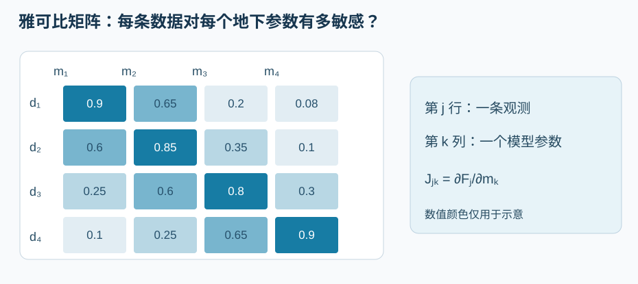
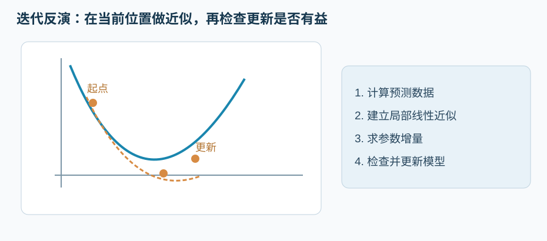



上一篇我们已经定义好了衡量拟合好坏的目标函数。现在问题变成了具体的执行算法：**面对地下成百上千个网格电阻率参数，计算机怎么知道往哪个方向修改模型能让数据误差快速下降？** 本篇分三步走：先建立描述“改参数对数据有多大影响”的**雅可比矩阵**；再从初中抛物线出发理解 **Newton 迭代**；最后把两者结合，一步不落地推导出地球物理反演中最核心的 **Gauss–Newton 正规方程**。

## 本篇路线图
- [13.1 雅可比矩阵是什么：改动一层地下，数据会改变多少？](#sec-07d-jacobian)
- [13.2 梯度和 Hessian 在干什么：从一元二次函数学 Newton 方法](#sec-07e-newton)
- [13.3 Gauss–Newton 从哪里来：每个矩阵都推给你看](#sec-07f-gauss-newton)

---

## 13.1 雅可比矩阵是什么：改动一层地下，数据会改变多少？

要在高维参数空间里高效寻找最佳模型，计算机必须先有一张“操作指南”：**微调第 $k$ 个网格的电阻率，会引起第 $j$ 条预测数据发生多大变化？** 这张按行和列排好的灵敏度表格，就是**雅可比矩阵（Jacobian Matrix）**。

### 一、从简单线性函数的偏导数排出一张表

先不碰电磁学，看三条包含两个参数 $m_1,m_2$ 的预测公式：

$$
d_1=2m_1+3m_2,\qquad d_2=m_1-m_2,\qquad d_3=4m_2.
$$

固定 $m_2$ 不动，只看 $m_1$ 变化时各条数据变化多快（即求偏导数）：$\frac{\partial d_1}{\partial m_1}=2$，$\frac{\partial d_2}{\partial m_1}=1$，$\frac{\partial d_3}{\partial m_1}=0$；同理固定 $m_1$ 对 $m_2$ 求偏导，把所有偏导数排成一张矩阵：

$$
\boxed{\mathbf J=\begin{pmatrix}
2 & 3\\
1 & -1\\
0 & 4
\end{pmatrix}}.
$$

**牢记矩阵的行列分工：** 雅可比矩阵有 $N$ 行（对应 $N$ 条观测数据）、$M$ 列（对应 $M$ 个地下模型参数），第 $j$ 行第 $k$ 列元素定义为

$$
\boxed{J_{jk}=\frac{\partial F_j(\mathbf m)}{\partial m_k}}.
$$

### 二、用雅可比矩阵预估模型微调后的数据变化

如果把模型参数微调 $\Delta\mathbf m=(\Delta m_1,\Delta m_2)^T=(0.1,-0.2)^T$，预测数据的变化量直接用矩阵乘法就能算出来：

$$
\Delta\mathbf d=\mathbf J\Delta\mathbf m
=\begin{pmatrix}2 & 3\\ 1 & -1\\ 0 & 4\end{pmatrix}\begin{pmatrix}0.1\\ -0.2\end{pmatrix}
=\begin{pmatrix}-0.4\\ 0.3\\ -0.8\end{pmatrix}.
$$

### 三、非线性正演的局部线性化（一阶泰勒展开）

真实 MT 正演 $F(\mathbf m)$ 是非线性函数，但在当前模型 $\mathbf m$ 附近迈出一小步 $\Delta\mathbf m$ 时，我们可以用切线（一阶泰勒展开）近似预测新数据：

$$
\boxed{F(\mathbf m+\Delta\mathbf m)\approx F(\mathbf m)+\mathbf J\Delta\mathbf m}.
$$

由于模型走远之后局部切线斜率会改变，非线性反演必须在每轮更新模型后重新计算（或更新）雅可比矩阵。

### 四、计算机怎么算出雅可比矩阵？

最直观的方法是**有限差分扰动法**：先算一次基准正演 $F(\mathbf m)$，然后每次只给第 $k$ 个参数加上极小扰动 $\epsilon$ 再正演一次，用差商近似偏导数：

$$
J_{jk}\approx\frac{F_j(\mathbf m+\epsilon\mathbf e_k)-F_j(\mathbf m)}{\epsilon}.
$$

这种方法简单可靠，但如果三维网格有十万个参数，每轮迭代正演十万次显然算不动——因此现代大型 2D/3D 反演程序普遍采用**伴随法（adjoint method）**，只需额外求解少量伴随方程就能一次性拿到整张雅可比矩阵。

### 自我小测

**1.** 已知 $d=5m_1+2m_2$，求 $\partial d/\partial m_1$。  
**答：** $5$。

**2.** 某反演问题的雅可比矩阵有 $100$ 行、$20$ 列，代表多少条数据和多少个模型参数？  
**答：** $100$ 条观测数据，$20$ 个待求模型参数。

**3.** 为什么非线性反演在每轮迭代更新模型后，都需要重新更新雅可比矩阵？  
**答：** 因为正演函数是非线性的，当模型移动到新位置后，局部偏导数（切线斜率）也会随之改变。

---

手里有了预估数据变化的雅可比矩阵，接下来我们要看懂优化算法是怎么利用导数寻找目标函数最低点的。我们先拿一条最简单的开口向上抛物线，练一遍 **Newton 方法**。

[继续阅读：13.2 梯度和 Hessian 在干什么：从一元二次函数学 Newton 方法](#sec-07e-newton)

---

## 13.2 梯度和 Hessian 在干什么：从一元二次函数学 Newton 方法

反演在数学上就是寻找使目标函数 $\Phi(\mathbf m)$ 达到最小值的模型参数。我们先用单变量抛物线看清一阶导数和二阶导数各自扮演什么角色。

### 一、从抛物线 $\Phi(m)=(m-3)^2$ 看一阶与二阶导数

假设目标函数是开口向上的抛物线：

$$
\Phi(m)=(m-3)^2=m^2-6m+9.
$$

一眼就能看出最低点在 $m=3$。如果我们假装不知道答案，站在初始猜测点 $m_0=0$ 处该怎么找？
- **一阶导数（斜率）指示下山方向**：$\Phi'(m)=2(m-3)$。在 $m_0=0$ 处斜率为 $-6<0$，说明往 $m$ 增大的方向走目标函数会下降；
- **二阶导数（曲率）告诉我们每一步该迈多大**：$\Phi''(m)=2>0$，说明曲线弯曲程度恒定，斜率每向右走 $1$ 单位就会平缓 $2$ 单位。

推广到多参数模型 $\mathbf m=(m_1,\dots,m_M)^T$ 时：
- 所有一阶偏导数组成**梯度向量** $\mathbf g=\nabla\Phi=\left(\frac{\partial\Phi}{\partial m_1},\dots,\frac{\partial\Phi}{\partial m_M}\right)^T$；
- 所有二阶偏导数组成对称的 **Hessian 矩阵** $\mathbf H$，元素为 $H_{jk}=\dfrac{\partial^2\Phi}{\partial m_j\partial m_k}$（此处粗体 $\mathbf H$ 代表 Hessian 矩阵，注意根据上下文与磁场强度区分）。

### 二、推导出 Newton 更新方程

在当前模型 $\mathbf m$ 附近，把目标函数做二阶泰勒展开（用抛物面局部逼近真实目标函数）：

$$
\Phi(\mathbf m+\Delta\mathbf m)\approx \Phi(\mathbf m)+\mathbf g^T\Delta\mathbf m+\frac{1}{2}\Delta\mathbf m^T\mathbf H\Delta\mathbf m.
$$

要找这个近似抛物面的最低点，对模型增量 $\Delta\mathbf m$ 求导并令其等于零向量：

$$
\mathbf g+\mathbf H\Delta\mathbf m=\mathbf 0 \implies \boxed{\mathbf H\Delta\mathbf m=-\mathbf g}.
$$

这就是经典的 **Newton 更新方程**。拿刚才的 $\Phi(m)=(m-3)^2$ 从 $m_0=0$ 算一遍：$g=-6,\,H=2$，解得 $2\Delta m=-(-6)=6 \implies \Delta m=3$，新模型 $m_1=0+3=3$，一步精准命中最低点！

### 三、为什么实际反演还需要线搜索（Line Search）？

真实 MT 目标函数不是简单的二次抛物线，在远离最低点时二阶泰勒近似会存在偏差，直接迈出完整的 $\Delta\mathbf m$ 有时反而会把误差算大。因此实际更新时通常引入步长因子 $\gamma\in(0,1]$：

$$
\boxed{\mathbf m_{k+1}=\mathbf m_k+\gamma\Delta\mathbf m},
$$

依次尝试 $\gamma=1,\,1/2,\,1/4,\dots$，直到目标函数确实下降为止，这一步称为**线搜索**。

### 自我小测

**1.** 设 $\Phi(m)=(m-5)^2$，当前处于 $m_0=1$，求梯度 $g$、二阶导数 $H$ 以及一步 Newton 更新后的新模型 $m_1$。  
**答：** $g=2(1-5)=-8$，$H=2$；由 $2\Delta m=8$ 得 $\Delta m=4$，故 $m_1=1+4=5$。

**2.** 如果 Hessian 矩阵接近奇异（某些方向曲率接近零），直接求解 $\mathbf H^{-1}\mathbf g$ 会出什么问题？  
**答：** 接近奇异意味着目标函数沿某些零空间方向几乎是平的，直接求逆会产生极其巨大的虚假步长，导致模型剧烈发散，必须引入正则化加以稳定。

---

直接计算精确 Hessian 矩阵需要对复杂的正演函数求二阶偏导，计算量极其恐怖。下一节我们看看聪明的数学家是怎么用现成的雅可比矩阵 $\mathbf J$ 巧妙绕开二阶导数，推导出 **Gauss–Newton 方法**的。

[继续阅读：13.3 Gauss–Newton 从哪里来：每个矩阵都推给你看](#sec-07f-gauss-newton)

---

## 13.3 Gauss–Newton 从哪里来：每个矩阵都推给你看

终于来到地球物理反演最核心的引擎——**Gauss–Newton（高斯–牛顿）方法**。它的妙处在于：**完全不需要对正演程序求二阶导数，只用一阶雅可比矩阵 $\mathbf J$ 就能拼出一个近似 Hessian，实现接近 Newton 法的快速收敛。** 我们把每一步矩阵求导拆开写清楚。

### 一、从残差向量与局部线性化出发

定义预测减观测的残差向量 $\mathbf r(\mathbf m)=F(\mathbf m)-\mathbf d$，先不加权重，构造数据失配目标函数（前面乘 $1/2$ 是为了求导后恰好消去平方带来的系数 $2$）：

$$
\Phi_d(\mathbf m)=\frac{1}{2}\mathbf r^T\mathbf r.
$$

站在当前第 $k$ 轮模型 $\mathbf m_k$ 处，想寻找更新步长 $\Delta\mathbf m$。利用一阶泰勒展开近似下一步的残差：

$$
\mathbf r(\mathbf m_k+\Delta\mathbf m)\approx \mathbf r_k+\mathbf J_k\Delta\mathbf m.
$$

代入目标函数，并按矩阵乘法展开平方项（类似 $(a+b)^2=a^2+2ab+b^2$，注意保持矩阵乘法顺序）：

$$
\begin{aligned}
\Phi_{\rm approx}(\Delta\mathbf m)
&=\frac{1}{2}(\mathbf r_k+\mathbf J_k\Delta\mathbf m)^T(\mathbf r_k+\mathbf J_k\Delta\mathbf m)\\
&=\frac{1}{2}\mathbf r_k^T\mathbf r_k+\Delta\mathbf m^T\mathbf J_k^T\mathbf r_k+\frac{1}{2}\Delta\mathbf m^T\mathbf J_k^T\mathbf J_k\Delta\mathbf m.
\end{aligned}
$$

### 二、对模型增量 $\Delta\mathbf m$ 按分量求导，得到正规方程

为了把矩阵求导看得毫不含糊，观察第 $p$ 个参数增量 $\Delta m_p$ 的偏导数：展开平方和 $\frac{1}{2}\sum_j (r_{k,j}+\sum_\ell J_{k,j\ell}\Delta m_\ell)^2$ 后对 $\Delta m_p$ 求导，得到 $\sum_j J_{k,jp}(r_{k,j}+\sum_\ell J_{k,j\ell}\Delta m_\ell)$，这正是向量表达式 $\mathbf J_k^T\mathbf r_k+\mathbf J_k^T\mathbf J_k\Delta\mathbf m$ 的第 $p$ 个分量。

令整个梯度向量为零：

$$
\mathbf J_k^T\mathbf r_k+\mathbf J_k^T\mathbf J_k\Delta\mathbf m=\mathbf 0 \implies \boxed{\mathbf J_k^T\mathbf J_k\Delta\mathbf m=-\mathbf J_k^T\mathbf r_k}.
$$

这就是无权重、无正则化下的 **Gauss–Newton 正规方程**！对比上一节的 Newton 方程 $\mathbf H\Delta\mathbf m=-\mathbf g$，你会发现右边 $\mathbf J_k^T\mathbf r_k$ 正好是精确梯度 $\mathbf g$，而左边的 $\mathbf J_k^T\mathbf J_k$ 则用一阶雅可比矩阵完美充当了**近似 Hessian**（它省去了精确 Hessian 中包含正演二阶导数的项 $\sum_j r_j\nabla^2 F_j$，在残差不太大时既准确又省算力）。

### 三、亲手算两轮非线性迭代

用一元非线性函数 $F(m)=m^2$ 体验一遍 Gauss–Newton 迭代：设实测数据 $d=9$，从初始猜测 $m_0=2$ 出发：
- **第 1 轮迭代**：预测 $F(2)=4$，残差 $r_0=4-9=-5$，雅可比（导数）$J_0=2m|_{m=2}=4$。代入正规方程 $J_0^2\Delta m=-J_0r_0$：
  $$
  16\Delta m=-4\times(-5)=20 \implies \Delta m=1.25 \implies m_1=2+1.25=3.25.
  $$
- **第 2 轮迭代**：新预测 $F(3.25)=10.5625$，残差 $r_1=1.5625$，新雅可比 $J_1=2\times 3.25=6.5$：
  $$
  \Delta m=-\frac{1.5625}{6.5}\approx -0.2404 \implies m_2=3.25-0.2404\approx 3.0096.
  $$

仅仅两步，就从 $2$ 迅速逼近了真解 $3$！（同时也提醒我们：若初始模型不幸选在 $m_0=0$ 处，局部导数 $J_0=0$，方程就会卡住——可见初始模型的合理性十分重要。）

### 四、加入数据误差权重与模型正则化

把实际勘探所需的“数据误差加权矩阵 $\mathbf W_d$”（满足 $\mathbf W_d^T\mathbf W_d=\mathbf C_d^{-1}$）和“模型平滑正则化项 $\frac{\lambda}{2}\|\mathbf L(\mathbf m-\mathbf m_{\rm ref})\|^2$”一起写进总目标函数：

$$
\Phi(\mathbf m)=\frac{1}{2}\|\mathbf W_d(F(\mathbf m)-\mathbf d)\|^2+\frac{\lambda}{2}\|\mathbf L(\mathbf m-\mathbf m_{\rm ref})\|^2,
$$

其中 $\lambda>0$ 是正则化权重，$\mathbf L$ 是粗糙度差分算子，$\mathbf m_{\rm ref}$ 是先验参考模型。重复完全相同的线性化与求导步骤，就得到了工业界三维反演程序（如 ModEM）实际求解的**正则化 Gauss–Newton 核心方程**：

$$
\boxed{
\left(\mathbf J_k^T\mathbf W_d^T\mathbf W_d\mathbf J_k+\lambda\mathbf L^T\mathbf L\right)\Delta\mathbf m
=-\mathbf J_k^T\mathbf W_d^T\mathbf W_d\mathbf r_k-\lambda\mathbf L^T\mathbf L(\mathbf m_k-\mathbf m_{\rm ref})
}.
$$

解出步长 $\Delta\mathbf m$ 后，结合线搜索更新 $\mathbf m_{k+1}=\mathbf m_k+\gamma\Delta\mathbf m$，如此循环直到 $\mathrm{nRMS}$ 收敛到合理目标值。

---

方程里新出现的正则化算子 $\mathbf L$ 和权重 $\lambda$ 究竟是怎么构造出来的？为什么经典的 **Occam 反演**非要强调“在满足数据拟合的所有模型中，挑出最平滑的那一个”？下一篇我们就来揭晓答案，并学习如何检验反演彩图的真伪。

[继续阅读：14｜Occam 正则化与反演结果可靠性验证](/posts/2026/10/mt-course-07c-occam-resolution/) · [返回总目录](/posts/2026/10/mt-course/)
