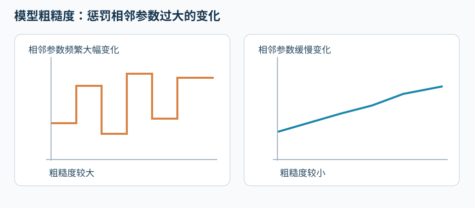
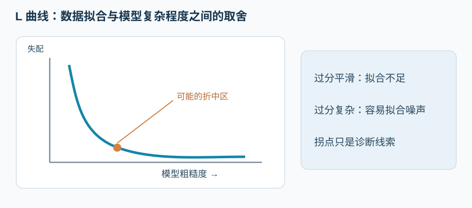
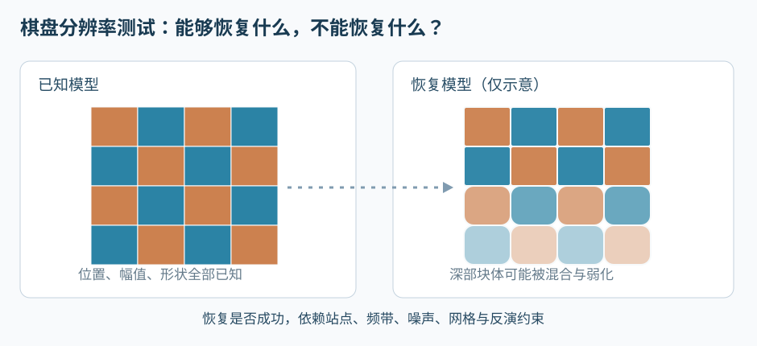



上一篇我们推导出带正则化的 Gauss–Newton 更新方程，其中包含模型约束算子 $\mathbf L$ 和权衡因子 $\lambda$。Constable、Parker 和 Constable（1987）提出的 **Occam（奥卡姆）反演**，把“奥卡姆剃刀原则（如无必要，勿增实体）”写进了地球物理反演：**在所有能够合理拟合观测数据的候选模型中，选择最平滑、最没有多余起伏的那一个。** 本篇先看清“平滑”是怎么量化成矩阵的，再学习反演彩图出炉后最关键的一步——**分辨率与可靠性验证**。

## 本篇路线图
- [14.1 Occam 为什么偏爱平滑模型：从相邻两层之差开始](#sec-07g-occam)
- [14.2 反演结果可信到哪一步：从 RMS 到分辨率测试](#sec-07h-validation)

---

## 14.1 Occam 为什么偏爱平滑模型：从相邻两层之差开始

把“尽量平滑”翻译成计算机能算的代数公式，只需要计算相邻网格参数之间的差值。

### 一、怎样定量衡量一个模型有多“粗糙”？

考虑一个只有三层的简化模型（反演中通常取对数电阻率 $m_j=\log_{10}\rho_j$ 作为参数，既保证电阻率恒正，又跨数量级尺度均衡）：
- **模型 A（剧烈起伏）**：$\mathbf m_A=(1,\,3,\,1)^T$，相邻两层差值分别为 $3-1=2$ 和 $1-3=-2$，平方和为
  $$
  \Phi_m(\mathbf m_A)=2^2+(-2)^2=8.
  $$
- **模型 B（平缓渐变）**：$\mathbf m_B=(1,\,2,\,3)^T$，相邻两层差值分别为 $2-1=1$ 和 $3-2=1$，平方和为
  $$
  \Phi_m(\mathbf m_B)=1^2+1^2=2.
  $$

显然模型 B 的变化更平缓，我们把相邻参数差的平方和 $\Phi_m$ 定义为**模型粗糙度（roughness）**。

### 二、用差分矩阵 $\mathbf L$ 写出粗糙度公式

定义一个 $(M-1)\times M$ 的一阶差分矩阵 $\mathbf L$：

$$
\mathbf L=\begin{pmatrix}
-1 & 1 & 0\\
0 & -1 & 1
\end{pmatrix}.
$$

把它乘以模型向量 $\mathbf m=(m_1,m_2,m_3)^T$，正好得到相邻层参数之差 $\mathbf L\mathbf m=(m_2-m_1,\,m_3-m_2)^T$。于是模型粗糙度紧凑地写为

$$
\boxed{\Phi_m(\mathbf m)=\lVert\mathbf L\mathbf m\rVert^2=\mathbf m^T\mathbf L^T\mathbf L\mathbf m},
$$

若希望模型同时靠近某个先验背景 $\mathbf m_{\rm ref}$，则写为 $\Phi_m=\lVert\mathbf L(\mathbf m-\mathbf m_{\rm ref})\rVert^2$。（二维、三维网格中则分别沿 $x,y,z$ 三个方向计算相邻网格差值，并可按网格宽度加权。）

### 三、Occam 反演的双目标权衡与 L 曲线

如果只最小化粗糙度 $\Phi_m$，程序会直接输出一块处处相等的均匀半空间（粗糙度为零），但完全解释不了野外观测数据；如果只最小化数据失配 $\Phi_d$，程序又会把随机噪声拟合进去，算出满屏锯齿状伪影。

Occam 反演把问题表述为带约束的优化：**在满足目标拟合水平 $\Phi_d(\mathbf m)\le \Phi_d^*$（通常对应 $\mathrm{nRMS}\approx 1.0$）的前提下，寻找使模型粗糙度 $\Phi_m(\mathbf m)$ 最小的解。** 数值求解时引入拉格朗日乘子调节数据失配与平滑度的权重：

$$
\Phi(\mathbf m)=\Phi_d(\mathbf m)+\lambda\Phi_m(\mathbf m).
$$

把不同正则化权重 $\lambda$ 算出来的“模型粗糙度 $\Phi_m$”和“数据失配 $\Phi_d$”画在双对数坐标系中，往往会形成一条形似英文字母 **L** 的曲线——**L 曲线（L-curve）**：
- 左上方陡峭段：$\lambda$ 太小（过拟合），粗糙度暴增但数据拟合几乎不再改善；
- 右下方平缓段：$\lambda$ 太大（过平滑），抹平了真实地质异常导致拟合急剧恶化；
- **L 曲线的拐角处**：正是在“拟合数据”和“保持模型简洁”之间取得最佳平衡的折中点。

### 四、Occam 的平滑结果一定等于真实地下吗？

真实地质界常有锋利的断层、突变的地层界面或很薄的矿层。由于 Occam 施加了平滑惩罚，反演结果往往会把尖锐界面**抹宽成渐变过渡带**，甚至把距离较近的两个独立低阻体连成一片——相当于给地下地质界面开了一层“磨皮滤镜”。

因此，Occam 模型应被理解为：**在现有数据误差下，观测资料真正“强迫要求”存在的最简洁构造轮廓**。

### 自我小测

**1.** 两个候选模型都能达到 $\mathrm{nRMS}=1.0$，为什么 Occam 原则优先选择粗糙度更小的那一个？  
**答：** 因为多出来的复杂剧烈起伏并没有带来显著的数据拟合改善，很可能是数据无法约束的零空间自由度或噪声过拟合伪影。

**2.** 平滑反演剖面上出现一个宽 $10\,\mathrm{km}$ 的低阻区，能否断言真实地下导电体一定宽 $10\,\mathrm{km}$？  
**答：** 不能。低阻区的边界宽度受观测频带分辨率和正则化平滑强度的双重影响，真实导电体可能更窄但电导率更高。

---

反演程序跑完、生成一张色彩绚丽的电阻率剖面图后，真正的科研考验才刚刚开始：**怎么向审稿人和自己证明，图上那个醒目的深部低阻体是数据确实需要的真实特征，而不是算法、初始模型或正则化凑出来的假象？** 下一节我们学习反演验证的标准武器库。

[继续阅读：14.2 反演结果可信到哪一步：从 RMS 到分辨率测试](#sec-07h-validation)

---

## 14.2 反演结果可信到哪一步：从 RMS 到分辨率测试

拿到一张反演剖面图时，最危险的习惯就是直接按颜色给低阻块贴上“岩浆房”或“断裂带”的标签。建立可信度必须经过系统检验。

### 一、反演方法家族概览

除了基于梯度迭代的 Occam / Gauss–Newton 正式反演（如开源的 **ModEM**、**MARE2DEM**、**Occam1D/2D** 等），常见分析中还会用到：
- **快速近似成像（如 Niblett–Bostick 变换）**：直接把不同频率的视电阻率和相位映射成近似深度—电阻率剖面，适合野外现场快速预览，但不能替代严格正反演；
- **随机采样反演（如蒙特卡洛 Monte Carlo、贝叶斯反演）**：生成成千上万个候选模型并统计后验概率分布，非常适合定量评估一维或多参数模型的非唯一性范围，但在大型三维网格中计算成本极高。

### 二、为什么过分追求更低的 RMS 反而危险？

假设平滑反演得到 $\mathrm{nRMS}=1.10$，剖面干净清晰；你把正则化权重 $\lambda$ 调小，硬把 $\mathrm{nRMS}$ 压到 $0.95$，结果剖面里长出了一堆密密麻麻的红蓝小斑点。多出来的那些小斑点，十有八九是在强行拟合数据里的随机噪声。**拟合度改善必须与模型复杂度的代价相匹配**，盲目追求极低 RMS 只会制造伪影。

### 三、棋盘分辨率测试（Checkerboard Test）

为了检验当前测站分布和观测频带在各个深度到底能看清多小的构造，地球物理学家常做**棋盘测试**：
1. 在均匀背景中人为摆放一排排高低阻交替的规则方块（像国际象棋棋盘）；
2. 用相同的测站位置和观测频率做正演，生成模拟观测数据，并加上与野外实际水平相当的高斯噪声；
3. 用与真实反演完全相同的网格和正则化参数对模拟数据进行反演；
4. 对比恢复出来的图像与原始棋盘：如果浅部方块棱角分明、深部方块却糊成一片，就客观划定了该数据集的有效分辨深度界限。

（注意：棋盘测试依赖所设方块的大小与电性对比度，通过某尺度的棋盘测试并不能保证任意不规则形态的异常体都能被完美恢复。）

### 四、异常体消除与扰动试验（Hypothesis Testing）

针对剖面上某个具体的关键低阻体或导电通道，最有说服力的检验是**假设检验（灵敏度测试）**：
- **消除试验**：在最终反演模型中，把这个低阻体手动替换成周围围岩的背景电阻率，重新运行正演计算理论曲线。如果替换后预测曲线与实测数据严重偏离（$\mathrm{nRMS}$ 显著恶化），说明这个异常体是**数据确实需要的**；如果替换后 $\mathrm{nRMS}$ 几乎纹丝不动，说明该异常体处于观测盲区，缺乏可靠约束；
- **边界扰动试验**：改变异常体的底界深度、宽度或电阻率数值，观察数据拟合何时开始明显变差，从而给出异常体几何参数的可靠不确定度范围；
- **初值与参数化对比**：更换不同的初始模型（比如不同电阻率的均匀半空间）和网格剖分重新反演，检查核心构造是否稳定重现。

### 五、横向与纵向分辨率的不对称性

地表测站像一排排眼睛排列在地面上，因此横向移动测站通常能较敏锐地锁定异常体的**水平位置**；但随着深度增加，电磁场扩散效应增强，深部异常体的**底界面深度**往往比顶界面更难精确卡死。看反演图时，绝不能把深部弱约束区每一条渐变等值线都当成精确的地质界线。

### 自我小测

**1.** 两个三维模型都能把数据拟合到 $\mathrm{nRMS}\approx 1.0$：模型 A 平滑简洁，模型 B 在深部多出一个狭窄的高阻柱，刚好符合你心中的地质假说。能直接选模型 B 发表吗？  
**答：** 不能。必须做异常体消除和扰动试验，检验那个深部狭窄高阻柱是否带来具有统计意义的数据拟合改善；如果去掉它数据拟合几乎不变，它就没有得到观测数据的支持，报告中必须如实保留不确定性。

**2.** 如果在反演模型中把某处深部低阻体替换成背景高阻后，正演计算的全局 $\mathrm{nRMS}$ 几乎没有变化，在论文中该如何严谨表述？  
**答：** 应客观指出：在当前测站分布、观测频带与数据误差水平下，数据对该深部低阻异常的灵敏度较低，其存在性或具体规模尚未获得充分约束。

---

到这里，我们已经拿到了经过严格分辨率检验的可靠电性结构模型。下一篇开启全书的最后三章——**地质解释**：看看地下岩石究竟是靠什么导电的，以及如何把一张电阻率彩图转化成经得起多学科检验的地质认识。

[继续阅读：15｜岩石导电机制、Archie 定律与全球深部电性](/posts/2026/10/mt-course-08a-rock-physics/) · [返回总目录](/posts/2026/10/mt-course/)
