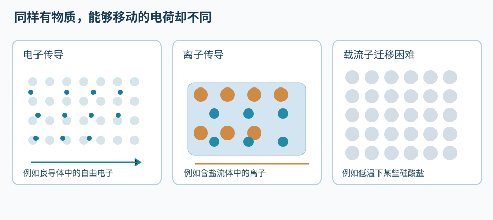
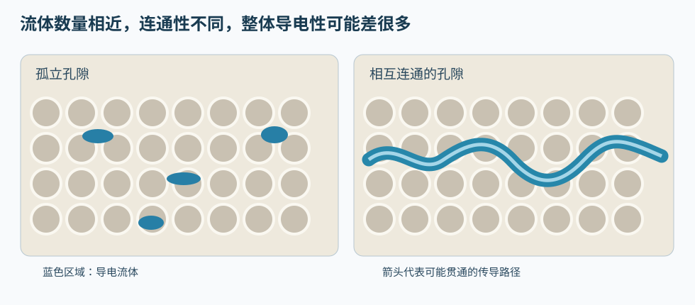
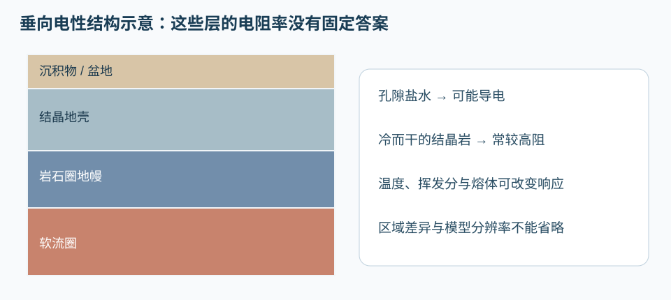



经历前十四个单元的电磁物理、信号处理、张量分析和反演验证，我们手里终于拿到了经过严格检验的地下电阻率剖面图。现在来到整套教程的最后三章——**地质解释（Geological Interpretation）**：**电阻率彩图上的一个低阻体，究竟代表含盐流体、部分熔融、石墨、硫化物还是黏土蚀变带？**

本篇先打好岩石物理基础：弄清楚电荷在矿物和流体中怎么移动，亲手算一遍 Archie 定律看看少量流体为什么能把整块岩石的电阻率拉低几个数量级，再把视野从单个测站放大到铺满大陆的大型阵列和全球深部地幔成像。

## 本篇路线图
- [15.1 岩石为什么能导电：从电子、离子与电阻率开始](#sec-08a-conduction)
- [15.2 少量流体为什么能显著改变电阻率：从 Archie 定律到连通性](#sec-08b-archie)
- [15.3 为什么要把 MT 测站铺满大陆：大尺度阵列与全球深部电性](#sec-08c-global-arrays)

---

## 15.1 岩石为什么能导电：从电子、离子与电阻率开始

要解答“为什么造岩硅酸盐矿物普遍高阻，而含盐水、硫化物和熔体却非常导电”，必须回到最底层的物理机制：**电荷在物质内部靠什么载体移动、移动起来有多顺畅？**

### 一、先分清电阻、电阻率和电导率

设想用同一种岩石加工出两根均匀圆柱样品：一根较长，一根较短。接通电源后，较长的柱子阻力更大，因为电荷需要跋涉更长的路程；如果把柱子加粗（增大横截面积 $A$），电流有了更宽阔的通道，总电阻就会变小。对于长度 $L$、横截面积 $A$ 的均匀柱体，总电阻 $R$ 满足：

$$
\boxed{R=\rho\frac{L}{A}},
$$

其中 $R$ 是电阻（单位 $\Omega$），$\rho$ 是剔除了样品几何尺寸影响后、仅反映材料本身导电能力的**电阻率**（单位 $\Omega\cdot\mathrm m$）。例如当 $\rho=10\,\Omega\cdot\mathrm m$、$L=2\,\mathrm m$、$A=1\,\mathrm m^2$ 时，$R=10\times(2/1)=20\,\Omega$；若截面积翻倍到 $2\,\mathrm m^2$，电阻降为 $10\,\Omega$。

电阻率的倒数称为**电导率** $\sigma$：

$$
\boxed{\sigma=\frac{1}{\rho}},
$$

单位是西门子每米（$\mathrm{S/m}$，注意不要与电导的单位 $\mathrm S$ 混淆）。当 $\rho=10\,\Omega\cdot\mathrm m$ 时，$\sigma=0.1\,\mathrm{S/m}$。

### 二、为什么有自由移动的电荷就能导电？——电子传导与离子传导

不同地球材料内部负责搬运电荷的“载流子”截然不同：
- **电子传导**：金属、部分硫化物以及石墨等碳质矿物内部存在大量可自由移动的电子，导电能力极强；
- **离子传导**：含盐孔隙水和硅酸盐熔体中，带有正负电荷的离子（如 $\mathrm{Na^+}$、$\mathrm{Cl^-}$、$\mathrm{H^+}$ 等）在电场驱动下发生定向迁移。

在单一载流子主导的简化模型中，电导率取决于三项因素的乘积：

$$
\boxed{\sigma=n|q|\mu_c},
$$

其中 $n$ 是单位体积内的有效载流子浓度，$|q|$ 是单个载流子所带电荷量，$\mu_c$ 是迁移率（衡量载流子在电场中移动的灵活程度）。多种载流子同时参与时，则为各载流子贡献之和 $\sigma=\sum_s n_s|q_s|\mu_s$。

### 三、造岩硅酸盐矿物与石墨、硫化物的巨大反差

构成地壳和上地幔主体的干燥造岩硅酸盐矿物（如石英、长石、橄榄石、辉石），在常温常压下自由电子极少、离子迁移极其困难，电阻率动辄高达 $10^3\sim 10^5\,\Omega\cdot\mathrm m$ 以上，几乎是绝缘体。

相比之下，**石墨**和某些**金属硫化物**（如黄铁矿、磁黄铁矿）即使在岩石中只占很小的体积分数，只要沿着晶粒边界或剪切带连成细丝状网络，就能让整块岩石的电阻率骤降几个数量级。

### 四、含盐水与部分熔融体为什么是天然低阻主力？

1. **含盐孔隙水**：地壳裂隙和孔隙中普遍赋存含盐流体，其中的溶解离子提供了丰富的载流子。盐度越高、温度越高（离子热运动加剧、水黏度下降，极端超临界条件除外），流体电导率就越高。一块致密结晶岩哪怕骨架本身高达 $10^4\,\Omega\cdot\mathrm m$，一旦裂隙里灌满连通盐水，整体电阻率就可能跌到几十欧姆米。
2. **硅酸盐部分熔融**：在深部高温环境下，岩石局部熔融产生的硅酸盐熔体同样含有大量可迁移离子（尤其是 $\mathrm{Na^+}$ 等碱金属离子），且含水量越高、温度越高，熔体黏度越低、电导率越高。

### 五、低阻体没有自带“身份证”：物理解释的工作顺序

由于含盐流体、部分熔融、石墨薄膜、硫化物以及黏土蚀变带都能在特定条件下产生相近的低电阻率值（例如 $1\sim 20\,\Omega\cdot\mathrm m$），反演剖面上的低阻区本身可不会附带一张写着“我是岩浆房”的身份证。

这决定了地质解释必须遵守严格的逻辑顺序：**先从电磁观测建立经过分辨率检验的电性结构模型，再结合温压条件、岩石物性实验、地震波速与区域构造背景，逐一甄别最合理的导电机制。**

### 自我小测

**1.** 某岩石样品的电阻率为 $\rho=100\,\Omega\cdot\mathrm m$，它的电导率 $\sigma$ 是多少？  
**答：** $\sigma=1/100=0.01\,\mathrm{S/m}$。

**2.** 一根均匀岩芯样品长度加倍、横截面积不变，总电阻如何变化？  
**答：** 加倍（由 $R=\rho L/A$ 可知，长度翻倍则电阻翻倍）。

**3.** 两块矿物骨架成分完全相同的花岗岩，为什么在野外测出来的电阻率可能相差上百倍？  
**答：** 因为岩石整体电阻率不仅取决于矿物骨架，还强烈受控于微裂隙发育程度、孔隙含水量、流体盐度、孔隙连通性以及蚀变程度。

---

理解了流体和导电相在岩石中的角色，接下来我们要算一笔更精细的定量账：**为什么岩石里仅仅混入 $5\%\sim 10\%$ 的导电流体，就能把整块岩石的电阻率拉低几十倍？** 这就是著名的 Archie 定律要回答的问题。

[继续阅读：15.2 少量流体为什么能显著改变电阻率：从 Archie 定律到连通性](#sec-08b-archie)

---

## 15.2 少量流体为什么能显著改变电阻率：从 Archie 定律到连通性

真实岩石是高阻矿物骨架与低阻孔隙流体的多相混合物。为什么区区百分之几的导电流体，就能主导整块岩石的导电表现？关键不仅在于**流体有多少（孔隙度）**，更在于**流体有没有连成一片（连通性）**。

### 一、串联还是并联？——连通性决定一切

借用初中电路的串联与并联来打比方：
- 如果导电流体被死死封在一个个互不相连的孤立小气泡里，电流必须强行穿过高阻矿物骨架才能前进（类似**电阻串联**），此时哪怕流体本身再导电，整块岩石依然呈现高阻；
- 一旦流体沿着孔隙喉道或微裂隙彼此贯通，电流就会集中沿着这条低阻高速路奔涌（类似**电阻并联**），整块岩石的整体电阻率就会出现断崖式下降。

### 二、孔隙度与 Archie 经验定律

一块岩石中孔隙体积占总体积的比例称为**孔隙度** $\phi=V_{\rm pore}/V_{\rm total}$（此处 $\phi$ 表示孔隙度，注意根据上下文与阻抗相位区分）。

对于骨架近似绝缘、且孔隙被单一导电流体完全饱和的干净砂岩或均匀孔隙岩石，Archie（1942）总结出了经典的经验公式：

$$
\boxed{\rho_b=a\rho_w\phi^{-m}},
$$

其中 $\rho_b$ 是整块岩石的体积电阻率，$\rho_w$ 是孔隙流体的电阻率，$m$ 是反映孔隙连通曲折程度的**胶结指数**（一般取 $1.3\sim 2.5$），$a$ 是接近 $1$ 的经验比例常数（教学计算中常取 $a=1$）。

### 三、亲手算一遍：孔隙度从 $5\%$ 增至 $10\%$ 的剧烈效应

设一组教学假设参数：孔隙盐水电阻率 $\rho_w=0.2\,\Omega\cdot\mathrm m$，胶结指数 $m=2$，$a=1$。
- **当孔隙度为 $5\%$（$\phi=0.05$）时**：
  $$
  \rho_b=0.2\times (0.05)^{-2}=\frac{0.2}{0.0025}=0.2\times 400=80\ \Omega\cdot\mathrm m.
  $$
- **当孔隙度增至 $10\%$（$\phi=0.10$）时**：
  $$
  \rho_b=0.2\times (0.10)^{-2}=\frac{0.2}{0.01}=0.2\times 100=20\ \Omega\cdot\mathrm m.
  $$

看清这个非线性放大效应：孔隙度仅仅增加了 $5$ 个百分点（翻了一倍），整体岩石电阻率却从 $80\,\Omega\cdot\mathrm m$ 暴跌到 $20\,\Omega\cdot\mathrm m$，整整下降了四倍！

### 四、同样孔隙度，换一种流体盐度会怎样？

如果保持孔隙度 $\phi=0.10$ 和 $m=2$ 不变，但孔隙里装的是更淡的水（$\rho_w=2\,\Omega\cdot\mathrm m$），算出来的岩石电阻率立刻变成 $\rho_b=2\times 100=200\,\Omega\cdot\mathrm m$，相差整整十倍。这再次说明：**单靠反演得到一个 $\rho_b=20\,\Omega\cdot\mathrm m$ 的低阻体，无法唯一倒推出“孔隙度是多少”**，必须有流体盐度、温度或岩石学资料的独立约束。

### 五、使用 Archie 定律必须留意的四个边界条件

Archie 定律最初源于沉积岩测井经验，直接套用到深部变质岩或上地幔部分熔融时，必须警惕以下失效情形：
1. **黏土矿物的表面导电（双电层效应）**：页岩或热液蚀变带中含有大量黏土矿物，矿物颗粒表面吸附的离子会提供额外的导电通道（此时需改用 Waxman–Smits 等修正模型）；
2. **部分饱和**：孔隙中同时存在油气和盐水时，还需引入含水饱和度项 $S_w^{-n}$；
3. **固体导电相干扰**：若岩石中含石墨或连通硫化物，即使完全干燥也能强烈导电；
4. **深部熔体几何形态**：上地幔部分熔融体的连通性受矿物晶粒二面角（wetting angle）和构造剪切变形控制，不能简单照搬砂岩的经验指数 $m$。

### 自我小测

在取 $a=1,\,m=2,\,\rho_w=1\,\Omega\cdot\mathrm m$ 的教学条件下，若孔隙度 $\phi=0.5$，整体电阻率 $\rho_b$ 是多少？如果野外反演只测得 $\rho_b=4\,\Omega\cdot\mathrm m$，能否反过来唯一确定该处孔隙度就是 $50\%$？  
**答：** 计算得 $\rho_b=1\times 0.5^{-2}=4\,\Omega\cdot\mathrm m$。但反过来仅凭 $\rho_b=4\,\Omega\cdot\mathrm m$ 绝不能唯一确定 $\phi=0.5$，因为如果孔隙流体更咸（例如 $\rho_w=0.04\,\Omega\cdot\mathrm m$），只需要 $\phi=0.1$（$10\%$ 孔隙度）同样能算出 $\rho_b=0.04\times 0.1^{-2}=4\,\Omega\cdot\mathrm m$。

---

理解了单块岩石的导电物理，接下来我们把视角拉升到数千千米的尺度：看看地球物理学家为什么要把 MT 测站铺满整座大陆，以及全球地幔电导率切片该如何正确解读。

[继续阅读：15.3 为什么要把 MT 测站铺满大陆：大尺度阵列与全球深部电性](#sec-08c-global-arrays)

---

## 15.3 为什么要把 MT 测站铺满大陆：大尺度阵列与全球深部电性

如果只在某一个测站看到“$100\,\mathrm{km}$ 深处有低阻异常”，你根本分不清它是一团孤立的局部透镜体，还是绵延上千千米的巨型岩石圈构造带。**要回答大陆演化和深部地幔动力学问题，就必须把单点测量扩展为二维面状观测阵列（MT Array）。**

### 一、为什么单条测线剖面往往不够用？

沿着一条东西向直线布设测站，只能切出一张二维垂向切片。如果地下有一个斜交测线的三维异常体，或者存在侧向电流绕流效应，二维剖面反演就会把侧方的异常错误地投影到测线正下方，制造出虚假的垂向条带。按规则网格布设的面状三维阵列，能从全方位捕捉电磁场感应，真正实现地下三维体积成像。

### 二、认识四大标志性大陆尺度观测计划

过去几十年间，全球多个国家实施了极具影响力的大陆尺度电磁探测计划：
- **Lithoprobe（加拿大）**：1984—2003 年实施的多学科岩石圈探测计划，将宽频与长周期 MT 与深反射地震紧密结合，揭示了北美克拉通拼合与造山带深部结构；
- **EarthScope / USArray（美国）**：在全美范围内以约 $70\,\mathrm{km}$ 的准规则网格布设长周期 MT 阵列（单站连续观测数周），绘制出覆盖整个美国大陆的岩石圈三维电性图谱；
- **SinoProbe（中国深部探测专项）**：在华北克拉通、青藏高原及重要成矿带开展了大规模长周期与宽频 MT 阵列观测（注：解读任何大型计划成果时，务必区分早期规划布设点位与最终实际采集并通过质控进入反演的有效测站分布）；
- **AusLAMP（澳大利亚）**：以约 $55\,\mathrm{km}$ 网格间距覆盖整个澳洲大陆的长周期 MT 计划，为理解古老大陆岩石圈演化及大型矿集区深部背景提供了关键约束。

### 三、全球地幔电导率反演为什么困难重重？

如果把视野进一步放大到全球地幔（深度 $40\sim 900\,\mathrm{km}$ 乃至地幔转换带），研究者通常利用全球地磁台站网（如 INTERMAGNET）记录的磁暴和 Sq 太阳静日变化，通过球谐函数展开提取地幔响应。

全球建模面临的最大瓶颈是**海陆台站分布极度不均**：北半球大陆台站密集，而广阔的南半球和大洋内部台站极其稀疏，加之导电海水层的海岸效应干扰，不同大洋深处的电导率模型依然存在较大的不确定度。

### 四、高清深度切片 $\ne$ 高深部分辨率

阅读大陆或全球三维模型的水平深度切片（如 $100\,\mathrm{km}$、$250\,\mathrm{km}$、$410\,\mathrm{km}$ 切片）时，必须严格区分三个概念：
1. **模型网格厚度**：计算机划分的网格有多薄（程序可以随意把地幔切成一百层）；
2. **数据深度灵敏度**：当前观测频带实际上能感受到哪个深度范围的电性变化；
3. **反演真实分辨率**：数据能否把上下相邻的两个深度层真正区分开。

**切得很细的网格只代表程序画图精细，绝不代表每一层切片都是彼此独立的真实地质地图。** 将电导率切片与全球地震层析成像（波速异常）、地幔矿物高温高压实验（如名义无水矿物中的水含量对电导率的影响）联合对比，才能得出稳健的深部地球动力学认识。

### 自我小测

**1.** 同样拥有 $100$ 个长周期 MT 测站，全部集中在一个角落加密布设，与按准规则网格均匀铺满整个研究区，两者对深部岩石圈三维几何形态的约束能力相同吗？  
**答：** 不相同。均匀面状阵列能够提供均衡的横向空间采样，约束深部大型构造的走向与三维边界；过度集中则只能提供局部信息，外围区域缺乏约束。

**2.** 某全球地幔电导率模型展示了 $20$ 张不同深度的水平切片，这是否意味着该模型拥有 $20$ 层相互独立的垂向分辨率？  
**答：** 不是。模型切片数量取决于人为设定的网格层数，而电磁场在深部具有较强的扩散平滑效应，相邻深度切片之间存在高度垂向相关性。

---

掌握了岩石物性机制与阵列成像原理，下一篇我们直接走进四个经典的真实大陆构造战场——北美 Cascadia 俯冲带、中大陆古裂谷、中国华北克拉通与青藏高原，看看地质学家是如何抽丝剥茧解读深部导电异常的。

[继续阅读：16｜大陆构造案例：Cascadia、北美裂谷、华北与青藏高原](/posts/2026/10/mt-course-08b-continental-cases/) · [返回总目录](/posts/2026/10/mt-course/)
