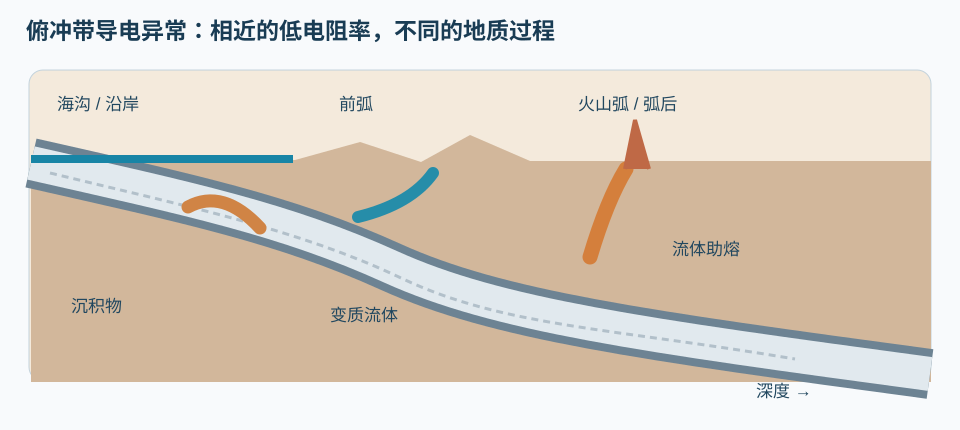



上一篇我们从电子、离子和 Archie 定律认识了岩石导电的微观机制，也了解了大陆尺度的观测阵列。本篇我们直接走进三个极具代表性的真实大陆构造案例——**活跃的北美 Cascadia 俯冲带**、**古老的北美中大陆裂谷与古缝合带**，以及**中国 SinoProbe 计划下的华北克拉通与青藏高原**，看看一线科研人员如何把电阻率剖面与地震、重力、磁法和构造背景编织成严谨的地质故事。

## 本篇路线图
- [16.1 俯冲带里为什么会出现三条导电带：Cascadia 案例](#sec-08d-cascadia)
- [16.2 古裂谷、缝合带与深部导体：北美大陆 MT 案例](#sec-08e-northamerica)
- [16.3 SinoProbe 怎么研究华北和青藏高原的深部电性？](#sec-08f-sinoprobe)

---

## 16.1 俯冲带里为什么会出现三条导电带：Cascadia 案例

北美西北部（美国华盛顿州、俄勒冈州及加拿大不列颠哥伦比亚省一带）的 **Cascadia 俯冲带**，是研究大洋板块俯冲、变质脱水与弧岩浆作用的天然实验室。这里年青而炽热的 Juan de Fuca（JdF）洋壳板块正自西向东俯冲到北美大陆板块之下。

（注：上图为帮助理解地质过程的概念性剖面示意，并非某一单篇文献的原始坐标成图。）

### 一、俯冲带的三条典型导电异常带

结合 EarthScope、MOCHA 等跨海陆长周期 MT 阵列（汇集约 $332$ 个测站，周期覆盖 $10\sim 14678\,\mathrm s$）的三维反演研究，科学家在 Cascadia 俯冲带识别出了三类空间位置和成因截然不同的低阻异常带：

1. **第一类：近海与俯冲界面顶部的导电带——俯冲沉积物与孔隙流体**  
   大洋板块携带大量饱含海水的深海沉积物和蚀变玄武岩俯冲进入海沟。在浅部挤压环境下，未完全排出的高盐度孔隙水以及富含黏土矿物的沉积层，沿着俯冲板片顶界形成一条向陆倾斜的浅部低阻带。
2. **第二类：前弧地幔楔角附近的导电带——变质脱水流体与慢滑移（ETS）**  
   随着板块继续下插，温度和压力升高，洋壳中的含水矿物（如绿泥石、角闪石、蛇纹石等）发生脱水变质反应，释放出大量含水流体向上运移，聚集在冷而致密的前弧地幔楔角（forearc mantle corner）及上覆地壳剪切带中。高孔隙流体压力不仅显著降低了岩石电阻率，还削弱了断层摩擦力——这一低阻区在空间上与**间歇性震颤与慢滑移（ETS）**震源区高度吻合。
3. **第三类：Cascade 火山弧及弧后下方的深部导电带——流体助熔（Flux Melting）**  
   在更深处（约 $70\sim 120\,\mathrm{km}$），板片释放的流体进入高温上覆地幔楔，显著降低了地幔橄榄岩的固相线温度，诱发**流体助熔**，产生含水硅酸盐熔体。这些向上运移的岩浆熔体在火山弧下方地幔楔和下地壳形成一条近垂向延伸的深部低阻通道，为地表 Cascade 火山链提供岩浆补给。

### 二、海陆联合观测与地震先验约束的价值

在 Cascadia 研究中，近海布设的海底 MT 测站填补了海岸线以西的观测空白，大幅提升了对浅部俯冲界面几何形态的约束；同时，利用独立宽角地震和接收函数确定的俯冲板片顶界作为结构参考，帮助检验导电异常究竟位于板片内部、界面之上还是上覆地幔楔中。

### 三、核心启示：同样的低阻颜色，凭什么得出三种地质解释？

三条异常在电阻率剖面上都表现为低阻，但它们对应的地质机制完全不同。区分它们的钥匙不是“颜色深浅”，而是**空间构造位置（海沟、前弧还是火山弧）、温压相图条件（流体稳定区还是部分熔融区）以及地震波速、天然震颤等独立观测的交叉印证**。

### 自我小测

**1.** 沿着俯冲板片顶界分布的浅部低阻带，与火山弧正下方地幔楔里的深部低阻带，能用同一种物性机制解释吗？  
**答：** 不能。前者温度较低，主要受俯冲沉积物孔隙盐水或低温变质脱水流体控制；后者处于高温软流圈/地幔楔环境，主要与流体助熔产生的部分熔融体及高温含水流体有关。

**2.** 如果在反演中把地震学确定的板片界面作为先验结构约束，结果真的沿着界面出现了低阻异常，能直接宣称“MT 独立证明了板片界面的存在”吗？  
**答：** 不能循环论证。必须通过对比无先验平滑反演、或者改变先验界面位置后的拟合残差变化，来检验数据本身对界面异常的独立约束强度。

---

看完了活跃俯冲带的动态流体与岩浆系统，接下来我们把目光转向看似平静古老的大陆内部，看看十亿年前的古裂谷和古缝合带如何在电性剖面上留下印记。

[继续阅读：16.2 古裂谷、缝合带与深部导体：北美大陆 MT 案例](#sec-08e-northamerica)

---

## 16.2 古裂谷、缝合带与深部导体：北美大陆 MT 案例

表面上风平浪静的大陆克拉通内部，地下岩石圈其实忠实保存着数十亿年来板块拼合、陆内裂解和岩浆底侵的历史档案。北美大陆的 **Midcontinent Rift（中大陆裂谷，简称 MCR）** 和 **USArray 大陆成像** 为我们展示了多地球物理方法联合解码的威力。

### 一、北美中大陆裂谷（MCR）的多物性交叉验证

北美中大陆裂谷形成于约 $11$ 亿年前（中元古代），是一条横切太古宙 Superior 克拉通和古元古代构造带、绵延超过 $2000\,\mathrm{km}$ 的巨型陆内裂谷系，后来因格林维尔造山运动的挤压而夭折，未能张开成大洋。依托覆盖该区的约 $222$ 个长周期 MT 测站，研究者对比了电性、重力和磁法揭示的地下结构：

| 地球物理方法 | 敏感的核心物性 | 常见地质对应体 |
|---|---|---|
| **大地电磁（MT）** | 电导率 / 电阻率 | 连通含盐流体、石墨/硫化物剪切带、部分熔融 |
| **重力勘探** | 岩石密度差异 | 高密度基性/超基性侵入岩、低密度沉积盆地 |
| **磁法勘探** | 岩石磁化率与剩磁 | 含磁铁矿的玄武岩流、辉长岩侵入体、磁性基底 |
| **地震学** | 弹性波速与波阻抗界面 | 岩性分层、莫霍面、岩石圈–软流圈边界（LAB） |

在 MCR 地区，裂谷轴部充填的厚层致密玄武岩和辉长岩侵入体在重力和磁法上表现为强烈的**正异常（高密度、强磁性）**，在 MT 模型中也对应**高电阻率**块体；而裂谷两侧坳陷的含盐沉积盆地以及伴生的古缝合带，则表现为**低密度与低电阻率**。

需要提醒的是，电性边界、密度边界和磁性边界并不总是严丝合缝地重合——例如后期热液蚀变或沿断层沉淀的少量石墨薄膜，可以剧烈降低岩石电阻率，却几乎不改变岩石的整体密度。正因每种方法敏感的物性不同，四者联合才能相互补充、减少多解性。

### 二、古缝合带与岩石圈–软流圈边界（LAB）的电性特征

当两块古老大陆地块发生碰撞拼合时，沿**古缝合带（paleo-suture zone）**往往发育深大断裂与韧性剪切带。如果当年的变质脱水或还原性流体在剪切带中沉淀出了连通的**石墨膜或硫化物**，即使历经十亿年冷却，今天在 MT 剖面上依然能看到一条贯穿地壳甚至切入岩石圈地幔的倾斜低阻带。

而在更深处，从冷而干燥、高阻的岩石圈地幔过渡到较热、含微量挥发分或部分熔融的软流圈时，电阻率往往显著下降，表现为**电性岩石圈–软流圈边界（eLAB）**。由于地震波速对温度与力学状态敏感，而电导率对微量水（氢缺陷）和熔体连通性极其敏感，电性 LAB 与地震 LAB 的深度有时存在一定差异，对比两者的异同恰恰是研究岩石圈热—化学演化的重要窗口。

### 三、解读深部大陆切片的注意事项

在利用 USArray 大规模子集（如 $1116$ 站中的 $423$ 站）进行三维成像时，初学者常听说一句口诀：“阻抗相位大于 $45^\circ$ 就说明地下越来越导电”。这句规律仅在**理想一维层状介质且采用正向相位定义**下成立；在复杂三维大陆地壳和静态位移影响下，切忌单凭个别频点的相位高低直接目测深部构造，而应通过完整的三维反演和异常体消除测试（把深部导体替换回高阻背景看 $\mathrm{nRMS}$ 是否恶化）来验证深部异常的可靠性。

### 自我小测

**1.** 一条深部低阻带在空间位置上恰好与地表地质填图识别的古缝合带重合，能否直接断言该低阻一定是石墨引起的？  
**答：** 不能。空间重合说明它与古缝合带构造有关，但低阻成因既可能是古剪切带中的石墨或硫化物，也可能是后期沿古断裂带贯入的深部含盐流体，需结合岩石学、热史和地震波速综合判断。

**2.** 某深部低阻体在反演模型中删掉后，正演计算的全局 $\mathrm{nRMS}$ 几乎没有变化，在撰写结论时应该怎么说？  
**答：** 应明确指出现有观测频带和测站分布对该深部低阻体的分辨率不足，它目前属于数据约束较弱的候选特征，不能作为确定性地质结论。

---

看完了北美的俯冲带和古裂谷，最后我们把目光投向中国本土——看看国家重大专项 **SinoProbe** 是如何在结构截然不同的**华北克拉通**和**青藏高原**开展深部电磁探测的。

[继续阅读：16.3 SinoProbe 怎么研究华北和青藏高原的深部电性？](#sec-08f-sinoprobe)

---

## 16.3 SinoProbe 怎么研究华北和青藏高原的深部电性？

中国大陆汇聚了古老稳定的克拉通地块与世界上最年轻、最剧烈的陆陆碰撞造山带。**SinoProbe（深部探测技术与实验研究专项）**在华北克拉通和青藏高原部署了大规模长周期（LMT）与宽频带（BBMT）观测阵列，为我们提供了对比两种极端大陆构造体制的绝佳范本。

### 一、务必分清“规划布站图”与“实际有效测站图”

阅读大型项目成果时，首先要建立一个严谨的习惯：**把方案里的“计划测点”与最终进入反演的“实际有效测站”严格区分开。**

野外勘探不是在地图上画好规则网格就能自动采集出干净数据：华北平原密集的城市建筑、高压电网、电气化铁路，以及青藏高原高海拔无人区的陡峭地形、冻土和交通限制，都会迫使部分测站偏移或因强人文干扰在质控阶段被剔除。真正决定三维反演空间分辨率的，是经过严格质量筛选后的**实际有效测站分布图**。

### 二、华北克拉通破坏与三维电性结构

华北克拉通是世界上最古老的陆块之一，却在中生代发生了显著的“克拉通破坏”（岩石圈减薄与改造），东部华北平原变得活动而薄弱，西部鄂尔多斯地块则依然保持冷而厚的稳定克拉通特征。

阅读华北三维电阻率模型时，建议遵循五步看图法：
1. **核对色标与物理量**：确认图件画的是电阻率（$\Omega\cdot\mathrm m$）还是电导率（$\mathrm{S/m}$），以及是否取了对数刻度；
2. **三维立体联合观察**：把不同深度的水平切片与多条横穿造山带的垂向剖面连起来看（某张水平切片上看似分开的两个低阻斑块，在更深处可能连成一体）；
3. **对照有效测站覆盖**：检查异常区正上方及周边是否有足够的测站支撑，警惕阵列边缘的边界伪影；
4. **对比构造单元**：将高阻块体（如稳定的鄂尔多斯刚性岩石圈）和低阻带（如太行山重力梯度带、郯庐断裂带及岩石圈减薄区）与已知构造单元比对；
5. **探讨物性机制**：结合地热流值、地震波速和地幔捕虏体岩石学资料，评估低阻异常究竟源于软流圈上涌热扰动、挥发分富集还是古俯冲板片脱水改造。

### 三、青藏高原下地壳低阻带与“通道流”假说检验

青藏高原在印度–欧亚板块持续碰撞挤压下，地壳增厚至 $60\sim 80\,\mathrm{km}$。大量 MT 剖面和阵列在青藏高原中下地壳（约 $20\sim 40\,\mathrm{km}$ 深度）探测到了显著的低电阻率异常带，常被用来探讨下地壳部分熔融、含水流体以及“下地壳通道流（channel flow）”等地球动力学模型。

然而，把一张三维反演彩图转化为构造结论前，必须经过四步严苛检验：
1. **阻断测试（连通性检验）**：如果模型上显示一条贯通数百千米的连续低阻通道，手动把中间一段替换成高阻背景再做正演——看看观测数据是否真的强烈反对“断开”；很多时候平滑正则化会把几个原本孤立的低阻囊体连成看似连续的条带；
2. **几何参数扰动**：改变低阻带的顶底埋深和厚度，确定数据的真实敏感范围；
3. **多参数化与多初始模型对比**：更换平滑权重和初始半空间，确认核心低阻体位置稳定；
4. **多学科证据交叉**：对照该区域的大地热流、地震低速带（Vs）、径向各向异性以及新生代岩浆岩年代学，判断当地温压条件是否确实达到了部分熔融固相线，还是由变质脱水盐水主导。

### 四、大尺度阵列与高密度细测线如何互补？

宽站距大陆阵列（点距几十千米）擅长勾勒全区三维岩石圈背景，但会漏掉几千米宽的局部断裂细节；高密度剖面（点距几百米到几千米）对浅中地壳断层刻画精细，却受限于二维假设和观测宽度。最理想的科研设计是“面状阵列控背景、加密剖面解细节”，并在各自敏感频段内合理加权融合。

### 自我小测

**1.** 某探测计划原定布设 $3000$ 个测站，能否在论文中直接写“本三维反演使用了 $3000$ 个高质量测站的数据”？  
**答：** 不能。必须如实统计实际完成野外采集、并通过噪声筛选和质量控制后最终输入反演程序的有效测站数量。

**2.** 青藏高原下地壳反演出一块低阻区，能否直接画上等号说“这里存在大规模部分熔融岩浆层”？  
**答：** 不能。下地壳低阻既可能来自部分熔融，也可能由高盐度变质流体或石墨化剪切带引起，必须结合当地大地热流、温压相图与地震波速/衰减证据共同约束。

---

大陆尺度的宏伟构造已经领略完毕。最后一篇（第 17 篇），我们将把镜头推向两个更具特色的应用场景——**用长周期 MT 搭配高密度音频 AMT 精细解剖新疆西准噶尔岩体与古洋壳**，以及**把仪器沉入数千米深海的海底海洋 MT**，并用一个完整实战案例演练如何写出滴水不漏的地质解释证据链。

[继续阅读：17｜区域与海洋案例：西准噶尔、海洋 MT 与地质解释证据链](/posts/2026/10/mt-course-08c-field-cases/) · [返回总目录](/posts/2026/10/mt-course/)
