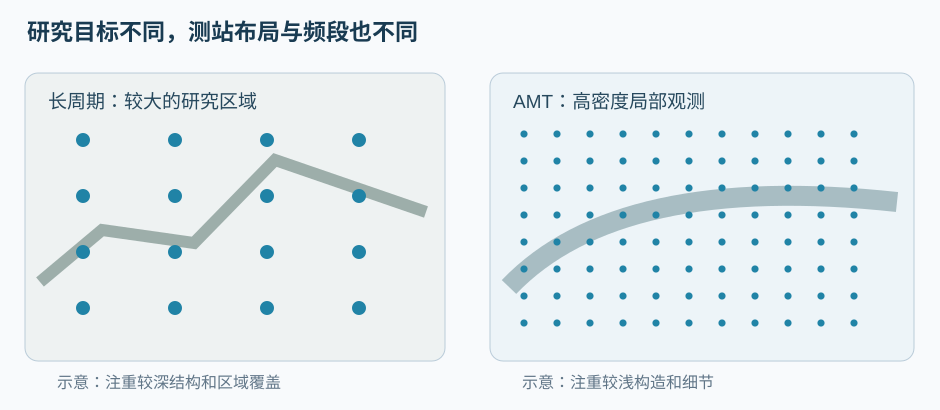
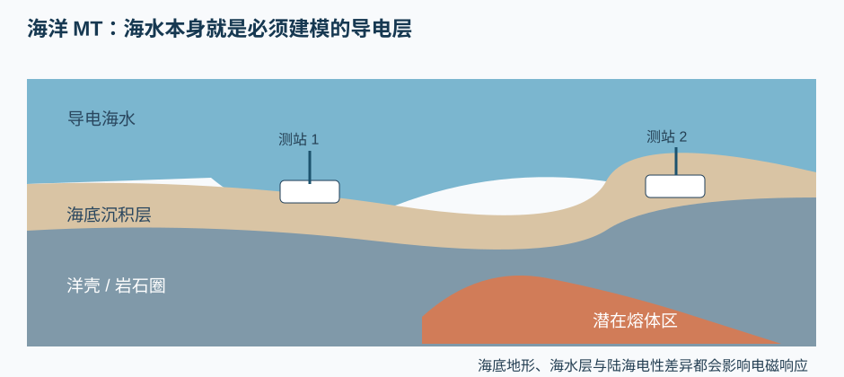
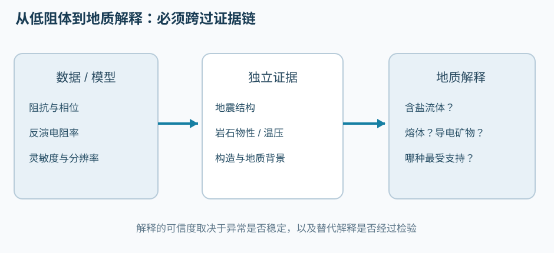



这是整套教程的最后一篇。前面我们走过了大陆尺度阵列和典型造山带，本篇先看两个尺度与环境截然不同的实战案例：**新疆西准噶尔的多尺度联合探测**（用宽站距长周期 MT 看深部古洋壳残片，再用高密度音频 AMT 精细刻画浅部花岗岩体与断裂），以及**潜入深海的海底大地电磁（Marine MT）**。最后，我们用一个完整的实战演练，把全书十七篇的所有方法串成一条经得起推敲的地质解释证据链。

## 本篇路线图
- [17.1 西准噶尔为什么既要长周期 MT 又要高密度 AMT？](#sec-08g-junggar-amt)
- [17.2 海底也能做 MT：海水、洋中脊与部分熔融](#sec-08h-marine)
- [17.3 从一张低阻彩图出发，怎样写出经得起检验的地质解释？](#sec-08i-evidence)

---

## 17.1 西准噶尔为什么既要长周期 MT 又要高密度 AMT？

新疆西准噶尔位于中亚造山带核心区域，记录了古亚洲洋俯冲增生、岛弧拼贴与后期花岗质岩浆侵入的复杂历史。要在同一个地区既看清深部几十千米的古板块残迹，又精细刻画地表出露的花岗岩体边界和控矿断裂，单一观测方式很难兼顾——于是研究者采用了**“长周期 MT + 高密度 AMT”双尺度组合策略**。

### 一、观测尺度必须跟着地质目标走

这两种方法不是谁比谁先进，而是分工不同：
- **大范围长周期 MT 阵列**（覆盖全区约 $101$ 个测站）：采集长周期信号，探测深度可达数十至上百千米，专门用来追踪深部地壳与上地幔的古构造边界；
- **局部高密度音频大地电磁（AMT）阵列**（如克拉玛依附近 Akebasitao 岩体区，在较小范围内以约 $2\,\mathrm{km}\times 1\,\mathrm{km}$ 网格密集布设约 $463$ 个测站，观测频带约 $759\sim 1.4\,\mathrm{Hz}$，质控剔除 $53$ 个强干扰点后反演）：利用高频信号对浅部地壳的高敏感度，精细描绘侵入体三维形态与浅部断裂网络。

### 二、深部古俯冲板片解释中的“低阻、低温、低速”辨析

在西准噶尔长周期 MT 研究中，结合相位张量椭圆和感应箭头（需先核对 Parkinson 或 Wiese 符号约定）的三维反演揭示出深部倾向低阻异常带，研究者结合区域构造与地震成像提出了“古洋壳俯冲板片残留”的假说。

这里有一个极易混淆的物理细节：**“低阻（高导）、低温、地震低速”绝不是自动绑定的同义词！** 按照纯热传导规律，温度越低的岩石反而往往越**高阻**。如果某深部异常同时表现出低阻、相对低温和地震低速，解释时就不能随口说“因为温度低所以更导电”，而必须指出其共同物性原因——例如古洋壳俯冲带入的含水蚀变矿物、蛇纹石化或沿古俯冲界面富集的石墨化碳质物。

### 三、如何正确阅读局部岩体的三维高密度 AMT 模型？

在 Akebasitao 高密度 AMT 成像中，致密未蚀变的花岗质侵入体通常表现为**高电阻率**（例如在可视化时提取 $\rho>5000\,\Omega\cdot\mathrm m$ 的三维等值面来勾勒岩体轮廓），而围岩及破碎蚀变断裂带则表现为**低电阻率**（如 $\rho<100\,\Omega\cdot\mathrm m$）。

看这类三维色块图时要牢记两点：
1. **等值面阈值是人为画图选的**：$5000\,\Omega\cdot\mathrm m$ 只是为了方便三维渲染挑选的参考门槛，不是地质学上“花岗岩与围岩的绝对物理分界线”；看图时一定要先按顺序浏览连续水平深度切片和垂向剖面，再看三维立体等值面；
2. **分频段检查数据拟合**：高密度 AMT 跨了从几百赫兹到几赫兹的宽频带，高频（如 $377.2\,\mathrm{Hz}$）反映极浅部，低频（如 $6.8\,\mathrm{Hz}$）反映较深部。验证拟合时不能只看全局 RMS，必须分频点检查实部、虚部和阻抗各分量的拟合情况，确保深浅部结构都获得了真实数据的支撑。

### 自我小测

**1.** 为什么西准噶尔研究既要布设宽站距长周期 MT，又要局部加密布设高密度 AMT？  
**答：** 两者的探测深度与横向分辨率互补：长周期 MT 探测深度大，用于约束岩石圈尺度古构造框架；高密度 AMT 频段高、点距密，用于精细刻画浅部侵入岩体与断裂边界。

**2.** 在三维可视化中把所有电阻率高于 $5000\,\Omega\cdot\mathrm m$ 的单元渲染成一个蓝色立体块，能否直接认定这个立体块的表面就是花岗岩体的精确地质接触面？  
**答：** 不能。等值面边界随所选阈值和反演平滑程度而变化，它勾勒的是高阻异常的近似核心范围，并非锋利的岩性接触面。

---

看完了陆地上的多尺度勘探，接下来我们把仪器装进耐压玻璃球，沉入数千米深的海底，看看地球物理学家如何在导电的海水之下开展海洋大地电磁探测。

[继续阅读：17.2 海底也能做 MT：海水、洋中脊与部分熔融](#sec-08h-marine)

---

## 17.2 海底也能做 MT：海水、洋中脊与部分熔融

地球表面超过 $70\%$ 被海洋覆盖，板块构造最剧烈的诞生地（**洋中脊**）和消亡地（**俯冲海沟**）大多位于海底。仅靠陆地海岸线上的测站，很难看清离岸数百千米处的地幔结构——因此地球物理学家研发了**海底大地电磁（Marine MT）**仪器，直接沉放至数千米深的海床进行观测。

### 一、导电海水层带来的两大特殊效应

陆地 MT 测站头顶上是近似绝缘的空气（$\sigma_{\rm air}\approx 0$），而海底测站头顶上却盖着一层厚度可达数千米、电导率高达 $\sigma_{\rm sea}\approx 3\sim 4\,\mathrm{S/m}$（电阻率仅约 $0.25\sim 0.3\,\Omega\cdot\mathrm m$）的良导电海水！这带来两个不可忽视的物理后果：
1. **高频电磁屏蔽效应**：高频天然电磁波在穿过几千米厚的高导海水时能量几乎衰减殆尽，因此深海 MT 很难接收到高于 $1\,\mathrm{Hz}$ 的高频信号，主要依赖中长周期（几秒到上万秒）探测海洋岩石圈与上地幔；
2. **海水厚度与海底地形效应（Bathymetry Effect）**：海底山脉、海沟斜坡以及海岸线（陆地高阻与海水低阻的剧烈对比）会强烈扭曲感应电流分布。因此，海洋 MT 正反演**绝不能套用平地边界条件**，必须在三维网格中精细刻画真实的海水深度与海底地形。

### 二、海洋 MT 的两大经典科研战场

1. **俯冲海沟与岩石圈–软流圈边界（Cocos 板块案例）**：  
   在中美洲尼加拉瓜外海，Cocos 大洋板块向海沟俯冲。科学家在海沟与大洋侧布设了约 $50$ 个海底宽频 MT 测站，在俯冲洋岩石圈底部（约 $45\sim 70\,\mathrm{km}$ 深度）发现了一条强烈的低阻带。结合地震波速资料，该低阻通道被解释为被上方冷而致密的岩石圈“盖层”圈闭的**富熔体低黏度层**，润滑着大洋板块的俯冲运动。
2. **洋中脊与地幔减压熔融（东太平洋海隆等案例）**：  
   在板块张裂的洋中脊下方，深部热地幔物质向上隆升（upwelling），随着压力降低发生**减压部分熔融**，形成的新鲜岩浆向上汇聚补给洋壳。利用跨洋中脊布设的海底 MT 阵列（如约 $29$ 个测站剖面），研究者清晰捕捉到了脊轴下方从上地幔向上汇聚的低阻熔融通道。

这里同样需要保持科学严谨：**“地幔物质向上运动（上涌）”是动力学速度概念，而 MT 测量的是“低电阻率（高导）”**；将低阻带解释为地幔上涌熔融区，必须结合岩石学减压熔融模型、地震成像与海底地形热流证据。

### 自我小测

**1.** 海洋 MT 三维反演中，为什么必须把海水层和精细海底地形放进正演网格里一起计算？  
**答：** 因为海水是高导体（约 $0.3\,\Omega\cdot\mathrm m$），海水深度变化、海沟起伏和海岸线会显著改变电磁场的衰减和电流路径，不建模海水与地形会把海洋效应误当成地下构造假象。

**2.** 洋中脊正下方反演出一条垂向低阻带，能否仅凭这张电阻率图就直接算出“地幔正以每年 $5\,\mathrm{cm}$ 的速度向上流动”？  
**答：** 不能。MT 约束的是地下电导率分布（反映熔体含量与连通性），并不直接测量地幔流动速度，动力学速率需要结合板块扩张速率与地球动力学数值模拟推算。

---

现在，所有的理论工具、数据处理方法、反演验证手段和岩石物性知识都已齐聚一堂。最后一节，我们用一个完整的实战演练，把整套学习路线拧成一条经得起任何审视的**地质解释证据链**。

[继续阅读：17.3 从一张低阻彩图出发，怎样写出经得起检验的地质解释？](#sec-08i-evidence)

---

## 17.3 从一张低阻彩图出发，怎样写出经得起检验的地质解释？

整套教程从最朴素的“校园气温场”起步，走过了三角函数、复数、麦克斯韦方程、有限差分、傅里叶变换、阻抗张量、Gauss–Newton 与 Occam 反演。现在我们站到了最后一步：**面对一张刚刚算出来的三维电阻率彩图，怎样写出一段既深刻又经得起科学检验的地质解释？**

### 一、情景演练（教学示例）

设想如下研究情景（以下数值为**教学假设示例**，用于演示分析逻辑）：  
某研究团队在一条区域深大断裂带周边布设了 $80$ 个宽频 MT 测站，经过三维反演得到总体 $\mathrm{nRMS}=1.1$ 的电阻率模型。切片显示，在 $15\sim 25\,\mathrm{km}$ 深度范围内，沿断裂带走向出现一条明显的低阻异常带，异常体电阻率约为 $10\sim 30\,\Omega\cdot\mathrm m$，而周围中地壳围岩背景约为 $300\,\Omega\cdot\mathrm m$。

看到这张图，最容易犯的错误是直接下结论：“我们在 $20\,\mathrm{km}$ 深处发现了一个大型岩浆房！” 下面我们用“三层证据链”一步步校准这个结论。

### 二、第一层证据：观测数据本身过关吗？

在讨论地质之前，先回头审视原始数据：
1. 这 $80$ 个测站的实际有效率是多少？磁偏角、偶极长度、通道极性和仪器响应标定是否全部核对无误？
2. 约束 $15\sim 25\,\mathrm{km}$ 深度的核心周期段，是否避开了死频带（dead band）和强人文噪声污染？
3. 相邻测站的静态位移是否已评估？相位张量椭圆和感应箭头在平面上是否呈现出与该低阻带走向一致的清晰响应？

### 三、第二层证据：反演模型里的低阻带真的是“数据强迫要求”的吗？

$\mathrm{nRMS}=1.1$ 只说明整体拟合尚可，还不能证明低阻带的几何边界精确无误。我们需要做四项模型检验：
1. **消除试验**：把 $15\sim 25\,\mathrm{km}$ 处的低阻体全部替换成 $300\,\Omega\cdot\mathrm m$ 的围岩背景，重新正演——观察 $\mathrm{nRMS}$ 是否显著恶化、哪些频段和测站的拟合崩溃；
2. **幅值敏感性**：把异常体电阻率从 $20\,\Omega\cdot\mathrm m$ 调高到 $50\,\Omega\cdot\mathrm m$ 或 $100\,\Omega\cdot\mathrm m$，检验数据能卡住多强的导电性；
3. **几何扰动**：上下移动异常体埋深或改变宽度，确定数据对顶底界面的真实分辨率；
4. **多初值与正则化对比**：更换不同初始半空间和平滑参数重新反演，确认该低阻带稳定存在，而非正则化伪影。

### 四、第三层证据：多种物性候选机制的逐一甄别

确认低阻体真实可靠后，结合物性实验与多学科独立资料排查成因：
- **候选 A（连通含盐流体）**：深大断裂带在构造活动期常成为流体运移通道，若当地大地热流中等、地震波速略降且无现代火山活动，断裂带内的含盐变质流体或大气降水深循环是极具竞争力的解释；
- **候选 B（部分熔融）**：要支持“岩浆房/部分熔融”假说，必须展示当地地温梯度或热流数据支持 $15\sim 25\,\mathrm{km}$ 深度已达到含水花岗质岩石的固相线温度（通常需大于 $650\sim 700\,^\circ\mathrm C$），且地震波速（尤其是横波 $V_s$）和泊松比有相应异常；
- **候选 C（石墨或硫化物剪切带）**：如果该断裂带是经历过强烈韧性剪切与还原变质的古老构造带，沿糜棱岩叶理沉淀的连通石墨膜同样能在常温下产生 $10\sim 30\,\Omega\cdot\mathrm m$ 的低阻响应。

### 五、写出一段无懈可击的科学结论

把以上三层证据浓缩成一段规范的地质解释表述：

> 三维 MT 反演在约 $15\sim 25\,\mathrm{km}$ 深度揭示出一条沿区域断裂带走向延伸的低阻异常带（$10\sim 30\,\Omega\cdot\mathrm m$，围岩背景约 $300\,\Omega\cdot\mathrm m$）。模型消除与扰动测试表明，现有观测数据明确要求该深部导电异常的存在，但对其底界深度和准确厚度的约束仍存在一定不确定性。结合区域中等热流背景与构造特征，该低阻带最可能反映断裂破碎带内赋存的连通含盐流体，或古剪切带中富集的石墨化导电矿物；若要进一步检验是否存在局部部分熔融，仍需结合高分辨率地震波速与岩石学温压资料加以约束。

这段话把**观测事实、模型检验边界、物性多解性与待检验假说**分得清清楚楚，既给出了有价值的地质洞见，又守住了科学严谨的底线。

### 六、全系列知识地图：从地表波形到地下地质故事

回顾十七篇讲义走过的完整科学链条：

1. **电磁物理与数学语言（第 01–03 篇）**：用场、相量和麦克斯韦方程建立电磁波在导电介质中的传播与趋肤深度规律；
2. **数值正演（第 04–05 篇）**：用有限差分网格与矩阵方程把连续微分方程交给计算机求解；
3. **野外观测与信号处理（第 06–08 篇）**：从五通道同步采集出发，经切窗、FFT、远参考与稳健回归提取复阻抗张量；
4. **张量分析与诊断（第 09–11 篇）**：利用坐标旋转、WAL 不变量、相位张量和静态位移诊断梳理数据维数与畸变；
5. **反演与模型验证（第 12–14 篇）**：在零空间与噪声约束下，用 Gauss–Newton 和 Occam 反演构建平滑电性模型，并用棋盘与消除试验划定可信边界；
6. **岩石物性与地质解释（第 15–17 篇）**：借助导电机制、Archie 定律与多学科证据链，将电阻率分布转化为可检验的地球动力学认识。

### 自我小测（结课四问）

**1.** 某低阻异常在平面上恰好沿一条已知断裂带分布，能否直接将其命名为“含水断裂带”？  
**答：** 不能。空间吻合说明它受断裂构造控制，但导电介质既可能是含盐流体，也可能是沿断裂沉淀的石墨、硫化物或黏土蚀变矿物，需结合温压与多学科证据甄别。

**2.** 反演时把正则化参数调小，使 $\mathrm{nRMS}$ 从 $1.1$ 降到了 $0.9$，剖面里多出了许多细小斑点，模型变得更准确了吗？  
**答：** 未必。在噪声存在的情况下，低于 $1.0$ 的 RMS 往往意味着模型开始强行拟合随机噪声（过拟合），新增的细小斑点很可能是反演伪影。

**3.** 如果两个形态差异明显的模型都能把数据拟合到 $\mathrm{nRMS}\approx 1.0$，在报告中应该如何呈现？  
**答：** 应重点指出两个模型共同稳定存在的构造特征，同时客观说明两者存在差异的部分属于当前数据分辨率之外的不确定区间，并用扰动实验给出参数范围。

**4.** 大地电磁测深（MT）最直接测量和约束的是什么？  
**答：** MT 直接观测的是地表天然电磁场随时间的变化，通过频域传递函数和物理反演最直接约束的是**地下岩石的电导率（电阻率）空间分布**；至于背后的岩性、流体或熔融成因，则必须依靠物性关系与多学科证据链来推断。

---

至此，这套从零起步的大地电磁测深自学教程已经全部完结。最初那些看似抽象的偏导数、复数、矩阵和泰勒展开，最终都化作了透视地球深部奥秘的眼睛。祝你在今后的地球物理学习与科研探索中，既能写得出严谨漂亮的公式，也能讲得出有理有据的地质故事！

[返回系列总目录](/posts/2026/10/mt-course/)
